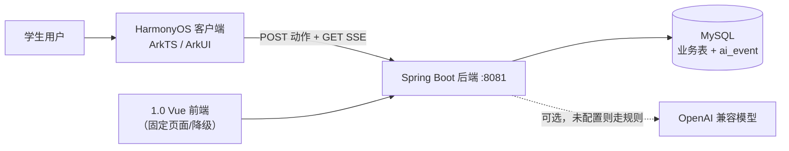
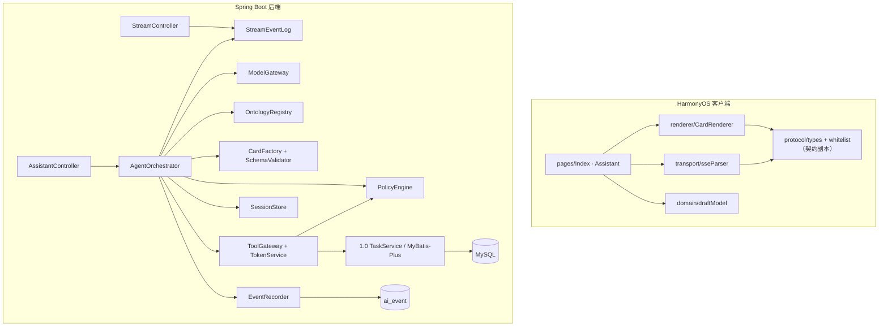
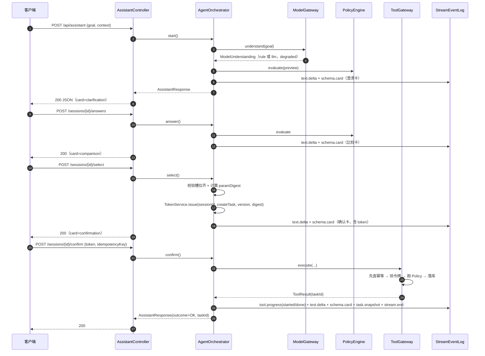
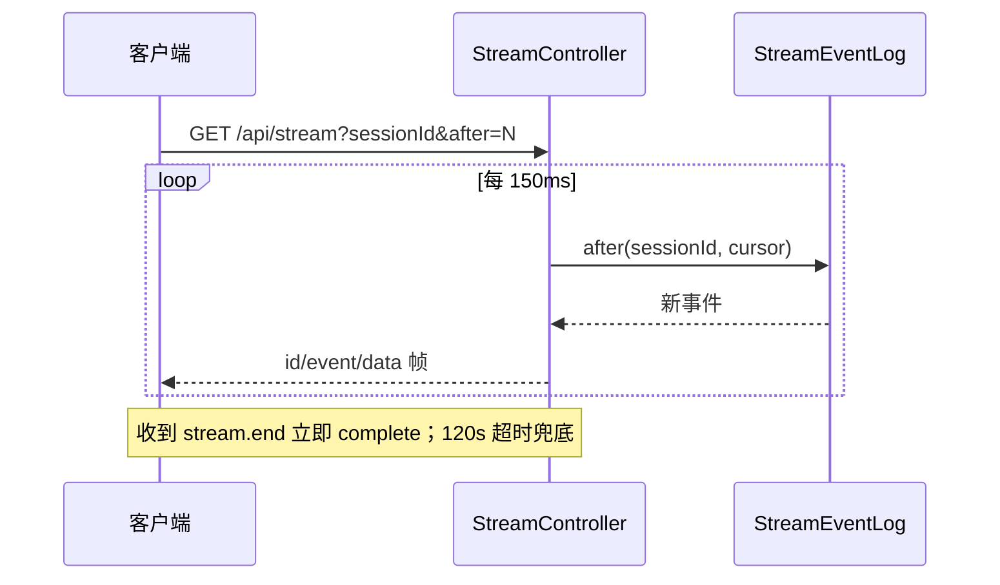
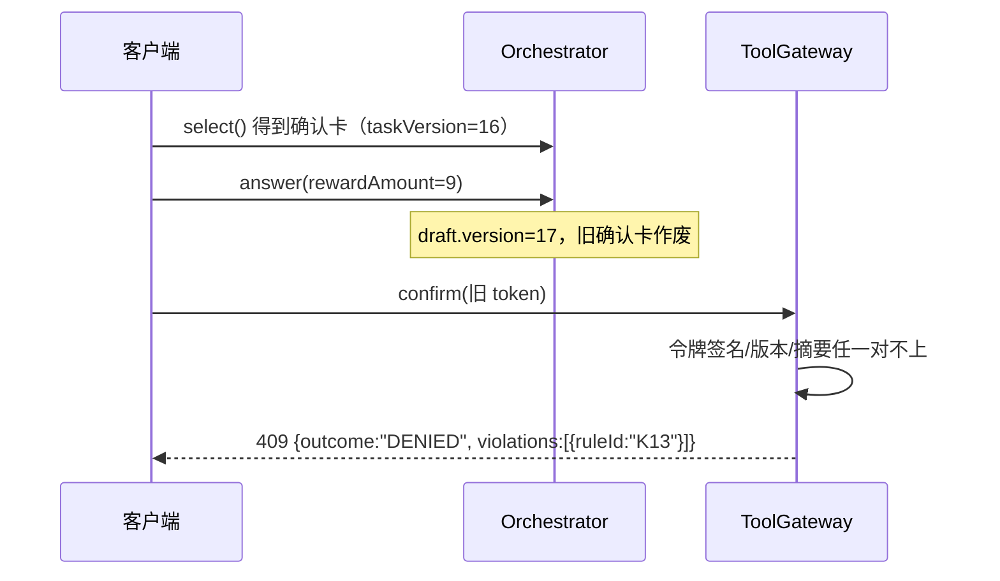
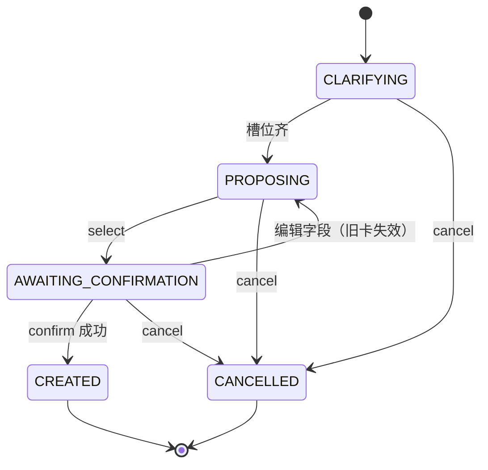
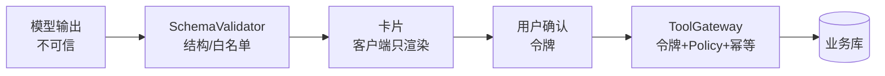

# CampusBridge 2.0 总体设计（设计评审版）

> **版本**：2026-11-17 · **状态**：可评审（M2 已实现，M3/M4 待补）
> **范围**：2.0 新增的 Agent / 契约 / 鸿蒙客户端 / 流式协议 / 可信工具 / 事件。
> **不覆盖**：1.0 业务本身。1.0 的 SRS、模块职责、一致性边界仍以
> [srs.md](srs.md)、[architecture.md](architecture.md) 为准；本文只说明 2.0 怎么“架在 1.0 上”。
>
> **权威顺序**：`contract/src/**`（类型）> `contract/PROTOCOL.md`（协议文字）> 本文（实现说明）> 代码注释。
> 本文与契约冲突时，以契约为准并改本文。

---

## 0. 怎么读这份文档

| 你想审什么 | 看哪节 |
|---|---|
| 整体架构和边界 | §3、§4 |
| 交互与协议是否自洽 | §5、§6 |
| 安全与信任边界 | §7（重点） |
| 故障时会怎样 | §8（重点） |
| 为什么这么设计 | §10 ADR |
| 哪些地方是欠账 | §11 设计债（重点） |
| 现在能证明什么 | §12 验证与证据 |
| 需要你拍板的事 | §13 评审问题 |

一句话：**模型只出候选，服务端做校验和决策，客户端只渲染白名单；所有副作用先确认、再执行、后记录；2.0 只加壳，不改 1.0 接口字段。**

---

## 1. 目标与非目标

### 1.1 目标

1. 用户说一句话 → AI 理解 → **追问缺失** → 生成当次任务需要的卡片 → 用户确认 → 可信工具执行 → 全程留证据。
2. 保留 1.0 全部业务（任务 / 申请 / 履约 / 积分 / 消息），2.0 在前后各加一层壳。
3. 模型可替换、可降级：没有模型密钥也能把整条链路演完。
4. 客户端只渲染**声明式 Schema**，不执行模型生成的 ArkTS/JS/SQL。
5. 现场能演“意外”：关模型、点旧卡、重复提交、断流重连。

### 1.2 非目标（明确不做）

- 不做真 RAG / 向量库（本体 JSON 检索够用）。
- 不重写 1.0 业务，不改 1.0 的接口路径和字段。
- 不做仓颉（答辩一页讲选型）。
- 不做云端部署 / OSS 上传。
- 不做平板/眼镜独立端（同一工程断点布局）。
- 不追求 40 条评测 100% 通过，只要求有分数、能解释未修项。

---

## 2. 约束与红线

### 2.1 课程红线（贯穿 M1–M4）

1. **模型只产出候选**，系统决定能不能执行。
2. **不在线执行模型生成的代码**；只渲染白名单组件。
3. **副作用必须确认**：`Preview → Confirm → Execute → Record`，令牌绑定 `taskId + action + taskVersion + 参数摘要 + 过期时间 + nonce`。

### 2.2 工程约束

- 仓库路径全英文（hvigor 拒绝中文路径）。
- Java 编译目标 17；后端 Spring Boot 3 + MyBatis-Plus + MySQL。
- 契约独立在 `contract/`，由 `scripts/sync-contract.ps1` 同步进 `app/`；**不手改 app 里的四个契约副本**。
- 组员的纯 TS 模块不许 import `@ohos.*`，必须能 `node --test`。

---

## 3. 系统全景

### 3.1 C4 · 上下文



### 3.2 容器与组件



**依赖方向**：Controller → Orchestrator → Gateway/Policy/Card → 1.0 Service → DB。2.0 包不反向依赖 1.0 的 Controller，1.0 也不 import 2.0 的类（除组合根配置）。

### 3.3 职责一句话

| 组件 | 只做一件事 | 不做什么 |
|---|---|---|
| `AssistantController` | HTTP 协议转换 | 不做业务判断 |
| `AgentOrchestrator` | 串“理解→澄清→提案→确认→工具” | 不直接写业务库 |
| `ModelGateway` | 选规则/LLM、超时重试、熔断、降级 | 不决定任务能不能发 |
| `OntologyRegistry` | 本体版本、概念/关系/约束 | 不执行工具 |
| `PolicyEngine` | K01–K15 约束求值 | 不生成卡片 |
| `CardFactory + SchemaValidator` | 造卡、校验卡 | 不执行副作用 |
| `TokenService` | 签发/校验一次性确认令牌 | 不写业务 |
| `ToolGateway` | 幂等 + 令牌 + 策略 + 落库 + 记录 | 不生成 UI |
| `StreamEventLog` | 每会话事件序号与回放 | 不持久化（当前） |

---

## 4. 关键流程

### 4.1 主链路：一句话 → 澄清 → 比较 → 确认 → 建单



**注意**：流是**旁路投影**，不是建单依据。客户端建单只认 `POST .../confirm` 的返回和 `task.snapshot`。

### 4.2 断流与回放



- 客户端 `StreamAssembler` 按 `eventId` 去重、按 `sequence` 找缺口。
- 发现 `gap`：断开，用 `after=lastSequence` 重连。
- App 重启：`StreamEventLog` 是内存的，重启后回放为空；当前需要 `GET /api/assistant/sessions/{id}` 全量刷新（M4 接 `ai_event` 后才能真回放）。

### 4.3 旧卡失效（K13）



### 4.4 幂等重放

同一 `idempotencyKey` 第二次提交：`ToolGateway` 直接返回第一次的 `ToolResult`（`replay=true`、同一 `taskId`），记录 `tool.idempotent.replay`，**不产生第二条任务**。

---

## 5. 契约

### 5.1 两条通道

| 通道 | 端点 | 作用 | 产生业务事实 |
|---|---|---|---|
| 同步动作 | `POST /api/assistant`、`/sessions/{id}/{answers,select,confirm,cancel}` | 开始/回答/选择/确认/撤销 | **只有 confirm 成功** |
| 只推送 | `GET /api/stream?sessionId=&after=` | 文本、卡片、工具进度、任务快照、结束 | 否 |

辅助端点：`GET /api/assistant/sessions/{id}`（查会话）、`GET /api/events`（审计事件）、`GET /api/ontology`、`POST /api/ontology/reload`、`POST /api/schema/validate`、`GET /ai-demo/`。

### 5.2 流事件信封（`campushub.stream.v1`）

```json
{
  "protocol": "campushub.stream.v1",
  "eventId": "evt-s-xxx-3",
  "sequence": 3,
  "sessionId": "s-xxx",
  "ts": "2026-11-17T01:00:00Z",
  "kind": "schema.card",
  "payload": { "card": { } }
}
```

五种 kind 与产生位置：

| kind | 产生位置 | 客户端动作 |
|---|---|---|
| `text.delta` | `AgentOrchestrator.emit` | 追加气泡，不触发业务 |
| `schema.card` | 同上 | 先过白名单，再渲染 |
| `tool.progress` | `confirm` 前后 | 显示进度；failed 显示原因 |
| `task.snapshot` | confirm 成功 | 以服务端 taskId/status/version 为准 |
| `stream.end` | 会话终态 | done/cancelled 收尾；其余按原因降级 |

### 5.3 UI Schema 与白名单

- 四类卡片：`clarification` / `comparison` / `confirmation` / `progress`。
- 五种 block：`Text` / `Field` / `Choice` / `Summary` / `Progress`。
- 七种 action：`answer` / `select` / `confirm` / `edit` / `cancel` / `retry` / `open`。
- 副作用动作只有 `confirm`；它必须 `requiresConfirmation=true` 且带令牌。
- 服务端在 `respond()` 里对**每一张**返回的卡跑 `SchemaValidator`，不合法直接 500 `SCHEMA_INVALID`，不会把坏卡发给客户端。

> ⚠️ **文档债**：`docs/M2-schema.md` 是早期规范稿，里面写的 `Button` block、`actionId:"publish"`、`Field.source` 都不在当前契约里。以 `contract/src/**` 为准，这份文档需要重写。

### 5.4 九条最小测试的落点

| # | 课件要求 | 实现/测试 | 状态 |
|---|---|---|---|
| 1 | 非白名单组件被拒 | `SchemaValidator.validateBlocks`；`contract/test/contract.test.ts` | ✅ |
| 2 | 绑定不存在字段失败 | `SchemaValidator` Field 检查；M1-013 | ✅ |
| 3 | 高风险 Action 缺确认失败 | `SchemaValidator.validateActions`；M1-014 | ✅ |
| 4 | Task Model 更新后旧授权失效 | 令牌绑 `taskVersion`；`AgentFlowTest.改过内容之后旧确认卡失效` | ✅ |
| 5 | 同一幂等键只产生一次事实 | `ToolGateway.idempotentResults`；`AgentFlowTest.确认后建单_重复确认不再建单` | ✅ |
| 6 | 刷新后恢复 `lastStableVersion` | 客户端 `draftModel` + 服务端 `GET session` | ◐ 只有模型/回放，未做完整冷启动恢复 |
| 7 | 投影自动移除禁止动作 | 服务端校验整卡拒绝；客户端无“移除后重投影” | ◐ 只做拒绝，不做裁剪 |
| 8 | UI 展示值与工具参数摘要一致 | `SchemaValidator.validateToken` 对比 `paramDigest` | ✅ |
| 9 | 工具失败不得写成功事实 | `ToolGateway` 失败返回 DENIED；M1-015；single-flight 锁 | ✅ |

---

## 6. 状态与数据

### 6.1 会话状态机（窄状态机，不能跳步）



### 6.2 状态放在哪

| 状态 | 存放 | 生命周期 | 重启后 |
|---|---|---|---|
| 会话 / 草稿 / 最后一张卡 | `SessionStore`（内存 Map） | 进程内 | **丢失** |
| 确认令牌（issued/used） | `TokenService`（内存 Map） | 300s（可配） | **全失效** |
| 幂等结果 | `ToolGateway.idempotentResults`（内存 Map） | 进程内 | **丢失** |
| 流事件 | `StreamEventLog`（每会话 List） | 进程内 | **丢失** |
| 审计事件 | `ai_event` 表 | 持久 | 保留 |
| 业务任务 | MySQL（demo 用 H2） | 持久 | 保留 |

**设计取舍**：M1/M2 演示优先“能跑、能解释”，把会话/令牌/幂等/流都放内存；代价是重启后旧卡全部失效、流不能真回放。M4 要接 `ai_event` 和正式会话表，这一点在 §11 明确列为设计债。

### 6.3 确认令牌

格式：`v1.<nonce>.<expiresEpoch>.<hmac>`，签名覆盖：

```
sessionId | action(createTask) | taskVersion | paramDigest | nonce | expires
```

校验顺序（`ToolGateway`）：**幂等命中 → 令牌存在/未用/未过期/签名对 → action 与 session 匹配 → Policy → 落库 → consume**。任何一步失败都不写业务事实。

---

## 7. 安全与信任边界（评审重点）

### 7.1 信任分层



- 模型：只出候选，永远不直接调用工具。
- 客户端：不可信；即使客户端伪造请求，服务端仍要验令牌、验策略。
- 工具：唯一写业务库的入口，统一走 `TaskCommandPort` → 1.0 `TaskService`。

### 7.2 已有控制

| 控制 | 实现 | 强度 |
|---|---|---|
| 结构/白名单 | 服务端 `SchemaValidator`（每张卡） | 强 |
| 字段白名单 | `DraftField` 23 个键 | 强 |
| 确认令牌 | HMAC + nonce + 过期 + 版本 + 摘要 | 中（密钥可随机） |
| 幂等 | `idempotencyKey` + single-flight 锁 | 中（进程内） |
| 权限 | 1.0 `TaskService` 的认证/校验 | 中 |
| 审计 | `ai_event` + `trace_id` | 强 |

### 7.3 当前安全缺口（必须在设计评审中拍板）

| # | 问题 | 影响 | 现状/缓解 |
|---|---|---|---|
| S1 | `/api/assistant/**`、`/api/stream` 在 `SecurityConfig` 里 permitAll | 任何人可调用助手与流 | M1 演示有意放开；M2 起应接用户身份 |
| S2 | `POST /api/assistant` 的 `context.requesterId` 由客户端传入 | 可冒充任意用户建单 | 目前靠 1.0 `TaskService` 校验兜底，但不能证明“是谁” |
| S3 | `GET /api/stream` 不校验会话归属 | 知道 sessionId 就能读事件 | 会话 ID 随机、短生命周期；不等于安全 |
| S4 | 令牌密钥未配置时每次启动随机生成 | 重启后旧卡全失效；多实例不一致 | demo 可接受；部署必须固定 `ai.token.secret` |
| S5 | 会话/令牌/幂等/流全在进程内 | 多实例、重启后行为不一致 | 已在 §6.2 如实标注，M4 外置 |
| S6 | 客户端真实链路页收到卡未再过白名单 | 服务端已验证，但缺少纵深防御 | 演示页有意简化；M2 收口补 `cardProblems()` |

**建议的收口方案（待拍板）**：助手通道改为“匿名会话 + 设备码”或直接复用 1.0 JWT；`requesterId` 只从认证主体取，绝不从 body 取；流订阅校验 `session.owner`。

---

## 8. 失败与降级矩阵

| 场景 | 系统行为 | 证据/日志 | 残余风险 |
|---|---|---|---|
| 未配置模型密钥，`mode=auto` | 静默走规则基线（`degraded=false`） | `model.success` 无，规则结果 | 用户不知道没走模型 |
| `mode=llm` 但密钥缺失 | 规则基线 + `degraded=true` + 说明 | `model.fallback reason=not-configured` | 无 |
| 模型超时/报错 | 重试 `maxRetries` 次；仍失败 → 规则 + `degraded=true` | `model.error` / `model.fallback` | 延迟增加 |
| 连续失败 ≥ 阈值 | 熔断 `cooldownSeconds`，期间直接规则 | `model.circuit.open` | 熔断窗口内不尝试模型 |
| 工具业务校验失败 | `outcome=DENIED`、409、无 taskId | `tool.denied` / `policy.rejected` | 无 |
| 工具重复调用（同幂等键） | 返回第一次结果，`replay=true` | `tool.idempotent.replay` | 多实例下失效 |
| 旧卡确认（taskVersion 变） | 409 + `K13`，草稿退回 `AWAITING_CONFIRMATION` | `violation K13` | 无 |
| 令牌过期/用过/被改 | 409，需重新出卡 | `tool.denied` 原因 | 无 |
| 流出现缺口 | 客户端断开，`after=lastSequence` 重连 | 客户端 `gap` 状态 | 服务端内存重启后补不回 |
| 流中断 | 服务端保留事件；重连从 after 继续 | `StreamEventLog.after` | 同上 |
| 服务端重启 | 会话/令牌/幂等/流全丢；旧卡失效 | 无持久化 | **必须重新开始会话** |
| 流超时 120s | `SseEmitter.complete()` | — | 长任务需重新订阅 |
| 坏 Schema | 服务端 500 `SCHEMA_INVALID`，不返回卡 | 校验错误列表 | 无 |
| DB 不可用 | 事件落盘失败只警告；建单失败 → DENIED | `events` 警告日志 | 审计可能丢 |
| `cursor_expired` | 协议已定义；服务端当前未实现该原因 | — | 只能全量刷新 |

---

## 9. 可观测性

- **trace**：`TraceIdFilter` 从 `X-Trace-Id` 取或生成 `tr-xxx`，写 MDC + 响应头；`AssistantResponse.traceId` 一起返回。
- **事件**：`EventRecorder` 同时写内存环（500 条）与 `ai_event` 表；当前约 20 类，例如
  `session.started`、`understanding.applied`、`clarify.asked/answered`、`confirmation.issued`、`confirm.requested/replay`、`tool.request/denied/success/failure`、`policy.rejected`、`task.created`、`model.success/error/fallback/circuit.open`。
- **流**：`StreamEventLog` 每会话序号从 1 开始；客户端可按 `after` 回放。
- **延迟**：`model.success` 记 `latencyMs`；评测报告记单条端到端耗时（本地规则基线平均 32ms / P95 174ms）。
- **缺什么**：没有指标端点（Prometheus）、没有按会话的成本累计、`ai_event` 没有模型/Prompt/Schema/工具版本字段。

---

## 10. ADR（关键决策）

### ADR-001：同步动作与流推送分成两条通道

- **背景**：SSE 只适合单向推送；确认/撤销需要可靠响应和幂等键。
- **决定**：`POST /api/assistant/**` 负责所有动作，`GET /api/stream` 只推送。
- **后果**：客户端不能靠“读到某段文本”建单；流可以断线重连而不影响业务；代价是客户端要维护两套状态。

### ADR-002：契约独立成 `contract/`，同步进客户端

- **背景**：鸿蒙工程要先建空目录，契约不能等工程。
- **决定**：`contract/src/**` 是唯一来源，`tsc + node --test` 独立验证，`sync-contract.ps1` 复制四个文件进 `app/`。
- **后果**：契约改动可独立评审；app 里四个副本禁止手改；多一步同步命令。

### ADR-003：只渲染声明式 Schema + 白名单

- **背景**：模型生成的 UI 不可信。
- **决定**：卡片只有五种 block、七种 action；服务端校验，客户端只渲染。
- **后果**：表达力受限（不能任意布局），换来“绝不执行生成代码”。

### ADR-004：规则基线优先，LLM 可选

- **背景**：现场不能依赖公网模型和密钥；课程要求“模型挂了还能服务”。
- **决定**：`rule / llm / auto` 三模式；无密钥或失败自动退回规则，并显式 `degraded`。
- **后果**：演示稳定；规则抽取能力有限，复杂表达会追问更多。

### ADR-005：确认令牌绑版本 + 参数摘要 + nonce + 过期；幂等键独立

- **背景**：旧卡必须失效；重复点击不能重复建单。
- **决定**：令牌 HMAC 覆盖 `sessionId|action|taskVersion|paramDigest|nonce|expires`；`idempotencyKey` 由客户端生成，服务端先查重。
- **后果**：改任何字段旧卡即失效；多实例需要共享令牌/幂等存储（当前未做）。

### ADR-006：M1/M2 的 AI 状态先放内存

- **背景**：演示优先，避免过早引入会话表和流持久化。
- **决定**：`SessionStore`、`TokenService`、`ToolGateway` 幂等、`StreamEventLog` 都是进程内。
- **后果**：重启丢会话、旧卡全失效、流不能真回放；M4 接 `ai_event` 与外置存储。

### ADR-007：复用 1.0 业务，2.0 只加壳

- **背景**：课件明确“不得为了方便完全重写”。
- **决定**：2.0 新增 `agent/ gateway/ ontology/ policy/ schema/ tool/ events/`，通过 `TaskCommandPort` 调 1.0 `TaskService`，不改 1.0 接口字段。
- **后果**：旧语义和旧校验全部保留；2.0 不能绕过 1.0 规则；迁移时要跟 1.0 的演进（已适配 MyBatis-Plus 的 `TaskView`）。

---

## 11. 设计债与处置建议

| # | 债 | 严重度 | 现状 | 目标 | 建议时点 |
|---|---|---|---|---|---|
| D1 | 助手通道无身份，`requesterId` 由 body 传入 | **高** | permitAll + context | 从认证主体取 requesterId；流校验归属 | M2 收口（本周） |
| D2 | `docs/M2-schema.md` 与冻结契约不一致 | 中 | 旧规范稿 | 按 `contract/src` 重写，删 Button/publish | 本周 |
| D3 | 会话/令牌/幂等/流全在内存 | 中 | 见 §6.2 | 会话表 + `ai_event` 回放 + 共享幂等 | M4 |
| D4 | 确认令牌密钥默认随机 | 中 | `TokenService` | 部署必须配 `ai.token.secret`，启动校验 | M3 |
| D5 | 客户端不校验真实流里的卡 | 中 | Assistant 页直接渲染 | 复用 `cardProblems()`，拒绝时保留上一张卡 | M2 收口 |
| D6 | L2 固定页面降级未实现 | 中 | 只有规则基线 | 流打不开/协议不认识 → 传统任务页 | M2/M3 |
| D7 | 模型路由/配额/缓存/成本表缺失 | 中 | 只有模式选择+重试+熔断 | M3 ADR + 路由/配额/缓存 + 成本表 | M3 |
| D8 | 无压测/故障注入脚本 | 中 | 只有单元/集成测试 | 三类压测 + 三种故障注入 | M3 |
| D9 | 数据治理/记忆/红队/飞轮未做 | 中 | 模板 | 按 M4 清单补 | M4 |
| D10 | `ai_event` 缺版本字段 | 低 | 只有事件类型/payload | 加模型/本体/Prompt/Schema/工具版本 | M4 |
| D11 | 平板断点未做 | 低 | deviceTypes 有 tablet | 断点布局 + 截图 | M2 |
| D12 | 客户端冷启动恢复未做 | 低 | 只有内存 draft | `lastStableVersion` + 会话查询 | M2/M4 |

---

## 12. 验证与证据（截至 2026-11-17）

| 项 | 结果 | 位置 |
|---|---|---|
| 契约测试 | **23/23** | `contract && npm run check` |
| 后端测试 | **283 项，0 失败，40 跳过** | `backend && mvn -o test` |
| 评测 | **40/40**（含 3 条流断言） | `evals/reports/run-2026-11-16T10-22-10-189Z.json` |
| 四步链路 | `CLARIFYING → PROPOSING → AWAITING_CONFIRMATION → CREATED`，重复确认不建单 | `scripts/smoke-assistant.mjs` |
| 流 | 14 条事件、五种 kind、序号连续 | `GET /api/stream` |
| 模拟器 | 未签名 HAP 安装成功；四卡切换 + 坏卡拒绝 + 真实链路 | `evidence/M2/screenshots/` |

---

## 13. 评审需要你拍板的问题

1. **助手通道身份**：接 1.0 JWT，还是匿名会话 + 设备码？（决定 §7 的收口方式）
2. **`requesterId` 来源**：同意“只从认证主体取、绝不信 body”吗？
3. **流是否要持久化**：M4 前是否接受“重启丢流、只能开新会话”？
4. **令牌密钥**：部署时固定到环境变量，还是继续随机（只保演示）？
5. **M2-schema.md**：按契约重写，还是保留为“历史规范稿”？
6. **平板断点**：做真断点，还是只做宽屏截图 + 说明？
7. **M3 模型供应商与预算**：云端 API 还是校内私有？这决定 ADR 四问和成本表。
8. **L2 固定页面**：复用 1.0 Vue 页面，还是在 ArkUI 里做简化任务页？

---

## 14. 代码地图

| 层 | 入口 |
|---|---|
| 契约 | `contract/src/protocol/types.ts`、`whitelist.ts`、`transport/events.ts`、`sse.ts` |
| 协议实现 | `backend/.../controller/{AssistantController,StreamController}.java`、`events/StreamEventLog.java` |
| Agent | `agent/AgentOrchestrator.java`、`agent/SessionStore.java`、`agent/ClarificationPolicy.java` |
| 模型 | `gateway/model/ModelGateway.java`、`RuleModelClient.java`、`OpenAiCompatibleClient.java` |
| 本体/策略 | `ontology/OntologyRegistry.java`、`policy/PolicyEngine.java`、`ConstraintEvaluators.java` |
| 卡片 | `schema/CardFactory.java`、`SchemaValidator.java` |
| 工具 | `tool/TokenService.java`、`ToolGateway.java`、`ServiceTaskCommandAdapter.java` |
| 事件 | `events/EventRecorder.java`、`filter/TraceIdFilter.java` |
| 客户端 | `app/.../pages/Assistant.ets`、`renderer/CardRenderer.ets`、`transport/sseParser.ts`、`domain/draftModel.ts` |

---

> **评审提示**：本文件是“实现现状 + 决策 + 欠账”的合并版。§7 的 S1–S6 和 §11 的 D1–D12 是这次评审真正要拍板的地方；其余部分如果与 `contract/` 冲突，以契约为准。
