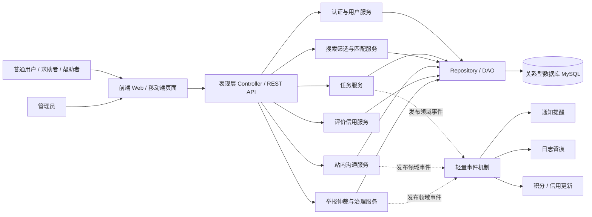

# 架构辩论赛记录

## 实验要求 ： "架构辩论赛"

**实验流程：**

1. **每位成员**分别用不同的 Prompt 策略向 AI 咨询架构建议：
   - 陈亮：A.直接问"推荐什么架构"
   - 时铭泽：B.提供详细项目约束后问
   - 殷晓瑞：C.要求 AI 对比多种方案的优劣
   - 张琼文：D.让 AI 扮演架构师角色进行分析

2. **记录每个 Prompt 和 AI 的回答**

3. **团队辩论会**（线下或线上，30 分钟）：
   - 每人展示 AI 给出的方案和理由
   - 讨论不同 Prompt 策略下 AI 回答的质量差异
   - 团队投票选择最终方案

4. **记录**：最终选择了什么，为什么？**为什么不选**其他方案？

## 实验结果

### AI咨询结果

#### 1. 直接问"推荐什么架构"(A)：
##### prompt：
我是一名软件工程大二学生，要做一个课程大作业项目，目标是构建一个面向校园场景的互助服务平台。现在我要选择该项目的架构，你推荐什么架构？

##### answer：

本项目推荐采用：
> **模块化单体架构 + 分层架构 + MVC / REST 表现层 + 局部轻量事件机制**

该架构更适合 10 周课程大作业：实现难度可控、团队学习成本低、模块边界清晰，能够支撑“认证、发布、接单、沟通、完成确认、评价信用、举报仲裁”等核心互助闭环。

本项目不建议第一版采用微服务架构，也不建议把事件驱动作为系统主架构。微服务会显著增加服务拆分、接口调用、部署运维和数据一致性成本；事件驱动若作为主架构，会让核心流程异步化，增加调试和排错难度。对于校园范围内的互助平台，第一版没有必要承担这类复杂度。

总体架构

架构核心思想是：系统整体仍然是一个单体应用，但在单体内部按业务模块拆分代码；模块之间通过清晰的 Service 接口协作，避免所有逻辑堆在 Controller 中。对于通知、日志、积分更新这类非主流程逻辑，可以使用轻量事件机制解耦，但不引入独立消息中间件作为第一版必需组件。

#### 2. 提供详细的项目约束(B)：
##### promp：
我是一名软件工程大二学生，要做一个课程大作业项目，目标是构建一个面向校园场景的互助服务平台，需要在十周之内完成。现在我们要选择该项目的架构，我们了解MVC、分层、微服务、事件驱动等架构。我的项目总体要求见“00-大作业总览.pdf”，项目文档见"D:\SE-3-2\SEEC2\campusbridge\README.md"，需求分析结果见“D:\SE-3-2\SEEC2\campusbridge\docs\P1”，请你遵循这些约束，分析项目的合适架构。
##### answer：
结合课程约束、现有技术栈和 P1 需求，我建议你们的最终选择是：

**模块化单体架构 + 分层架构 + MVC/REST 表现层 + 局部事件机制**

这个结论和你们现有的 [README.md](/D:/SE-3-2/SEEC2/campusbridge/README.md)、[需求规格说明书.md](/D:/SE-3-2/SEEC2/campusbridge/docs/P1/04-需求规格说明书/需求规格说明书.md)、[详细用例描述.md](/D:/SE-3-2/SEEC2/campusbridge/docs/P1/05-用例图与详细用例描述/详细用例描述.md)、[用户故事.md](/D:/SE-3-2/SEEC2/campusbridge/docs/P1/06-用户故事与AI辅助实验/用户故事.md) 里的约束是高度一致的。

**为什么它最合适**

你们的项目不是“超大规模互联网平台”，而是一个 10 周内完成、4 人协作、以“校园互助闭环”为核心的课程项目。需求文档里反复强调的是：

- 第一版必须控制复杂度
- 优先交付认证、发布、接单、沟通、完成、评价、举报的闭环
- 敏感任务要审核
- 站内沟通、日志留痕、争议仲裁都要做
- 明确不做重社交、排行榜、复杂运营

这意味着你们最需要的是“**业务闭环稳定 + 边界清楚 + 易开发易调试**”，而不是“分布式能力最强”。

**对几种候选架构的判断**

1. `MVC`
MVC 适合作为后端表现层组织方式，比如 Spring MVC 的 `Controller -> Service -> Repository`。但它不够作为整个系统的总架构，因为它主要解决的是 Web 请求处理，不足以表达“认证、任务、沟通、治理、信用”这些业务模块边界。

2. `分层架构`
非常适合你们。前端 Vue 3，后端 Spring Boot，本来就天然适合做表现层、业务层、数据访问层分离。它能很好支撑你们现在最重要的同步主流程：发布任务、接单、确认完成、发起争议。

3. `微服务`
不建议第一版采用。原因不是它“不高级”，而是它会额外引入太多与你们当前目标无关的成本：
- 服务拆分难
- 接口联调复杂
- 部署和运维复杂
- 数据一致性更难
- 调试跨服务问题更痛苦

对于十周课程项目，这些成本通常会直接挤压功能完成度。

4. `事件驱动`
不适合做主架构，但很适合作为辅助机制。你们确实有一些天然适合事件化的场景：
- 状态变化后发通知
- 写审计日志
- 更新积分或信用
- 触发超时提醒

所以事件驱动应该是“局部使用”，不是“全系统异步化”。

**推荐的最终表述**

> CampusBridge 第一版采用模块化单体架构。系统整体部署为一个 Spring Boot 应用，在内部按业务模块划分，并使用分层架构组织代码；表现层采用 MVC/REST 风格；对于通知、日志、积分、信用更新等非核心链路，采用轻量事件机制解耦。

**建议的模块划分**

推荐至少拆成这几个模块：

- 用户认证与档案模块
- 任务发布与管理模块
- 搜索筛选与轻量匹配模块
- 接单与任务生命周期模块
- 站内沟通模块
- 完成确认与评价信用模块
- 举报仲裁与治理模块
- 通知与审计日志模块

这里面最关键的是把“任务状态流转”集中管理，不要散落在多个 Controller 里。

**一句话结论**

如果你们的目标是“十周内做出一个能跑、能演示、能答辩、能说明设计权衡的校园互助平台”，最合适的不是微服务，也不是纯事件驱动，而是**模块化单体 + 分层架构**；`MVC` 用在表现层，`事件机制` 用在通知、日志、积分这些辅助流程上。

如果你愿意，我下一步可以直接帮你把这个分析整理成一份可放进 `docs/P2/` 的“候选架构对比表 + 最终选择理由”成稿。

#### 3. 对比多种方案的优劣(C)
##### prompt:
我是一名软件工程大二学生，要做一个课程大作业项目，目标是构建一个面向校园场景的互助服务平台。现在我要选择该项目的架构，请对比MVC、分层、微服务、事件驱动等架构的开发复杂度，可维护性，可扩展性，性能，团队学习成本，10 周内可行性等角度的优劣。
##### answer:
面对一个10周内交付、面向校园场景的互助服务平台，架构选型直接决定了你们能否顺利结课。大二阶段的课程大作业，**核心目标是用够用的架构把核心功能做稳、做完整**，而不是追求技术的新潮。

下面把这四种架构放到你这个具体项目里，从六个关键维度做一个扎扎实实的对比，然后你会很清楚该怎么选。

###### 四种架构在校园互助平台中的含义

先明确我们对比的是什么，避免概念打架：

-   **MVC架构**：强调把代码分成模型、视图、控制器。常见于服务端渲染应用，比如用 Spring MVC + Thymeleaf，或用 Django。视图层处理界面，控制器分发请求，模型承载业务逻辑和数据。
-   **分层架构**：通常指逻辑上的多层（表示层、业务层、持久层），偏向整体结构设计，并不限定具体表现模式。实际项目中多表现为 Controller - Service - Repository (DAO) 式的单体应用，且可与 MVC 叠加。
-   **微服务架构**：按业务功能拆成多个独立部署的小服务（如用户服务、任务服务、消息服务），服务间通过 HTTP/RPC 通信，各自拥有独立数据库。
-   **事件驱动架构**：组件间通过发布、订阅事件来通信与协作，核心是异步和解耦。常用于通知、数据同步，既可以嵌在单体里（如 Spring Event），也可以作为微服务间的通信骨干。

###### 核心维度对比速览

| 架构类型 | 开发复杂度 | 可维护性 | 可扩展性 | 性能 | 团队学习成本 | 10周内可行性 |
| :--- | :---: | :---: | :---: | :---: | :---: | :---: |
| **MVC** | **低** | 中 | 低-中 | **高** | **低** | **极高** |
| **分层架构** | **低** | **高** | 中 | **高** | **低** | **极高** |
| **微服务架构** | **极高** | 中（初期） | **高** | 中-高 | **极高** | **极低** |
| **事件驱动架构** | 高 | 中 | **高** | 中 | 高 | 低 |

> 总结：MVC 和分层架构（常结合使用）属于“单体阵营”，非常适合这次大作业；而微服务和事件驱动架构则极可能成为进度杀手。

###### 各维度详细分析

1. 开发复杂度

-   **MVC / 分层架构（优势）**：结构简单直观，一个 IDE 就能管理所有代码。以校园互助为例，“用户发帖 -> 后端接收 -> 存入数据库 -> 返回结果”这一流程，在单体中可能只需要写几行代码。调试、断点追踪都非常直接。
-   **微服务架构（劣势）**：复杂程度陡增。你需要拆分多个项目，处理服务发现、远程调用、分布式事务（比如接单时如何保证任务状态和用户积分同时成功）、部署协调等难题。开发一个简单功能都不得不在多个服务间来回切换。
-   **事件驱动架构（劣势）**：引入了异步和消息中间件，让程序执行流程变得不直观。一个简单的“发布任务”操作，可能就变成了“发布事件 -> 通知服务监听 -> 处理逻辑”，出了问题排查链路会变得复杂。

2. 可维护性

-   **分层架构（优势）**：只要层间接口清晰（Controller 调 Service，Service 调 Repository），代码职责明确，任何组员都能快速定位和修改功能，是最佳实践。
-   **MVC（中等）**：如果业务逻辑大量写在 Controller 或 Model 里，代码很快会变得臃肿。需要和分层思想结合，才能保持代码整洁。
-   **微服务架构（初期劣势）**：项目刚起步时，拆分不当、接口频繁变动会带来巨大维护开销。随着业务和团队成熟，其模块化独立部署的优势才会体现。
-   **事件驱动架构（中等）**：事件湖里的事件和处理器关系可能会变得错综复杂，全局流程不清晰，排查一条业务线可能非常耗时。

3. 可扩展性

-   **微服务 / 事件驱动（优势）**：可扩展性最强。比如“消息通知”模块负载高，可以单独扩容。想接入一个新功能，也可以作为独立服务开发，不影响旧功能。
-   **单体分层 / MVC（劣势）**：只能将整个应用打包复制，进行水平扩展。但对于一个用户量有限的校园互助平台，一台服务器都已绰绰有余。所以在这个项目里，可扩展性并非关键需求。

4. 性能

-   **单体分层 / MVC（优势）**：所有调用都在进程内完成，是内存级方法调用，几乎没有网络开销。对校园互助这种请求并发量不高的场景，响应速度快，硬件成本极低。
-   **微服务 / 事件驱动（劣势）**：性能瓶颈一般在网络通信上。服务间的多次 HTTP 调用、消息队列的串行化反串行化，都会引入毫秒级延迟。虽然可以扩展，但对于你们项目的体量，属于典型的过度设计，拖累整体性能。

5. 团队学习成本

-   **单体分层 / MVC（优势）**：大二同学基本都学过，用 Java 的 Spring Boot 或 Python 的 Flask/Django 可以轻松上手，可以专注解决业务问题。
-   **微服务（极高）**：需要学习 Spring Cloud/Docker/k8s、服务间通信、分布式理论等。单是搭建环境就可能花掉几周时间，技术难度远超课程要求。
-   **事件驱动（高）**：需要掌握 RabbitMQ/Kafka 等中间件，理解异步编程、最终一致性等概念，建模思维也要从同步转为异步，门槛很高。

6. 10 周内可行性（定生死的指标）

-   **MVC / 分层架构（完美匹配）**：10周时间刚好够你们完成需求、设计、编码、测试的完整流程，做出一个功能完备的原型，甚至还有时间优化。
-   **微服务架构（极大风险）**：10 周可能刚搭完架子，连一个完整功能都运行不顺。课程作业大概率会因技术框架而失败。
-   **事件驱动架构（高风险）**：引入异步和消息队列带来的复杂性，会极慢拖慢业务开发。最终很可能成品功能缺失严重。

###### 最终推荐：单体分层架构 + MVC 模式 + 局部事件解耦

它就是你们最熟悉的 **Spring Boot** 或 **Django** 那种开发模式。在这个大作业里，它的优点被最大化，缺点全部被规避，是确定性最高的选择。

具体建议：

1.  **核心架构**：采用经典的 **分层架构** 组织项目，结构按 `controller`、`service`、`repository`（或 `dao`）划分。把 MVC 作为其表现层的实现模式。
2.  **前后端分离（可选，更推荐）**：后端提供 RESTful API，前端用 Vue/React 或更简单的阿里低代码引擎搭建。这样比 JSP/Thymeleaf 更灵活，分工也明确。
3.  **善用事件优化内部**：在单体内部，可以用 Spring Event 或类似的轻量级发布/订阅模型来解耦核心业务与通知等辅助逻辑。比如，任务状态变为“已完成”后，发布事件触发积分更新和站内信通知。这保留了事件驱动思想的优点，又避免了独立中间件的沉重。

**请坚决避开微服务，也不要试图以事件驱动作为核心架构**。让技术为业务服务，把这个校园互助平台的功能做扎实，才是大作业拿到高分的正道。

如果需要，我还可以帮你细化这个推荐的架构，比如具体的技术栈选型或项目模块划分。

#### 4. 让 AI 扮演架构师角色进行分析(D)
##### prompt：
你是一个软件架构师，现在要构建一个面向校园场景的互助服务平台，满足学⽣之间存在⼤量⽇常互助需求。你需要选择该项目的架构，请你分析项目的合适架构。
##### answer：
对于“校园互助服务平台”这类项目，我会建议采用**前后端分离 + 分层单体优先，预留微服务演进能力**的架构，而不是一开始就做重型微服务。

原因很直接：校园互助平台早期的核心目标通常是**快速上线、验证需求、控制成本、便于迭代**，而不是追求超大规模分布式复杂度。学生互助场景虽然功能不少，但初期业务复杂度往往还不足以支撑微服务带来的治理成本。

**一、项目特点分析**

这个平台一般会包含这些核心业务：

1. 用户与身份认证  
2. 需求发布与接单  
3. 分类检索与推荐  
4. 即时沟通或留言  
5. 订单/任务状态流转  
6. 信用评价与举报审核  
7. 消息通知  
8. 后台运营管理  

这类系统的特点是：

- 业务模块清晰，但模块之间关联较强
- 读多写中等，峰值通常集中在开学、考试周、活动期
- 对响应速度、可维护性、稳定性有要求
- 需要一定的风控、审核、权限和日志能力
- 初期团队规模通常不大，不适合过度复杂架构

**二、推荐架构**

推荐采用：

**1. 客户端层**
- Web 管理后台
- H5/小程序/APP 学生端

**2. 接入层**
- Nginx / API Gateway
- 统一鉴权、限流、跨域、路由转发

**3. 业务应用层**
先采用**模块化单体架构**，按领域拆分模块：
- 用户中心
- 互助任务中心
- 订单/接单中心
- 消息通知中心
- 评价信用中心
- 举报审核中心
- 后台运营中心

这里是“单体部署、模块隔离”，而不是“所有代码揉在一起”。这样既方便开发，又便于后续拆分。

**4. 数据层**
- MySQL：核心业务数据
- Redis：缓存、会话、热点数据、验证码、限流
- Elasticsearch（可选）：任务搜索、关键词检索
- 对象存储：头像、任务图片、凭证材料

**5. 异步支撑层**
- RabbitMQ / Kafka（初期 RabbitMQ 更合适）
用于：
- 消息通知
- 审核异步处理
- 评价积分变更
- 日志采集
- 削峰填谷

**三、为什么不建议一开始就做微服务**

微服务适合业务线很多、团队很大、并发很高、独立扩展需求明显的场景。  
而校园互助平台初期通常会遇到这些现实问题：

- 团队人手有限
- 需求变动快
- 功能还在探索
- 部署和运维资源有限

如果直接上微服务，会立刻引入：

- 服务注册发现
- 配置中心
- 链路追踪
- 分布式事务
- 服务监控
- 接口治理
- 部署编排复杂度

这些成本对校园项目往往“不划算”。

**四、最合适的落地方式**

建议采用**DDD 轻量化思想 + 模块化单体**：

- 按业务域拆模块
- 每个模块有自己的 controller、service、repository
- 模块之间通过明确接口交互
- 公共能力下沉为基础设施层

典型分层可以是：

- 表现层：接口、参数校验、权限控制
- 应用层：用例编排、事务控制
- 领域层：核心业务规则
- 基础设施层：数据库、缓存、消息队列、文件存储

这样设计的好处是：
- 结构清晰
- 便于多人协作
- 后期可平滑拆成微服务

**五、后续演进路线**

如果平台发展较快，可以按阶段演进：

**阶段1：模块化单体**
- 快速上线
- 验证核心流程：发布、接单、完成、评价

**阶段2：单体 + 缓存 + MQ**
- 解决热点访问和异步通知问题
- 提升性能和用户体验

**阶段3：按边界拆微服务**
优先拆这些独立性较强的模块：
- 用户中心
- 消息通知
- 搜索服务
- 审核与风控
- 评价信用体系

核心交易链路如果不复杂，可以继续保留在主业务服务中。

**六、技术选型建议**

如果是常见教学/实战项目，推荐：

- 前端：Vue / React + 管理后台框架
- 后端：Spring Boot
- 数据库：MySQL
- 缓存：Redis
- 消息队列：RabbitMQ
- 搜索：Elasticsearch（可选）
- 文件存储：MinIO / OSS
- 部署：Docker + Nginx
- 监控：Prometheus + Grafana（后期）

**七、架构结论**

这个项目最合适的架构是：

**“前后端分离的模块化单体架构，配合 MySQL + Redis + MQ，预留微服务演进能力。”**

这是校园互助平台里性价比最高的方案，因为它兼顾了：

- 开发效率
- 系统可维护性
- 部署成本
- 后续扩展性

### 团队分析与讨论

**最终方案**
经比较四种 Prompt 的 AI 输出，团队采纳“详细项目约束 Prompt”作为主要决策依据，吸收"多维度对比"表述，并对"架构师建议"做人工裁剪。最终选择“前后端分离的模块化单体 + 分层架构 + MVC/REST + 局部轻量事件机制”，暂不采用微服务、全局事件驱动或重型中间件方案。
最终选择：
> **前后端分离的模块化单体架构 + 分层架构 + MVC/REST 表现层 + MySQL 单库 + 局部轻量事件机制。**

更具体地说：前端沿用 Vue 3 + Vite；后端沿用 Java 17 + Spring Boot 3；后端整体作为一个 Spring Boot 单体应用部署，内部按业务模块划分，如用户认证、任务发布、搜索筛选、接单生命周期、站内沟通、评价信用、举报仲裁、通知日志等；代码层面采用 `Controller -> Service -> Repository/DAO` 分层；通知、日志、信用/积分更新这类辅助逻辑可以使用 Spring Event 或普通服务调用解耦，但第一版不引入 RabbitMQ/Kafka 作为必需组件。

**为什么选它**
这个方案最贴合项目真实约束。课程总览明确周期是 10 周、团队 4 人，MVP 必须优先完成用户管理、需求发布与浏览、订单流程管理等核心功能；P1 需求也明确“第一版必须控制复杂度，优先交付核心互助闭环”，并强调站内沟通、任务状态流转、评价信用、举报仲裁、日志审计和敏感任务审核。这些需求需要的是清晰边界、低部署成本、好调试和可追溯，而不是分布式治理能力。

它也最贴合你们现有工程状态。README 里的技术栈已经是 Vue 3、Spring Boot 3、MySQL，当前后端 `pom.xml` 还只有 Spring Web 和测试依赖，说明项目仍处在基础工程阶段。此时选择模块化单体能最大化复用现有基础，避免把 P2 设计写成后续 P4/P5 无法落地的“漂亮但沉重”的架构。

**Prompt 质量差异**
“直接问推荐什么架构”输出结论是对的，直接给出了“模块化单体 + 分层 + MVC/REST + 局部事件”。优点是简洁、方向清楚；缺点是论证证据不足。它虽然说到了 10 周、核心闭环等内容，但这些不是 Prompt 明确提供的上下文，所以这类回答更像“凭常见课程项目经验猜中”，不能单独作为最终决策依据。

“提供详细项目约束后问”质量最高。它把课程周期、现有技术栈、P1 需求和功能闭环都纳入分析，并明确区分了 MVC、分层、微服务、事件驱动各自该放的位置。它最适合作为最终方案的主依据。不过也要注意：AI 声称参考了本地文档路径，这一点必须由人工核对。我们现在核对后发现它的大方向与文档一致，所以可以采纳，但不能无审查照搬。

“要求对比多种方案优劣”最适合补交付物里的候选架构对比表。它按开发复杂度、维护性、扩展性、性能、学习成本、10 周可行性展开，符合 P2 的验收维度。问题是它项目贴合度不如 B，且有些表述偏绝对，比如把事件驱动整体评价为低可行，容易忽略“局部轻量事件”其实是可用的。因此 C 应作为对比材料，不应作为完整最终设计。

“架构师角色分析”信息量最大，但也是最容易过度设计的一份。它提出 Redis、RabbitMQ/Kafka、Elasticsearch、对象存储、API Gateway、Prometheus/Grafana、DDD 分层等，看起来专业，但很多内容超出当前 10 周课程项目和现有工程基础。尤其是结论中“配合 MySQL + Redis + MQ”会让 MQ 从可选优化变成默认依赖，这对第一版风险偏高。D 的价值在于提供“后续演进路线”，不是第一版落地方案。

**为什么不选其他方案**
不选纯 MVC：MVC 适合作为表现层/请求处理模式，但不足以表达任务生命周期、站内沟通、评价信用、举报仲裁等业务模块边界。最终方案保留 MVC/REST，但不把它单独称为系统总架构。

不选微服务：当前团队规模、周期和功能范围不支持一开始拆服务。微服务会引入服务拆分、接口联调、部署运维、分布式事务、链路追踪和监控等成本，容易挤占核心功能实现时间。

不选全局事件驱动：任务发布、接单、确认完成、争议仲裁这些主流程需要清晰、可调试、可追责。全系统异步化会让状态流转更难排查。事件机制只适合通知、审计日志、信用/积分更新等辅助逻辑。

不选 D 里的“Redis + MQ + ES + 网关 + 监控”作为第一版默认技术栈：这些组件不是完全错误，但现在作为必选项会超出课程项目的必要复杂度。可以把 Redis、WebSocket、对象存储、搜索引擎、MQ 写进“后续演进”，第一版只保留 MySQL 和轻量事件机制更稳。