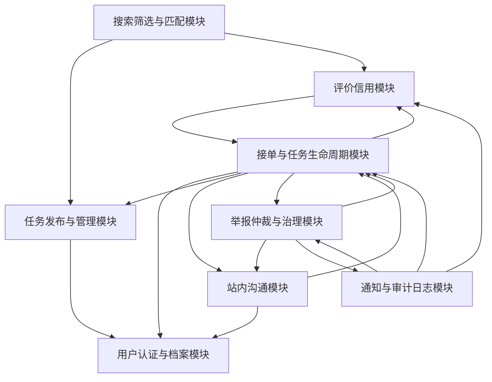

# 模块划分与技术选型

## 1. 设计前提

> 前后端分离的模块化单体架构 + 分层架构 + MVC/REST 表现层 + MySQL 单库 + 局部轻量事件机制

## 2. 模块划分

### 2.1 后端核心模块

| 模块 | 主要职责 | 主要输入/输出 |
|---|---|---|
| 用户认证与档案模块 | 校内身份认证、登录注册、用户档案维护、角色与权限管理、隐私字段控制 | 输入：认证信息、档案编辑请求；输出：用户身份状态、公开档案信息 |
| 任务发布与管理模块 | 创建任务、编辑草稿、取消/重发、分类管理、任务详情维护 | 输入：任务表单、分类信息；输出：任务记录、任务详情 |
| 搜索筛选与匹配模块 | 任务列表浏览、关键词搜索、分类筛选、按校区/信用/标签排序、轻量推荐 | 输入：查询条件；输出：任务列表、推荐结果 |
| 接单与任务生命周期模块 | 申请接单、选择帮助者、状态流转、超时处理、完成确认主流程编排 | 输入：接单申请、状态变更请求；输出：任务状态、候选者列表、处理结果 |
| 站内沟通模块 | 站内文字/图片消息、会话管理、与任务相关的沟通记录保存 | 输入：消息内容、会话请求；输出：聊天记录、会话摘要 |
| 评价信用模块 | 双向评价、信用记录计算、积分变更记录、信用展示 | 输入：评分、评价文字、任务完成结果；输出：评价记录、信用记录、积分变化 |
| 举报仲裁与治理模块 | 举报、申诉、敏感任务审核、违规拦截、处罚记录 | 输入：举报信息、申诉材料、审核动作；输出：处理结论、处罚结果、审核状态 |
| 通知与审计日志模块 | 发送系统通知、记录关键操作日志、为后续追责和审计提供证据 | 输入：业务事件、操作记录；输出：通知消息、审计日志 |

### 2.2 前端页面模块

| 模块 | 主要职责 |
|---|---|
| 认证与个人中心 | 登录、认证、档案查看与编辑 |
| 任务大厅 | 任务浏览、搜索、筛选、查看详情 |
| 发布与编辑页 | 发布任务、保存草稿、修改任务 |
| 接单与任务管理页 | 申请接单、查看候选者、状态推进、确认完成 |
| 消息中心 | 站内聊天、通知提醒 |
| 评价与举报页 | 评价、申诉、举报、查看处理结果 |
| 管理后台页面 | 审核敏感任务、处理举报、查看日志摘要 |

## 3. 模块依赖与接口

### 3.1 依赖原则

- 前端只通过 REST API 与后端交互，不直接访问数据库。
- 后端采用 `Controller -> Service -> Repository/DAO` 的分层调用。
- 任务生命周期模块是核心协调模块，可调用认证、沟通、评价、治理等模块能力。
- 通知与审计日志模块尽量通过轻量事件机制或服务调用接收业务结果，避免侵入主流程。
- 模块之间优先通过清晰的应用服务接口协作，不跨层直接访问其他模块的数据访问层。

### 3.2 主要依赖关系

| 模块 | 依赖模块 | 说明 |
|---|---|---|
| 任务发布与管理模块 | 用户认证与档案模块 | 校验发布者身份、权限和公开信息 |
| 搜索筛选与匹配模块 | 任务发布与管理模块、评价信用模块 | 读取任务数据，并结合信用/标签进行筛选排序 |
| 接单与任务生命周期模块 | 用户认证与档案模块、任务发布与管理模块、站内沟通模块、评价信用模块、举报仲裁与治理模块 | 负责任务主流程编排，是系统核心模块 |
| 站内沟通模块 | 用户认证与档案模块、任务生命周期模块 | 校验会话双方身份，并与任务上下文关联 |
| 评价信用模块 | 任务生命周期模块 | 以完成/取消/争议结果为信用计算依据 |
| 举报仲裁与治理模块 | 任务生命周期模块、站内沟通模块、通知与审计日志模块 | 读取任务状态、聊天证据和关键日志进行处理 |
| 通知与审计日志模块 | 各业务模块 | 接收任务状态变化、举报处理、评价完成等事件 |

### 3.3 模块依赖图

### 3.4 接口方式

| 接口类型 | 使用位置 | 数据格式 |
|---|---|---|
| REST API | 前端与后端之间的主要交互方式 | JSON |
| Service 接口调用 | 后端模块之间协作 | Java 对象 / DTO |
| 轻量事件机制 | 通知、日志、积分/信用等辅助流程 | 领域事件对象 |

## 4. 技术选型

| 层次 | 选择 | 选择理由 |
|---|---|---|
| 前端框架 | Vue 3 + Vite + Vue Router | 与现有工程一致，开发门槛低，适合快速构建课程项目页面 |
| 后端框架 | Java 17 + Spring Boot 3 | 与现有后端骨架一致，适合 REST API、分层开发和模块化组织 |
| 表现层风格 | MVC/REST | 适合前后端分离场景，便于接口联调和职责分离 |
| 数据库 | MySQL | 结构化数据清晰，适合用户、任务、评价、举报、日志等核心业务数据存储 |
| 数据访问 | Repository/DAO 模式 | 与分层架构匹配，便于隔离 SQL 与业务逻辑 |
| 前后端通信 | HTTP + JSON | 简单直接，易于调试和测试 |
| 轻量异步机制 | Spring Event 或普通服务解耦 | 可支持通知、审计、积分更新等辅助逻辑，又不必引入重型 MQ |
| 鉴权与会话 | Spring Boot 鉴权组件 + 后续可扩展 JWT/Session | 当前阶段先保证身份可信与权限控制，具体实现保持轻量 |
| 文件存储 | 本地存储起步，后续可扩展对象存储 | 当前阶段主要支持图片/凭证上传，先控制复杂度 |
| 部署方式 | 前后端分离部署 | 前端静态资源部署简单，后端单体部署成本低，便于演示与答辩 |

## 5. 暂不引入的技术

| 技术 | 暂不引入原因 |
|---|---|
| 微服务拆分 | 当前团队规模小、周期短，会显著增加联调和运维复杂度 |
| RabbitMQ / Kafka | 当前通知和日志场景可先用轻量事件机制满足 |
| Redis | 当前规模下不是必需组件，可后续用于缓存、验证码、限流 |
| Elasticsearch | 当前搜索规模较小，可先基于数据库查询实现 |
| API Gateway / 服务注册发现 | 单体架构下没有必要，会造成过度设计 |
