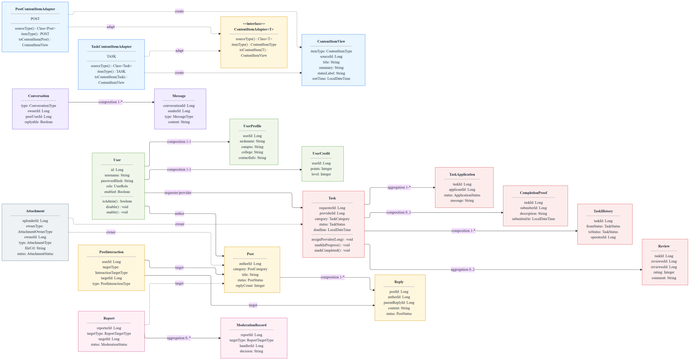
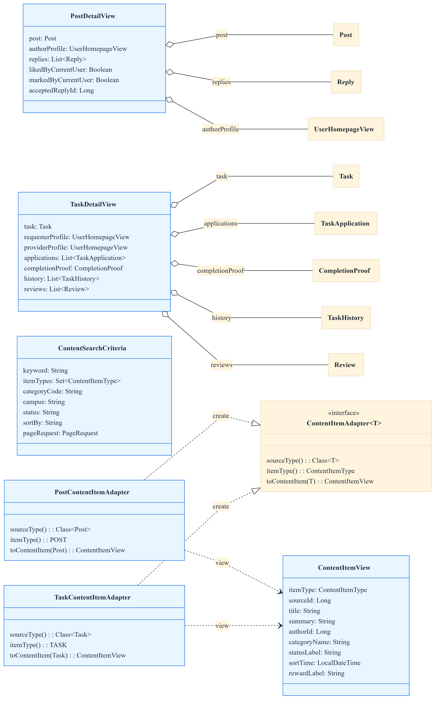
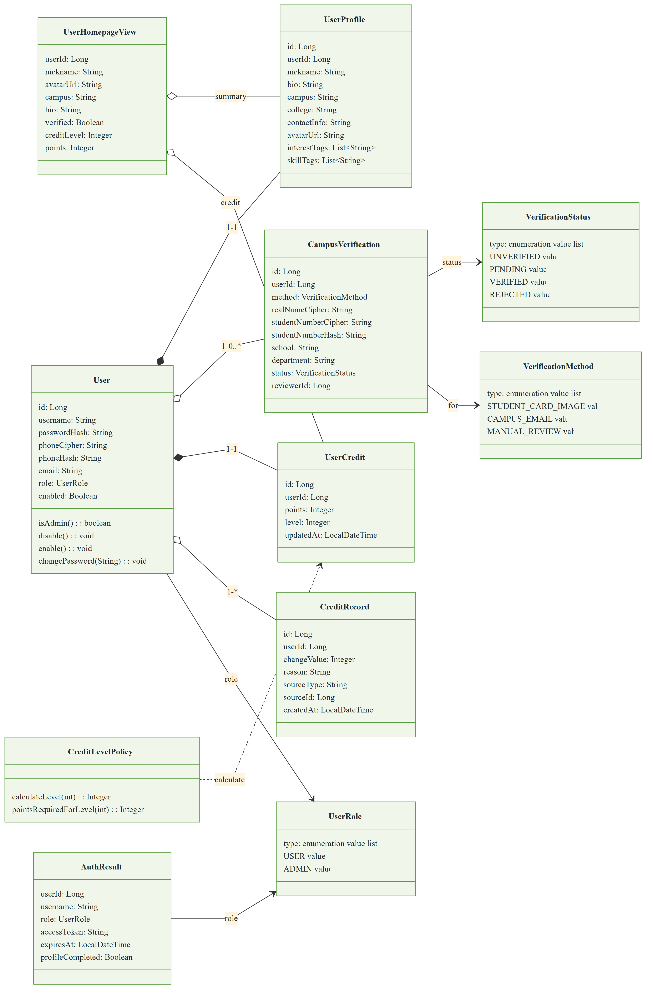
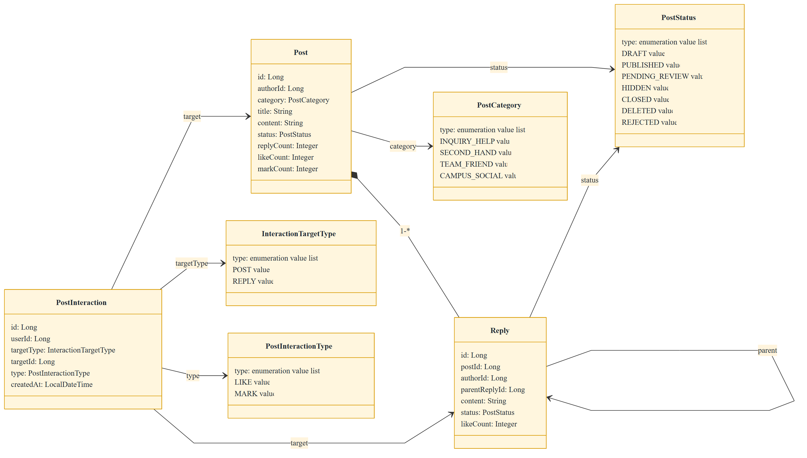
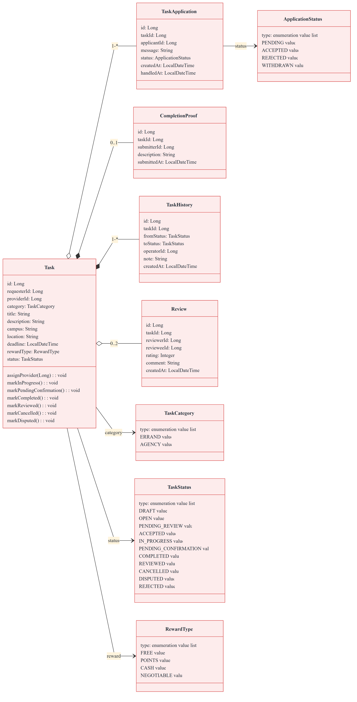
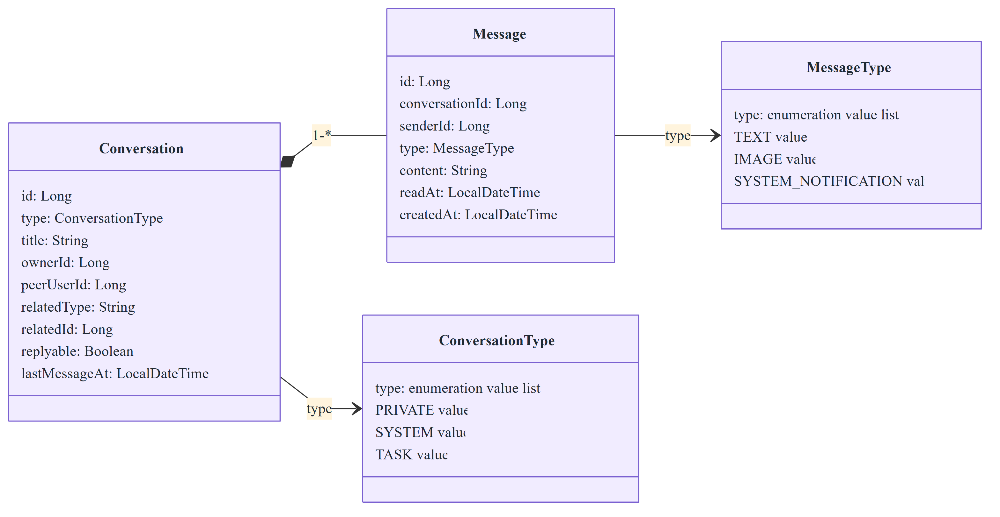
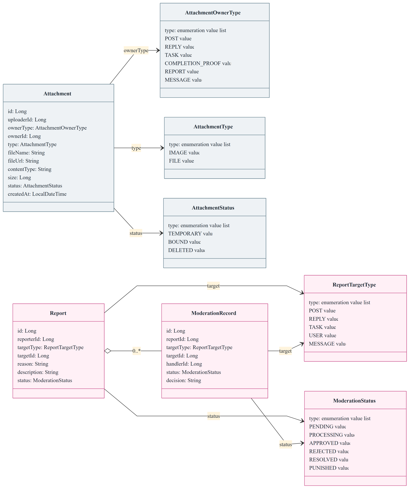
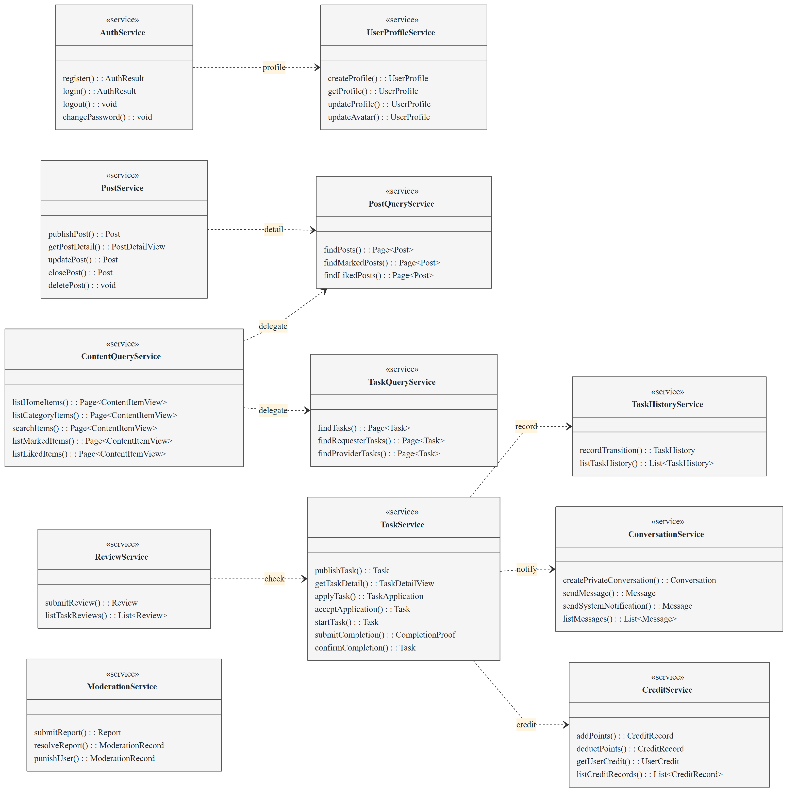

# 校园互助服务平台核心类设计

## 1. 设计目标与功能覆盖

本设计面向校园互助服务平台的详细设计阶段，核心思路是：

```text
统一展示，分别建模。
```

系统在首页、板块页、搜索页、用户收藏/点赞列表等位置使用统一的 `ContentItemView` 展示内容；底层业务模型则区分为 `Post` 和 `Task`：

- `Post`：社区型内容，采用帖子 + 回复模式，适用于打听求助、二手交易、组队&搭子、校园交友等场景。
- `Task`：任务/订单型内容，采用接单 + 状态机模式，适用于跑腿、委托代办等需要明确流程的场景。

### 1.1 P0 功能覆盖

根据 `00-大作业总览.pdf`，P0 必做功能包括用户管理、需求发布与浏览、订单流程管理。本设计覆盖情况如下：

| P0 模块 | 要求 | 本设计中的对应 |
|---|---|---|
| 用户管理 | 注册、登录、个人资料 | `User`、`UserProfile`、`AuthService`、`UserProfileService` |
| 需求发布与浏览 | 发布、列表、详情、筛选 | `PostService`、`TaskService`、`ContentQueryService`、`PostQueryService`、`TaskQueryService`、`ContentSearchCriteria`、`PostDetailView`、`TaskDetailView` |
| 订单流程管理 | 完整的接单-完成流程 | `Task`、`TaskApplication`、`TaskStatus`、`CompletionProof`、`TaskHistory`、`TaskService` |

同时，本设计也为 P1/P2 功能预留了扩展空间：

| 优先级 | 模块 | 本设计中的对应 |
|---|---|---|
| P1 | 评价与信用体系 | `Review`、`UserCredit`、`CreditRecord`、`CreditLevelPolicy`、`ReviewService`、`CreditService` |
| P1 | 消息通知 | `Conversation`、`Message`、`ConversationService` |
| P2 | 智能匹配与推荐 | 可在 `ContentQueryService` 外增加排序策略或推荐服务 |
| P2 | 管理后台 | `Report`、`ModerationRecord`、`ModerationService` |
| P2 | 即时通讯 | `Conversation`、`Message` 可扩展为一对一消息 |

## 2. 类设计总览

| 模块 | 类/接口/枚举 | 说明 |
|---|---|---|
| 统一展示 | `ContentItemView` | 内容列表统一展示项 |
| 统一展示 | `PostDetailView` | 帖子详情展示对象 |
| 统一展示 | `TaskDetailView` | 任务详情展示对象 |
| 统一展示 | `ContentSearchCriteria` | 内容查询与筛选条件 |
| 统一展示 | `ContentItemType` | 展示项来源类型 |
| 统一展示 | `ContentItemAdapter<T>` | 内容展示适配器接口 |
| 统一展示 | `PostContentItemAdapter` | 帖子展示适配器 |
| 统一展示 | `TaskContentItemAdapter` | 任务展示适配器 |
| 用户与身份 | `User` | 用户账号主体 |
| 用户与身份 | `UserProfile` | 用户公开档案 |
| 用户与身份 | `UserHomepageView` | 用户主页展示对象 |
| 用户与身份 | `UserCredit` | 用户积分与等级 |
| 用户与身份 | `CreditRecord` | 积分变化记录 |
| 用户与身份 | `CreditLevelPolicy` | 积分等级计算策略 |
| 用户与身份 | `CampusVerification` | 校内认证记录 |
| 用户与身份 | `AuthResult` | 登录/注册结果对象 |
| 帖子 | `Post` | 社区型帖子 |
| 帖子 | `Reply` | 帖子回复 |
| 帖子 | `PostInteraction` | 点赞、标记、采纳等互动 |
| 任务 | `Task` | 跑腿/代办任务 |
| 任务 | `TaskApplication` | 接单申请 |
| 任务 | `CompletionProof` | 完成凭证 |
| 任务 | `TaskHistory` | 状态流转历史 |
| 任务 | `Review` | 双向评价 |
| 对话通知 | `Conversation` | 站内会话 |
| 对话通知 | `Message` | 会话消息 |
| 附件 | `Attachment` | 附件 |
| 治理 | `Report` | 举报记录 |
| 治理 | `ModerationRecord` | 管理员处理记录 |

## 3. 核心类图

本节引用基于本设计生成的 PNG 类图。颜色用于区分模块；关系线遵循 UML 类图习惯：普通箭头表示关联，空心菱形表示聚合，实心菱形表示组合，空心三角表示继承或接口实现，虚线表示依赖或实现。

### 3.1 总览类图



### 3.2 统一展示模块类图



### 3.3 用户与身份模块类图



### 3.4 帖子模块类图



### 3.5 任务模块类图



### 3.6 对话通知模块类图



### 3.7 附件与治理模块类图



### 3.8 核心服务接口类图



### 3.9 模块颜色说明

| 颜色 | 模块 | 说明 |
|---|---|---|
| 蓝色 | 统一展示 | `ContentItemView`、详情视图、查询条件、适配器 |
| 绿色 | 用户与身份 | 用户账号、资料、认证、积分 |
| 黄色 | 帖子 | 社区型帖子、回复、互动 |
| 红色 | 任务 | 跑腿/代办任务、接单、状态机、评价 |
| 紫色 | 对话通知 | 私聊、系统通知、任务会话 |
| 灰蓝色 | 附件 | 附件及其所属对象 |
| 粉色 | 治理 | 举报、审核、处罚记录 |
| 灰色 | 服务接口 | 应用服务、查询服务、仓储接口 |

### 3.10 关系符号说明

| 符号 | 含义 | 示例 |
|---|---|---|
| 实线箭头 | 关联 | `Post` 关联 `User` 表示作者 |
| 空心菱形 | 聚合 | `Task` 聚合多个 `TaskApplication` |
| 实心菱形 | 组合 | `Conversation` 组合多个 `Message` |
| 空心三角 | 继承/接口实现 | `PostContentItemAdapter` 实现 `ContentItemAdapter<Post>` |
| 虚线箭头 | 依赖 | `TaskService` 依赖 `ConversationService` 发送通知 |

## 4. 统一展示模块

### 4.1 ContentItemView

**职责：** 表示内容列表中的统一展示项，用于首页、板块页、搜索结果、点赞列表、标记列表等场景。它是展示对象，不是持久化实体。

| 关键属性 | 类型 | 说明 |
|---|---|---|
| `itemType` | `ContentItemType` | 来源类型：`POST` 或 `TASK` |
| `sourceId` | `Long` | 来源对象 ID |
| `title` | `String` | 展示标题 |
| `summary` | `String` | 内容摘要 |
| `authorId` | `Long` | 作者/发布者 ID |
| `authorName` | `String` | 作者展示名 |
| `categoryName` | `String` | 板块或分类 |
| `statusLabel` | `String` | 状态展示文案 |
| `createdAt` | `LocalDateTime` | 创建时间 |
| `sortTime` | `LocalDateTime` | 排序时间 |
| `replyCount` | `Integer` | 回复数，可为空 |
| `likeCount` | `Integer` | 点赞数，可为空 |
| `rewardLabel` | `String` | 任务奖励展示文案，可为空 |

**关键方法：** 无业务方法，只作为展示数据载体。

### 4.2 PostDetailView

**职责：** 表示帖子详情页展示对象，组合帖子主体、作者摘要、回复列表和当前用户互动状态。

| 关键属性 | 类型 | 说明 |
|---|---|---|
| `post` | `Post` | 帖子主体 |
| `authorProfile` | `UserHomepageView` | 作者公开资料摘要 |
| `replies` | `List<Reply>` | 回复列表 |
| `likedByCurrentUser` | `Boolean` | 当前用户是否点赞 |
| `markedByCurrentUser` | `Boolean` | 当前用户是否标记 |
| `acceptedReplyId` | `Long` | 被采纳回复 ID，可为空 |

**关键方法：** 无业务方法，由 `PostService.getPostDetail()` 创建。

### 4.3 TaskDetailView

**职责：** 表示任务/订单详情页展示对象，组合任务主体、需求方、服务方、接单申请、完成凭证、历史和评价。

| 关键属性 | 类型 | 说明 |
|---|---|---|
| `task` | `Task` | 任务主体 |
| `requesterProfile` | `UserHomepageView` | 需求方资料摘要 |
| `providerProfile` | `UserHomepageView` | 服务方资料摘要，可为空 |
| `applications` | `List<TaskApplication>` | 接单申请列表 |
| `completionProof` | `CompletionProof` | 完成凭证，可为空 |
| `history` | `List<TaskHistory>` | 状态历史 |
| `reviews` | `List<Review>` | 评价列表 |

**关键方法：** 无业务方法，由 `TaskService.getTaskDetail()` 创建。

### 4.4 ContentSearchCriteria

**职责：** 表示内容列表查询和筛选条件，只表达筛选意图，不包含 SQL 或数据库实现细节。

| 关键属性 | 类型 | 说明 |
|---|---|---|
| `keyword` | `String` | 关键词 |
| `itemTypes` | `Set<ContentItemType>` | 内容类型筛选 |
| `categoryCode` | `String` | 板块或任务分类编码 |
| `campus` | `String` | 校区筛选 |
| `locationKeyword` | `String` | 地点关键词 |
| `status` | `String` | 状态筛选 |
| `createdAfter` | `LocalDateTime` | 发布时间下限 |
| `createdBefore` | `LocalDateTime` | 发布时间上限 |
| `sortBy` | `String` | 排序字段 |
| `pageRequest` | `PageRequest` | 分页参数 |

**关键方法：** 无业务方法。

### 4.5 ContentItemAdapter<T>

**职责：** 将不同业务对象转换为统一展示项 `ContentItemView`。

| 关键方法 | 返回值 | 说明 |
|---|---|---|
| `sourceType()` | `Class<T>` | 返回适配器支持的源对象类型 |
| `itemType()` | `ContentItemType` | 返回转换后的展示项类型 |
| `toContentItem(T source)` | `ContentItemView` | 转换为统一展示项 |

`PostContentItemAdapter` 实现 `ContentItemAdapter<Post>`，负责把 `Post` 转换为 `ContentItemView`。`TaskContentItemAdapter` 实现 `ContentItemAdapter<Task>`，负责把 `Task` 转换为 `ContentItemView`。

## 5. 用户与身份模块

### 5.1 User

**职责：** 表示用户账号主体，负责登录身份、角色和账号可用性。

| 关键属性 | 类型 | 说明 |
|---|---|---|
| `id` | `Long` | 用户 ID |
| `username` | `String` | 登录名 |
| `passwordHash` | `String` | 加密后的密码 |
| `phone` | `String` | 手机号 |
| `email` | `String` | 邮箱 |
| `role` | `UserRole` | 用户角色 |
| `enabled` | `Boolean` | 账号是否可用 |
| `createdAt` | `LocalDateTime` | 创建时间 |
| `updatedAt` | `LocalDateTime` | 更新时间 |

| 关键方法 | 返回值 | 说明 |
|---|---|---|
| `isAdmin()` | `boolean` | 判断是否为管理员 |
| `disable()` | `void` | 禁用账号 |
| `enable()` | `void` | 启用账号 |
| `changePassword(String newPasswordHash)` | `void` | 修改密码哈希 |

### 5.2 UserProfile

**职责：** 表示用户主动维护的公开资料，不负责认证流程和积分等级计算。

| 关键属性 | 类型 | 说明 |
|---|---|---|
| `id` | `Long` | 档案 ID |
| `userId` | `Long` | 所属用户 ID |
| `nickname` | `String` | 昵称 |
| `bio` | `String` | 简介 |
| `campus` | `String` | 常驻校区 |
| `college` | `String` | 学院 |
| `contactInfo` | `String` | 对外展示联系方式 |
| `avatarUrl` | `String` | 头像地址 |
| `interestTags` | `List<String>` | 兴趣标签 |
| `skillTags` | `List<String>` | 能力标签 |

**关键方法：** 资料更新由 `UserProfileService` 负责。

### 5.3 UserHomepageView

**职责：** 表示个人主页展示对象，组合公开资料、认证状态和积分等级。它是展示数据载体，不是持久化实体。

| 关键属性 | 类型 | 说明 |
|---|---|---|
| `userId` | `Long` | 用户 ID |
| `nickname` | `String` | 昵称 |
| `avatarUrl` | `String` | 头像 |
| `campus` | `String` | 校区 |
| `bio` | `String` | 简介 |
| `verified` | `Boolean` | 是否已认证 |
| `verificationLabel` | `String` | 认证展示文案 |
| `creditLevel` | `Integer` | 积分等级 |
| `points` | `Integer` | 当前积分 |

### 5.4 UserCredit

**职责：** 保存用户当前积分和等级结果。

| 关键属性 | 类型 | 说明 |
|---|---|---|
| `id` | `Long` | 记录 ID |
| `userId` | `Long` | 用户 ID |
| `points` | `Integer` | 当前积分 |
| `level` | `Integer` | 当前等级 |
| `updatedAt` | `LocalDateTime` | 更新时间 |

### 5.5 CreditRecord

**职责：** 记录积分或信用变化来源。

| 关键属性 | 类型 | 说明 |
|---|---|---|
| `id` | `Long` | 记录 ID |
| `userId` | `Long` | 用户 ID |
| `changeValue` | `Integer` | 积分变化值 |
| `reason` | `String` | 变化原因 |
| `sourceType` | `String` | 来源类型 |
| `sourceId` | `Long` | 来源对象 ID |
| `createdAt` | `LocalDateTime` | 创建时间 |

### 5.6 CreditLevelPolicy

**职责：** 表示积分等级计算规则。

| 关键方法 | 返回值 | 说明 |
|---|---|---|
| `calculateLevel(int points)` | `Integer` | 根据积分计算等级 |
| `pointsRequiredForLevel(int level)` | `Integer` | 查询等级所需积分 |

### 5.7 CampusVerification

**职责：** 表示校内身份认证记录。认证状态可展示在个人主页，但认证流程不放入 `UserProfile`。

| 关键属性 | 类型 | 说明 |
|---|---|---|
| `id` | `Long` | 认证记录 ID |
| `userId` | `Long` | 用户 ID |
| `method` | `VerificationMethod` | 认证方式 |
| `realNameCipher` | `String` | 真实姓名密文 |
| `studentNumberCipher` | `String` | 学号密文 |
| `studentNumberHash` | `String` | 学号哈希，用于查重 |
| `school` | `String` | 学校 |
| `department` | `String` | 院系 |
| `evidenceUrl` | `String` | 认证材料 |
| `status` | `VerificationStatus` | 认证状态 |
| `reviewerId` | `Long` | 审核人 ID |
| `rejectReason` | `String` | 驳回原因 |

### 5.8 AuthResult

**职责：** 表示注册或登录成功后的认证结果。

| 关键属性 | 类型 | 说明 |
|---|---|---|
| `userId` | `Long` | 用户 ID |
| `username` | `String` | 登录名 |
| `role` | `UserRole` | 用户角色 |
| `accessToken` | `String` | 登录凭证 |
| `expiresAt` | `LocalDateTime` | 过期时间 |
| `profileCompleted` | `Boolean` | 是否已完善资料 |

### 5.9 用户与身份枚举

```text
UserRole: USER, ADMIN
VerificationMethod: STUDENT_CARD_IMAGE, CAMPUS_EMAIL, MANUAL_REVIEW
VerificationStatus: UNVERIFIED, PENDING, VERIFIED, REJECTED
```

## 6. 帖子模块

### 6.1 Post

**职责：** 表示社区型内容。打听求助、二手交易、组队&搭子、校园交友当前均采用统一的帖子 + 回复结构。

| 关键属性 | 类型 | 说明 |
|---|---|---|
| `id` | `Long` | 帖子 ID |
| `authorId` | `Long` | 作者 ID |
| `category` | `PostCategory` | 帖子分类 |
| `title` | `String` | 标题 |
| `content` | `String` | 正文 |
| `status` | `PostStatus` | 帖子状态 |
| `replyCount` | `Integer` | 回复数 |
| `likeCount` | `Integer` | 点赞数 |
| `markCount` | `Integer` | 标记数 |
| `createdAt` | `LocalDateTime` | 创建时间 |
| `updatedAt` | `LocalDateTime` | 更新时间 |

**关键方法：** 帖子发布、修改、关闭和删除由 `PostService` 负责。

### 6.2 Reply

**职责：** 表示帖子下的回复，支持对帖子回复和对回复再回复。

| 关键属性 | 类型 | 说明 |
|---|---|---|
| `id` | `Long` | 回复 ID |
| `postId` | `Long` | 所属帖子 ID |
| `authorId` | `Long` | 回复人 ID |
| `parentReplyId` | `Long` | 父回复 ID，可为空 |
| `content` | `String` | 回复内容 |
| `status` | `PostStatus` | 回复状态 |
| `likeCount` | `Integer` | 点赞数 |
| `createdAt` | `LocalDateTime` | 创建时间 |

### 6.3 PostInteraction

**职责：** 表示用户对帖子或回复的互动。

| 关键属性 | 类型 | 说明 |
|---|---|---|
| `id` | `Long` | 互动 ID |
| `userId` | `Long` | 用户 ID |
| `targetType` | `InteractionTargetType` | 互动对象类型 |
| `targetId` | `Long` | 互动对象 ID |
| `type` | `PostInteractionType` | 互动类型 |
| `createdAt` | `LocalDateTime` | 创建时间 |

### 6.4 帖子模块枚举

```text
PostCategory: INQUIRY_HELP, SECOND_HAND, TEAM_FRIEND, CAMPUS_SOCIAL
PostStatus: DRAFT, PUBLISHED, PENDING_REVIEW, HIDDEN, CLOSED, DELETED, REJECTED
InteractionTargetType: POST, REPLY
PostInteractionType: LIKE, MARK
```

## 7. 任务模块

### 7.1 Task

**职责：** 表示跑腿、委托代办等任务型内容，承担课程总览中“订单/需求单”的核心职责。任务具有明确接单、确认、进行中、完成、评价流程。

| 关键属性 | 类型 | 说明 |
|---|---|---|
| `id` | `Long` | 任务 ID |
| `requesterId` | `Long` | 需求方 ID |
| `providerId` | `Long` | 服务方 ID，可为空 |
| `category` | `TaskCategory` | 任务分类 |
| `title` | `String` | 标题 |
| `description` | `String` | 说明 |
| `campus` | `String` | 校区 |
| `location` | `String` | 地点 |
| `deadline` | `LocalDateTime` | 截止时间 |
| `rewardType` | `RewardType` | 奖励方式 |
| `rewardDescription` | `String` | 奖励说明 |
| `completionStandard` | `String` | 完成标准 |
| `requiresProof` | `Boolean` | 是否要求凭证 |
| `status` | `TaskStatus` | 当前状态 |

| 关键方法 | 返回值 | 说明 |
|---|---|---|
| `assignProvider(Long providerId)` | `void` | 设置服务方并进入已确认状态 |
| `markInProgress()` | `void` | 标记为进行中 |
| `markPendingConfirmation()` | `void` | 标记为待确认 |
| `markCompleted()` | `void` | 标记为已完成 |
| `markReviewed()` | `void` | 标记为已评价 |
| `markCancelled()` | `void` | 标记为已取消 |
| `markDisputed()` | `void` | 标记为争议中 |

说明：`Task` 只维护自身状态和基本不变量。权限校验、历史记录、通知、积分信用事件由 `TaskService` 编排。

### 7.2 TaskApplication

**职责：** 表示服务方对任务的接单申请。

| 关键属性 | 类型 | 说明 |
|---|---|---|
| `id` | `Long` | 申请 ID |
| `taskId` | `Long` | 任务 ID |
| `applicantId` | `Long` | 申请人 ID |
| `message` | `String` | 申请说明 |
| `status` | `ApplicationStatus` | 申请状态 |
| `createdAt` | `LocalDateTime` | 创建时间 |
| `handledAt` | `LocalDateTime` | 处理时间 |

### 7.3 CompletionProof

**职责：** 表示任务完成凭证，凭证图片或文件通过 `Attachment` 关联。

| 关键属性 | 类型 | 说明 |
|---|---|---|
| `id` | `Long` | 凭证 ID |
| `taskId` | `Long` | 任务 ID |
| `submitterId` | `Long` | 提交人 ID |
| `description` | `String` | 完成说明 |
| `submittedAt` | `LocalDateTime` | 提交时间 |

### 7.4 TaskHistory

**职责：** 记录任务状态流转历史，满足订单历史记录和争议追溯需要。

| 关键属性 | 类型 | 说明 |
|---|---|---|
| `id` | `Long` | 历史记录 ID |
| `taskId` | `Long` | 任务 ID |
| `fromStatus` | `TaskStatus` | 原状态 |
| `toStatus` | `TaskStatus` | 新状态 |
| `operatorId` | `Long` | 操作人 ID |
| `note` | `String` | 说明 |
| `createdAt` | `LocalDateTime` | 创建时间 |

### 7.5 Review

**职责：** 表示任务完成后的双向评价。

| 关键属性 | 类型 | 说明 |
|---|---|---|
| `id` | `Long` | 评价 ID |
| `taskId` | `Long` | 任务 ID |
| `reviewerId` | `Long` | 评价人 ID |
| `revieweeId` | `Long` | 被评价人 ID |
| `rating` | `Integer` | 评分，1-5 星 |
| `comment` | `String` | 文字评价 |
| `createdAt` | `LocalDateTime` | 创建时间 |

### 7.6 任务模块枚举

```text
TaskCategory: ERRAND, AGENCY
TaskStatus: DRAFT, OPEN, PENDING_REVIEW, ACCEPTED, IN_PROGRESS, PENDING_CONFIRMATION, COMPLETED, REVIEWED, CANCELLED, DISPUTED, REJECTED
ApplicationStatus: PENDING, ACCEPTED, REJECTED, WITHDRAWN
RewardType: FREE, POINTS, CASH, NEGOTIABLE
```

主状态机：

```text
OPEN -> ACCEPTED -> IN_PROGRESS -> PENDING_CONFIRMATION -> COMPLETED -> REVIEWED
```

## 8. 对话通知模块

### 8.1 Conversation

**职责：** 表示站内会话。普通私聊和系统通知都以会话形式展示，系统通知会话不可回复。

| 关键属性 | 类型 | 说明 |
|---|---|---|
| `id` | `Long` | 会话 ID |
| `type` | `ConversationType` | 会话类型 |
| `title` | `String` | 会话标题 |
| `ownerId` | `Long` | 会话拥有者 ID |
| `peerUserId` | `Long` | 对方用户 ID |
| `relatedType` | `String` | 关联对象类型 |
| `relatedId` | `Long` | 关联对象 ID |
| `replyable` | `Boolean` | 是否允许回复 |
| `lastMessageAt` | `LocalDateTime` | 最后消息时间 |

### 8.2 Message

**职责：** 表示会话消息，包括用户消息和系统通知消息。

| 关键属性 | 类型 | 说明 |
|---|---|---|
| `id` | `Long` | 消息 ID |
| `conversationId` | `Long` | 会话 ID |
| `senderId` | `Long` | 发送者 ID，系统消息可为空 |
| `type` | `MessageType` | 消息类型 |
| `content` | `String` | 消息内容 |
| `readAt` | `LocalDateTime` | 阅读时间 |
| `createdAt` | `LocalDateTime` | 创建时间 |

### 8.3 对话通知枚举

```text
ConversationType: PRIVATE, SYSTEM, TASK
MessageType: TEXT, IMAGE, SYSTEM_NOTIFICATION
```

## 9. 附件模块

### 9.1 Attachment

**职责：** 表示帖子、回复、任务、完成凭证、举报、消息中的附件。

| 关键属性 | 类型 | 说明 |
|---|---|---|
| `id` | `Long` | 附件 ID |
| `uploaderId` | `Long` | 上传者 ID |
| `ownerType` | `AttachmentOwnerType` | 附件所属对象类型 |
| `ownerId` | `Long` | 所属对象 ID |
| `type` | `AttachmentType` | 附件类型 |
| `fileName` | `String` | 文件名 |
| `fileUrl` | `String` | 附件地址 |
| `contentType` | `String` | MIME 类型 |
| `size` | `Long` | 文件大小 |
| `status` | `AttachmentStatus` | 附件状态 |
| `createdAt` | `LocalDateTime` | 创建时间 |

```text
AttachmentOwnerType: POST, REPLY, TASK, COMPLETION_PROOF, REPORT, MESSAGE
AttachmentStatus: TEMPORARY, BOUND, DELETED
AttachmentType: IMAGE, FILE
```

## 10. 治理模块

### 10.1 Report

**职责：** 表示用户对帖子、回复、任务、用户、消息等对象的举报。

| 关键属性 | 类型 | 说明 |
|---|---|---|
| `id` | `Long` | 举报 ID |
| `reporterId` | `Long` | 举报人 ID |
| `targetType` | `ReportTargetType` | 举报对象类型 |
| `targetId` | `Long` | 举报对象 ID |
| `reason` | `String` | 举报理由 |
| `description` | `String` | 补充说明 |
| `status` | `ModerationStatus` | 处理状态 |
| `createdAt` | `LocalDateTime` | 创建时间 |

### 10.2 ModerationRecord

**职责：** 表示管理员对举报、内容审核、违规处罚等行为的处理记录。

| 关键属性 | 类型 | 说明 |
|---|---|---|
| `id` | `Long` | 处理记录 ID |
| `reportId` | `Long` | 关联举报 ID，可为空 |
| `targetType` | `ReportTargetType` | 处理对象类型 |
| `targetId` | `Long` | 处理对象 ID |
| `handlerId` | `Long` | 管理员 ID |
| `status` | `ModerationStatus` | 处理状态 |
| `decision` | `String` | 处理结论 |
| `handledAt` | `LocalDateTime` | 处理时间 |

```text
ReportTargetType: POST, REPLY, TASK, USER, MESSAGE
ModerationStatus: PENDING, PROCESSING, APPROVED, REJECTED, RESOLVED, PUNISHED
```

## 11. 核心服务接口

| 服务 | 职责 | 关键方法 |
|---|---|---|
| `AuthService` | 注册、登录、退出、改密 | `register()`、`login()`、`logout()`、`changePassword()` |
| `UserProfileService` | 用户资料管理 | `createProfile()`、`getProfile()`、`updateProfile()`、`updateAvatar()` |
| `ContentQueryService` | 统一展示查询服务 | `listHomeItems()`、`listCategoryItems()`、`searchItems()`、`listMarkedItems()`、`listLikedItems()` |
| `PostQueryService` | 帖子查询细节 | `findPosts()`、`findMarkedPosts()`、`findLikedPosts()` |
| `TaskQueryService` | 任务查询细节 | `findTasks()`、`findRequesterTasks()`、`findProviderTasks()` |
| `PostService` | 帖子发布、详情、编辑、关闭、删除 | `publishPost()`、`getPostDetail()`、`updatePost()`、`closePost()`、`deletePost()` |
| `ReplyService` | 帖子回复 | `replyToPost()`、`replyToReply()`、`deleteReply()` |
| `TaskService` | 任务发布、详情、接单、状态流转 | `publishTask()`、`getTaskDetail()`、`applyTask()`、`acceptApplication()`、`startTask()`、`submitCompletion()`、`confirmCompletion()`、`markDisputed()` |
| `TaskHistoryService` | 任务历史记录 | `recordTransition()`、`listTaskHistory()` |
| `InteractionService` | 点赞、标记、采纳 | `likePost()`、`markPost()`、`acceptReply()`、`cancelInteraction()` |
| `ConversationService` | 私聊和系统通知 | `createPrivateConversation()`、`createSystemConversation()`、`sendMessage()`、`sendSystemNotification()` |
| `ReviewService` | 双向评价 | `submitReview()`、`listTaskReviews()` |
| `UserHomepageService` | 用户主页聚合查询 | `getHomepage()` |
| `CreditService` | 积分与信用记录 | `addPoints()`、`deductPoints()`、`getUserCredit()`、`listCreditRecords()` |
| `ModerationService` | 举报和治理 | `submitReport()`、`resolveReport()`、`punishUser()` |

## 12. 类之间的关系

### 12.1 继承 / 实现关系

| 关系 | 说明 |
|---|---|
| `PostContentItemAdapter` 实现 `ContentItemAdapter<Post>` | 帖子展示适配器实现统一展示适配器接口 |
| `TaskContentItemAdapter` 实现 `ContentItemAdapter<Task>` | 任务展示适配器实现统一展示适配器接口 |

### 12.2 组合关系

组合表示整体对象负责组织局部对象，局部对象通常依附于整体业务存在。

| 整体 | 部分 | 说明 |
|---|---|---|
| `PostDetailView` | `Post`、`List<Reply>`、`UserHomepageView` | 帖子详情展示由帖子主体、回复和作者摘要组成 |
| `TaskDetailView` | `Task`、`List<TaskApplication>`、`CompletionProof`、`List<TaskHistory>`、`List<Review>` | 任务详情展示由任务主体、申请、凭证、历史和评价组成 |
| `UserHomepageView` | `UserProfile`、`CampusVerification`、`UserCredit` 的摘要信息 | 用户主页组合多个来源的展示信息 |

### 12.3 聚合关系

聚合表示对象之间有整体-部分关系，但部分对象可以独立存在或被单独查询。

| 聚合方 | 被聚合方 | 说明 |
|---|---|---|
| `User` | `UserProfile` | 一个用户拥有一份公开资料 |
| `User` | `UserCredit`、`CreditRecord` | 用户拥有当前积分状态和积分变化记录 |
| `Task` | `TaskApplication` | 一个任务可有多个接单申请 |
| `Task` | `TaskHistory` | 一个任务可有多条状态历史 |
| `Task` | `Review` | 一个任务完成后可产生双向评价 |
| `Conversation` | `Message` | 一个会话包含多条消息 |

### 12.4 关联关系

关联表示对象之间通过 ID 或服务调用发生联系，但不形成强生命周期绑定。

| 类 A | 类 B | 说明 |
|---|---|---|
| `Post` | `User` | `Post.authorId` 关联发布者 |
| `Reply` | `Post` | `Reply.postId` 关联所属帖子 |
| `Reply` | `User` | `Reply.authorId` 关联回复者 |
| `PostInteraction` | `Post` / `Reply` | 通过 `targetType` 和 `targetId` 关联互动对象 |
| `Task` | `User` | `requesterId` 和 `providerId` 关联需求方和服务方 |
| `TaskApplication` | `User` | `applicantId` 关联申请接单者 |
| `CompletionProof` | `Task` | `taskId` 关联任务 |
| `Review` | `User` | `reviewerId` 和 `revieweeId` 关联评价双方 |
| `Attachment` | 多种对象 | 通过 `ownerType` 和 `ownerId` 关联帖子、回复、任务、凭证、举报、消息 |
| `Report` | 多种对象 | 通过 `targetType` 和 `targetId` 关联被举报对象 |

### 12.5 服务依赖关系

| 服务 | 主要依赖 | 说明 |
|---|---|---|
| `ContentQueryService` | `PostQueryService`、`TaskQueryService`、`ContentItemAdapter<T>` | 统一展示查询入口，不直接承担具体查询细节 |
| `TaskService` | `TaskHistoryService`、`ConversationService`、`CreditService` | 编排状态流转、历史、通知和信用事件 |
| `UserHomepageService` | `UserProfileService`、`CreditService`、认证查询能力 | 聚合个人主页展示信息 |
| `ReviewService` | `TaskService` / `TaskRepository`、`ReviewRepository` | 校验任务状态后提交评价 |

## 13. 仓储接口

| 接口 | 主要职责 |
|---|---|
| `UserRepository` | 保存、查询用户账号 |
| `UserProfileRepository` | 保存、查询用户公开档案 |
| `UserCreditRepository` | 保存、查询用户积分等级 |
| `CreditRecordRepository` | 保存、查询积分变化记录 |
| `CampusVerificationRepository` | 保存、查询认证记录 |
| `PostRepository` | 保存、查询帖子 |
| `ReplyRepository` | 保存、查询回复 |
| `PostInteractionRepository` | 保存、查询互动记录 |
| `TaskRepository` | 保存、查询任务 |
| `TaskApplicationRepository` | 保存、查询任务申请 |
| `CompletionProofRepository` | 保存、查询完成凭证 |
| `TaskHistoryRepository` | 保存、查询任务历史 |
| `ReviewRepository` | 保存、查询评价 |
| `ConversationRepository` | 保存、查询会话 |
| `MessageRepository` | 保存、查询消息 |
| `AttachmentRepository` | 保存、查询附件 |
| `ReportRepository` | 保存、查询举报 |
| `ModerationRecordRepository` | 保存、查询治理记录 |

## 14. 设计模式应用说明

### 14.1 适配器模式

**应用场景：** `ContentItemAdapter<T>`、`PostContentItemAdapter`、`TaskContentItemAdapter`。

**为什么使用：** `Post` 和 `Task` 的业务结构不同，但首页、板块页、搜索结果等页面需要统一展示。适配器把不同业务对象转换成统一的 `ContentItemView`，使展示层不需要理解 `Post` 和 `Task` 的内部差异。

**如果不用：** 展示层需要到处判断对象类型，例如判断当前内容是帖子还是任务，再分别取字段、拼状态、拼奖励信息。这样会造成重复逻辑，并且新增二手交易、组队活动等独立模型时，需要修改大量展示代码，违反开闭原则。

### 14.2 状态模式 / 状态机设计

**应用场景：** `TaskStatus` 与 `TaskService`。

**为什么使用：** 跑腿/代办任务必须满足课程要求中的完整流程：接单、确认、进行中、完成、评价。使用状态机可以明确合法状态和流转路径：

```text
OPEN -> ACCEPTED -> IN_PROGRESS -> PENDING_CONFIRMATION -> COMPLETED -> REVIEWED
```

**如果不用：** 任务状态可能被任意修改，例如未接单就完成、未提交凭证就确认完成。流程混乱会影响订单历史、通知、评价和信用积分的正确性。

### 14.3 策略模式

**应用场景：** `CreditLevelPolicy`，以及可扩展的首页排序策略、推荐排序策略。

**为什么使用：** 积分等级规则和内容排序规则容易变化，单独抽出策略对象可以隔离变化。比如积分等级从简单分段改为综合评分时，只需要调整策略实现，不必修改 `UserCredit` 或 `CreditService` 的核心结构。

**如果不用：** 等级计算逻辑会散落在服务或实体中，规则变化时容易出现多处修改和规则不一致的问题。

## 15. SOLID 原则对应

| 原则 | 本设计中的体现 |
|---|---|
| 单一职责 SRP | `Post` 和 `Task` 分离；`Task` 和 `TaskService` 分离；`ContentQueryService` 和 `PostQueryService` / `TaskQueryService` 分离 |
| 开闭原则 OCP | 新增内容类型时可增加新的模型和 `ContentItemAdapter`，不必修改统一展示对象 |
| 里氏替换 LSP | `ContentItemAdapter<T>` 使用泛型接口，避免 `Object` 参数导致实现类无法安全替换 |
| 接口隔离 ISP | `TaskService` 与 `TaskHistoryService` 分离；查询服务和命令服务分离 |
| 依赖倒置 DIP | Service 依赖 Repository 接口和策略接口，而不是依赖具体数据库实现 |

## 16. 小结

本设计以 `Post` 和 `Task` 分别建模，既保留校园社区型内容的灵活性，也满足课程对任务/订单完整状态机的要求。`ContentItemView` 和适配器机制保证了首页与列表展示的统一性；`TaskService`、`TaskHistory`、`Review` 等类保证了接单、确认、完成、评价的闭环；`Conversation` 与 `Message` 为通知和沟通提供统一基础。整体设计覆盖全部 P0 功能，并为评价信用、通知、治理、推荐等后续功能保留了扩展空间。
