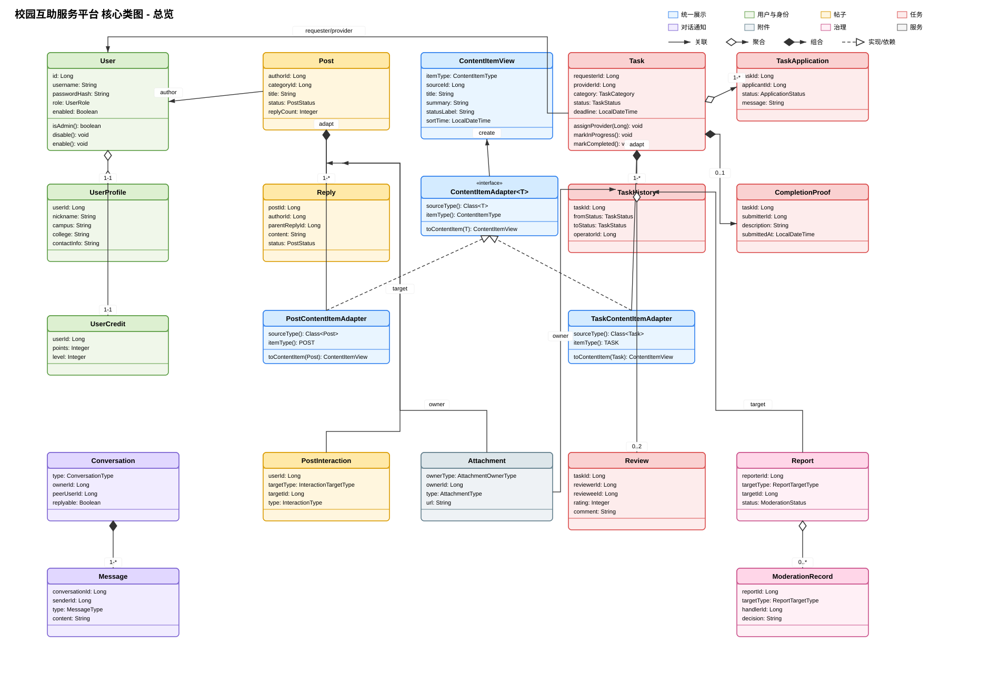
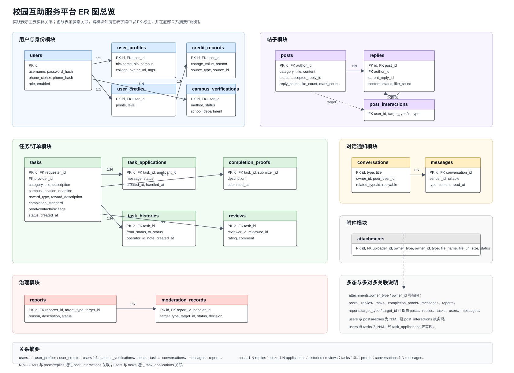

# 校园互助服务平台详细设计文档

## 1. 文档说明

本文档为校园互助服务平台 P3 阶段详细设计整合文档，汇总核心类设计、SOLID 检查、API 设计、数据库设计和 AI 辅助实验结果。

本阶段详细设计围绕以下目标展开：

1. 设计覆盖 P0 核心功能模块的类图。
2. 按 SOLID 原则审查 AI 原始设计并完成修正。
3. 使用 RESTful 风格定义 API 规范。
4. 完成 ER 图、建表 SQL、索引和隐私数据处理设计。
5. 记录 AI 在详细设计阶段的辅助作用和局限。

相关分项文件如下：

| 内容 | 文件 |
|---|---|
| 核心类设计 | `../01-核心类设计/核心类图/核心类设计.md` |
| 核心类图 | `../01-核心类设计/核心类图/核心类图-总览.svg` 等 SVG 文件 |
| SOLID 检查 | `../01-核心类设计/SOLID检查/SOLID检查清单.md` |
| API 规范 | `../02-API设计/openapi.yaml` |
| API AI 辅助实验 | `../02-API设计/API设计AI辅助实验.md` |
| 数据库建表 SQL | `../03-数据库设计/schema.sql` |
| ER 图 | `../03-数据库设计/ER图总览.svg` |
| 数据库设计说明 | `../03-数据库设计/数据库设计说明.md` |
| 数据库 AI 审查 | `../03-数据库设计/数据库设计AI审查报告.md` |
| AI 协作反思日志 | `../05-AI协作反思日志/AI协作反思日志#3.md` |

## 2. 总体设计思路

核心设计思路是：

```text
统一展示，分别建模。
```

系统在首页、板块页、搜索页、用户点赞/标记列表等位置统一展示内容，但底层业务模型区分为 `Post` 和 `Task`：

- `Post`：社区型内容，采用帖子 + 回复模式，适用于打听求助、二手交易、组队搭子、校园交友等场景。
- `Task`：任务/订单型内容，采用接单 + 状态机模式，适用于跑腿、委托代办等需要明确流程的场景。

这种设计既保留了校园社区交流的灵活性，又满足课程要求中对任务/订单流程、状态机、双方确认和双向评价的强调。

## 3. P0 功能覆盖

| P0 功能 | 设计覆盖 |
|---|---|
| 用户注册 / 登录 | `User`、`AuthResult`、`AuthService`，API 中的 `POST /auth/register`、`POST /auth/login`，数据库中的 `users` |
| 发布需求 | 社区型需求由 `Post` 承载，任务型需求由 `Task` 承载；API 中对应 `POST /posts`、`POST /tasks` |
| 浏览需求列表（含筛选） | `ContentItemView`、`ContentSearchCriteria`、`ContentQueryService`；API 中对应 `GET /content` |
| 接单 | `TaskApplication`、`TaskService.applyTask()`、`TaskService.acceptApplication()`；API 中对应任务申请与接受申请接口 |
| 查看订单详情 | `TaskDetailView` 聚合任务、申请、凭证、历史和评价；API 中对应 `GET /tasks/{taskId}` |
| 提交评价 | `Review`、`ReviewService`；API 中对应 `POST /tasks/{taskId}/reviews` |
| 任务状态机 | `TaskStatus`、`TaskHistory`、`TaskService`；数据库中对应 `tasks.status`、`task_histories` |

## 4. 核心类设计

### 4.1 类设计总览

系统核心类按模块划分如下：

| 模块 | 核心类 |
|---|---|
| 统一展示 | `ContentItemView`、`PostDetailView`、`TaskDetailView`、`ContentSearchCriteria`、`ContentItemAdapter<T>` |
| 用户与身份 | `User`、`UserProfile`、`UserHomepageView`、`CampusVerification`、`UserCredit`、`CreditRecord`、`CreditLevelPolicy` |
| 帖子 | `Post`、`Reply`、`PostInteraction` |
| 任务 | `Task`、`TaskApplication`、`CompletionProof`、`TaskHistory`、`Review` |
| 对话通知 | `Conversation`、`Message` |
| 附件 | `Attachment` |
| 治理 | `Report`、`ModerationRecord` |
| 服务接口 | `AuthService`、`PostService`、`TaskService`、`ContentQueryService`、`ReviewService`、`ConversationService` 等 |

### 4.2 核心类图

总览类图如下：



分模块类图包括：

- [统一展示模块类图](../01-核心类设计/核心类图/核心类图-统一展示模块.svg)
- [用户与身份模块类图](../01-核心类设计/核心类图/核心类图-用户与身份模块.svg)
- [帖子模块类图](../01-核心类设计/核心类图/核心类图-帖子模块.svg)
- [任务模块类图](../01-核心类设计/核心类图/核心类图-任务模块.svg)
- [对话通知模块类图](../01-核心类设计/核心类图/核心类图-对话通知模块.svg)
- [附件治理模块类图](../01-核心类设计/核心类图/核心类图-附件治理模块.svg)
- [服务接口模块类图](../01-核心类设计/核心类图/核心类图-服务接口模块.svg)

### 4.3 关键类职责

| 类 | 职责 |
|---|---|
| `ContentItemView` | 首页、板块页、搜索页等列表中的统一展示对象 |
| `ContentItemAdapter<T>` | 将 `Post`、`Task` 等业务对象转换为统一展示项 |
| `User` | 用户账号主体，负责登录身份、角色和启用状态 |
| `UserProfile` | 用户公开资料 |
| `CampusVerification` | 校内认证记录 |
| `Post` | 社区型帖子主体 |
| `Reply` | 帖子回复，支持父子回复 |
| `PostInteraction` | 点赞、标记等互动 |
| `Task` | 跑腿/代办任务主体，维护任务状态和基本不变量 |
| `TaskApplication` | 服务方对任务的接单申请 |
| `CompletionProof` | 服务方提交的完成凭证 |
| `TaskHistory` | 任务状态流转历史 |
| `Review` | 任务完成后的双向评价 |
| `Conversation` | 站内私聊、任务会话或系统通知会话 |
| `Message` | 会话消息 |
| `Attachment` | 通用附件 |
| `Report` | 用户举报或申诉 |
| `ModerationRecord` | 管理员处理记录 |

### 4.4 类之间的主要关系

| 关系类型 | 关系说明 |
|---|---|
| 关联 | `Post` 关联 `User` 表示作者；`Task` 关联 `User` 表示需求方和服务方 |
| 聚合 | `Task` 聚合 `TaskApplication`、`TaskHistory`、`Review` |
| 组合 | `Conversation` 组合多个 `Message` |
| 接口实现 | `PostContentItemAdapter`、`TaskContentItemAdapter` 实现 `ContentItemAdapter<T>` |
| 依赖 | `TaskService` 依赖 `TaskHistoryService`、`ConversationService`、`CreditService` 完成流程编排 |

## 5. SOLID 检查与修正

### 5.1 检查对象

SOLID 检查对象为 AI 原始核心类设计，修正依据为最终版核心类设计。

检查材料：

| 材料 | 文件 |
|---|---|
| AI 原始核心类设计 | `../01-核心类设计/AI原始核心类设计/AI原始核心类设计.md` |
| AI 原始类图 | `../01-核心类设计/AI原始核心类设计/AI原始类图.svg` |
| 修正后核心类设计 | `../01-核心类设计/核心类图/核心类设计.md` |

### 5.2 检查结果

| SOLID 原则 | 发现问题数 |
|---|---:|
| S - 单一职责原则 | 5 |
| O - 开闭原则 | 3 |
| L - 里氏替换原则 | 1 |
| I - 接口隔离原则 | 3 |
| D - 依赖倒置原则 | 2 |
| 合计 | 14 |

### 5.3 主要修正

| AI 原始设计问题 | 违反原则 | 修正方案 |
|---|---|---|
| 所有需求统一建模为 `Task` | SRP、OCP | 拆分为 `Post` 和 `Task` |
| `Task` 同时承担多类需求和流程职责 | SRP | `Task` 维护状态，`TaskService` 编排流程 |
| `User` 包含认证状态 | SRP | 拆出 `CampusVerification` |
| `UserProfile` 包含信用分 | SRP | 拆出 `UserCredit`、`CreditRecord` |
| 缺少统一展示对象 | OCP、DIP | 增加 `ContentItemView` |
| 缺少内容展示适配机制 | OCP、LSP | 增加泛型 `ContentItemAdapter<T>` |
| 查询能力只围绕任务 | SRP、OCP | 增加 `ContentQueryService`、`PostQueryService`、`TaskQueryService` |
| 完成凭证直接保存图片 URL | SRP、OCP | 增加通用 `Attachment` |
| 服务依赖方向不明确 | DIP | 明确 Service 依赖 Repository 接口和应用服务协作 |

修正后的设计通过模型拆分、服务拆分、适配器、状态机和策略对象降低耦合，提高了可扩展性。

## 6. 设计模式应用

### 6.1 适配器模式

应用场景：`ContentItemAdapter<T>`、`PostContentItemAdapter`、`TaskContentItemAdapter`。

使用原因：`Post` 和 `Task` 的业务结构不同，但首页、板块页、搜索结果等页面需要统一展示。适配器将不同业务对象转换为 `ContentItemView`，使展示层不需要理解具体实体内部结构。

如果不用该模式，展示层会直接判断 `Post`、`Task` 等具体类型。后续新增内容模型时，需要不断修改展示层代码，容易违反开闭原则。

### 6.2 状态模式 / 状态机思想

应用场景：`TaskStatus`、`TaskService`、`TaskHistory`。

使用原因：任务从开放接单到已接单、进行中、待确认、完成、评价，具有明确状态流转规则。状态机设计可以集中表达哪些流转合法，便于记录历史和处理异常流程。

如果不用状态机，任务状态可能被随意修改，接单、完成、确认、评价等流程容易出现不一致。

### 6.3 策略模式

应用场景：`CreditLevelPolicy`。

使用原因：积分等级规则可能随课程设计或产品规则变化而调整。将等级计算规则抽离为策略对象，可以避免把规则散落在用户资料、评价或积分服务中。

如果不用策略模式，规则变化时需要修改多个服务或实体，维护成本较高。

## 7. API 设计

### 7.1 API 设计原则

API 采用 OpenAPI 3.0.3 描述，统一前缀为：

```text
/api/v1
```

接口按用户、帖子、任务、接单申请、评价、会话、附件、举报和管理审核等模块组织。除注册、登录接口外，大部分接口使用 Bearer JWT 认证。

API 规范文件为：

```text
../02-API设计/openapi.yaml
```

### 7.2 P3 核心接口覆盖

| P3 要求 | API 路径 |
|---|---|
| 用户注册 / 登录 | `POST /auth/register`、`POST /auth/login` |
| 发布需求 | `POST /posts`、`POST /tasks` |
| 浏览需求列表（含筛选） | `GET /content`、`GET /posts`、`GET /tasks` |
| 接单 | `POST /tasks/{taskId}/applications`、`POST /tasks/{taskId}/applications/{applicationId}/accept` |
| 查看订单详情 | `GET /tasks/{taskId}` |
| 提交评价 | `POST /tasks/{taskId}/reviews` |

### 7.3 主要 API 模块

| 模块 | 代表接口 | 说明 |
|---|---|---|
| Auth | `POST /auth/register`、`POST /auth/login` | 注册和登录 |
| User | `GET /users/me`、`GET /users/{userId}/profile` | 用户信息和个人主页 |
| Verification | `POST /verifications`、`GET /verifications` | 校园认证 |
| Content | `GET /content` | 帖子和任务统一内容流 |
| Post | `POST /posts`、`GET /posts/{postId}`、`POST /posts/{postId}/replies` | 帖子发布、详情、回复 |
| Interaction | `POST /posts/{postId}/interactions`、`POST /posts/{postId}/replies/{replyId}/accept` | 点赞、标记、采纳回复 |
| Task | `POST /tasks`、`GET /tasks/{taskId}`、`POST /tasks/{taskId}/status-transitions` | 任务发布、详情、状态流转 |
| TaskApplication | `POST /tasks/{taskId}/applications`、`POST /tasks/{taskId}/applications/{applicationId}/accept` | 接单申请与接受申请 |
| Review | `POST /tasks/{taskId}/reviews` | 双向评价 |
| Conversation | `POST /conversations`、`GET /conversations/{conversationId}/messages` | 站内会话和消息 |
| Attachment | `POST /attachments` | 附件上传 |
| Report | `POST /reports` | 举报或申诉 |

### 7.4 请求、响应和错误处理

API 中的请求参数通过 schema 明确类型、必填项、长度限制、枚举值和格式。例如：

- `CreatePostRequest` 要求 `category`、`title`、`content` 必填。
- `CreateTaskRequest` 要求任务分类、标题、说明、校区、地点、截止时间、奖励方式、完成标准等字段。
- `CreateReviewRequest.rating` 限制为 1-5。
- 分页参数 `page`、`size` 设定了最小值和最大值。

常见错误响应包括：

| 状态码 | 含义 |
|---|---|
| `400` | 请求参数错误 |
| `401` | 未认证或登录失效 |
| `403` | 无权限 |
| `404` | 资源不存在 |
| `409` | 状态冲突或重复操作 |
| `422` | 业务校验失败 |
| `500` | 服务器内部错误 |

### 7.5 API AI 辅助实验

P3 任务 2.2 中，先使用 AI 生成了 `openapi-ai初稿.yaml`，再进行人工审查和修正。

AI 初稿主要问题包括：

- 接口命名不够一致，例如直接使用 `/tasks/{taskId}/accept` 简化接单流程。
- 缺少完整错误响应。
- 参数校验不足。
- 安全设计不够细致。
- 没有覆盖附件上传、站内会话、个人主页、点赞标记、采纳回复等设计。

修正后的 `openapi.yaml` 已经通过 Redocly 校验，校验结果为 API 描述文件有效。

## 8. 数据库设计

### 8.1 数据库设计目标

数据库设计支撑用户、帖子、任务、对话、附件和治理等核心功能，遵循以下原则：

- `Post` 和 `Task` 分表，不使用大 `requests` 表。
- 展示对象不建表，由查询聚合生成。
- 任务流程通过 `tasks`、`task_applications`、`completion_proofs`、`task_histories`、`reviews` 共同支撑。
- 附件、举报、治理记录采用多态字段保持扩展性。
- 敏感信息采用哈希或密文字段保存。

数据库文件包括：

| 文件 | 说明 |
|---|---|
| `../03-数据库设计/schema.sql` | 建表 SQL |
| `../03-数据库设计/ER图总览.svg` | ER 图 |
| `../03-数据库设计/数据库设计说明.md` | 表结构、关系、索引和隐私说明 |
| `../03-数据库设计/数据库设计AI审查报告.md` | 数据库 AI 审查结果 |

ER 图如下：



### 8.2 核心表

| 模块 | 表 |
|---|---|
| 用户与身份 | `users`、`user_profiles`、`campus_verifications`、`user_credits`、`credit_records` |
| 帖子 | `posts`、`replies`、`post_interactions` |
| 任务 | `tasks`、`task_applications`、`completion_proofs`、`task_histories`、`reviews` |
| 对话通知 | `conversations`、`messages` |
| 附件 | `attachments` |
| 治理 | `reports`、`moderation_records` |

### 8.3 主要实体关系

| 关系 | 说明 |
|---|---|
| `users` 1:1 `user_profiles` | 一个用户对应一份公开资料 |
| `users` 1:1 `user_credits` | 一个用户对应一份当前积分等级 |
| `users` 1:N `posts` | 用户可发布多篇帖子 |
| `posts` 1:N `replies` | 帖子可有多条回复 |
| `tasks` 1:N `task_applications` | 任务可收到多个接单申请 |
| `tasks` 1:0..1 `completion_proofs` | 任务最多有一份完成凭证 |
| `tasks` 1:N `task_histories` | 任务可有多条状态历史 |
| `tasks` 1:N `reviews` | 任务完成后可产生双方评价 |
| `conversations` 1:N `messages` | 一个会话包含多条消息 |
| `reports` 1:N `moderation_records` | 一个举报可产生多条处理记录 |

`attachments`、`reports`、`moderation_records`、`post_interactions` 使用多态关联字段表达跨模块目标对象，由应用层根据类型进行校验。

### 8.4 索引设计

数据库索引围绕高频查询场景设计：

| 场景 | 索引 |
|---|---|
| 用户登录 | `uk_users_username` |
| 手机号查重 | `uk_users_phone_hash` |
| 帖子列表 | `idx_posts_category_status_created` |
| 帖子回复加载 | `idx_replies_post_created` |
| 任务列表筛选 | `idx_tasks_category_status_created`、`idx_tasks_campus_status_created` |
| 即将截止任务查询 | `idx_tasks_status_deadline` |
| 接单申请去重 | `uk_task_applications_task_applicant` |
| 任务状态历史 | `idx_task_histories_task_created` |
| 会话列表 | `idx_conversations_owner_last` |
| 会话消息分页 | `idx_messages_conversation_created` |
| 附件加载 | `idx_attachments_owner` |
| 举报处理列表 | `idx_reports_status_created` |

### 8.5 隐私数据处理

| 数据 | 处理方式 |
|---|---|
| 密码 | `password_hash` 保存带盐哈希，不保存明文 |
| 手机号 | `phone_cipher` 保存密文，`phone_hash` 用于查重 |
| 真实姓名 | `real_name_cipher` 保存密文 |
| 学号 | `student_number_cipher` 保存密文，`student_number_hash` 用于查重 |
| 认证材料 | `evidence_url` 仅供审核流程访问，普通用户主页只展示认证摘要 |

### 8.6 数据库 AI 审查结论

数据库 AI 审查认为设计整体满足 P3 提交要求：

- 整体满足第三范式。
- 索引覆盖主要查询场景。
- 无明显严重性能瓶颈。
- 隐私字段设计较完整。
- 多态关联和统计字段属于工程折中，需要应用层配合校验和维护一致性。

## 9. 关键业务流程

### 9.1 社区型帖子流程

```text
用户发布帖子 -> 其他用户回复 -> 用户点赞/标记 -> 帖主可采纳回复 -> 帖子关闭或删除
```

涉及对象：

- `Post`
- `Reply`
- `PostInteraction`
- `Attachment`
- `PostService`
- `ReplyService`
- `InteractionService`

### 9.2 任务/订单流程

```text
发布任务 -> 服务方申请接单 -> 发布者选择帮助者 -> 任务进行中
-> 服务方提交完成凭证 -> 发布者确认完成 -> 双方评价
```

涉及对象：

- `Task`
- `TaskApplication`
- `CompletionProof`
- `TaskHistory`
- `Review`
- `TaskService`
- `TaskHistoryService`
- `ReviewService`

任务主状态机为：

```text
OPEN -> ACCEPTED -> IN_PROGRESS -> PENDING_CONFIRMATION -> COMPLETED -> REVIEWED
```

异常状态包括：

```text
CANCELLED, DISPUTED, REJECTED
```

### 9.3 附件上传流程

```text
上传附件 -> 生成 TEMPORARY 附件记录 -> 业务接口提交 attachmentIds
-> 后端校验上传者 -> 绑定 owner_type / owner_id -> 状态改为 BOUND
```

该流程避免将文件上传逻辑直接耦合到帖子、任务、消息等业务接口。

### 9.4 站内会话流程

```text
由帖子或任务创建会话 -> 发送消息 -> 系统通知也以会话形式展示
```

`Conversation.replyable` 用于区分普通可回复会话和不可回复系统通知。

## 10. 交付物完成情况

| P3 交付物 | 完成情况 |
|---|---|
| 类图 | 已完成，总览和分模块 SVG 类图位于 `../01-核心类设计/核心类图/` |
| SOLID 检查清单 | 已完成，记录 AI 原始设计 14 个 SOLID 问题及修正方案 |
| API 规范文档 | 已完成，`../02-API设计/openapi.yaml` 覆盖核心接口，并通过 Redocly 校验 |
| API AI 辅助实验 | 已完成，包含 `../02-API设计/openapi-ai初稿.yaml` 和对比说明 |
| ER 图 + 建表 SQL | 已完成，位于 `../03-数据库设计/` |
| 数据库设计说明 | 已完成，包含表、关系、索引、隐私数据处理 |
| 数据库 AI 审查 | 已完成，包含 3NF、索引、性能和安全审查 |
| 详细设计文档 | 本文档 |
| AI 协作反思日志 #3 | 已完成，位于 `../05-AI协作反思日志/AI协作反思日志#3.md` |

## 11. 总结

P3 阶段详细设计在 P1 需求分析和 P2 架构设计的基础上，将系统核心模型收敛为 `Post` 和 `Task` 分别建模、`ContentItemView` 统一展示的结构。该结构既能支持社区交流，也能满足课程对任务流程、状态机、双方确认和双向评价的要求。

类设计通过 SOLID 检查修正了 AI 原始设计中过度任务化、职责过重、接口过宽和展示层依赖具体实体等问题。API 设计使用 OpenAPI 描述并覆盖 P3 要求的核心接口。数据库设计提供了 ER 图、建表 SQL、索引说明和隐私处理方案，能够支撑用户、帖子、任务、会话、附件和治理等主要模块。

整体来看，当前详细设计已经覆盖 P3 阶段的主要交付要求，并为后续实现阶段保留了较清晰的模块边界和扩展空间。


