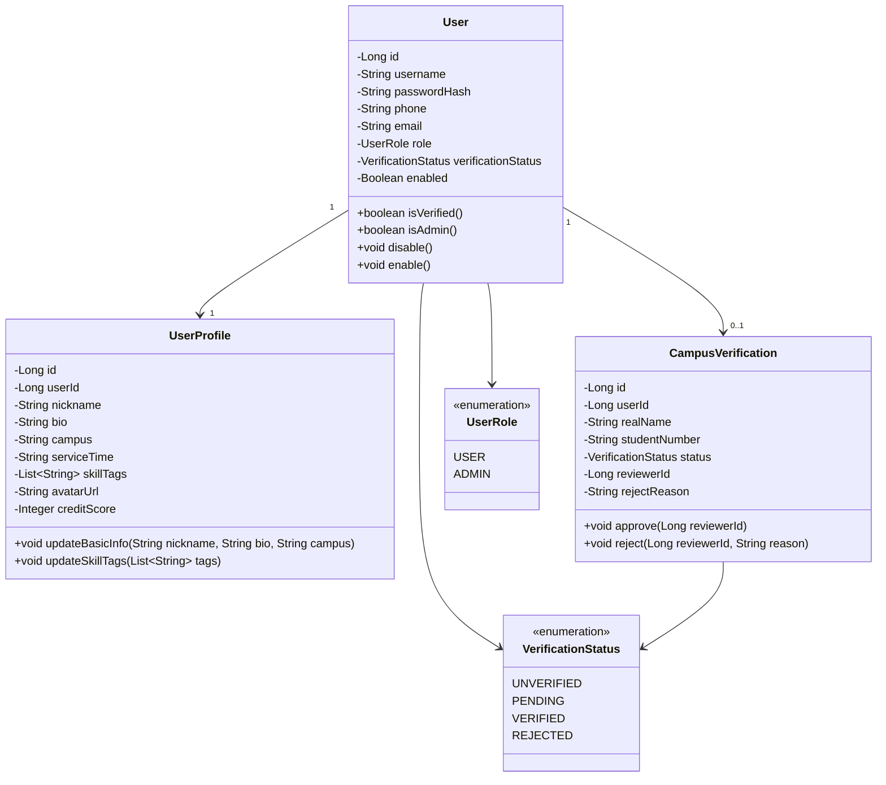
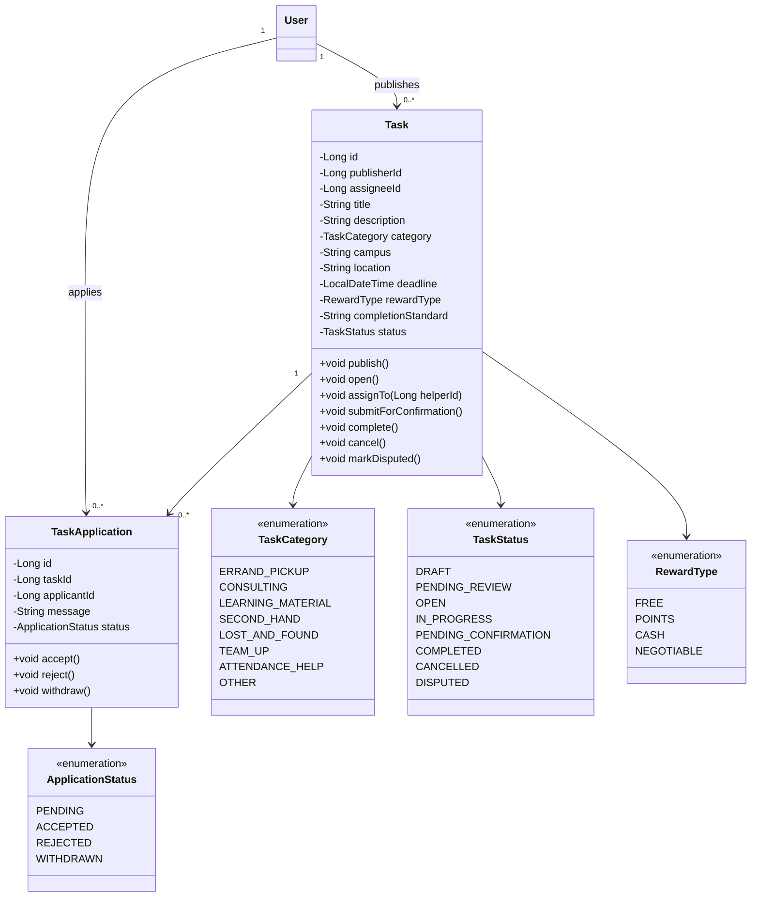
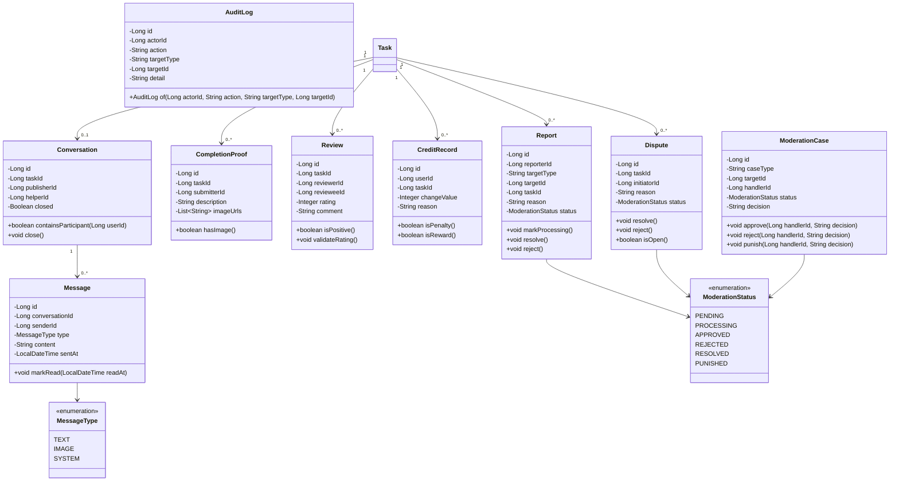

# AI 原始类图

## 1. 说明

本文档作为 P3 阶段 1.2 “让 AI 生成类图”任务的原始成果。该版本根据 P1 需求规格说明书、P2 架构设计文档和核心类设计草案生成，尚未经过团队人工 SOLID 检查与修正。

彩色清晰版类图见同目录下的 `AI原始类图.html`。本文档中的 Mermaid 图仅作为无色备份，避免不同 Mermaid 渲染器对样式语法支持不一致导致解析错误。

后续应重点检查：

1. 是否存在类职责过重。
2. 是否存在服务接口过大。
3. 是否存在枚举不利于扩展的问题。
4. 是否存在领域对象和服务职责边界不清的问题。
5. 是否存在 Repository、Service、Entity 之间依赖方向不合理的问题。

## 2. 总体类图

颜色约定：

| 模块 | 颜色 |
|---|---|
| 用户与身份 | 蓝色 |
| 任务与生命周期 | 绿色 |
| 沟通与凭证 | 紫色 |
| 评价与信用 | 橙色 |
| 治理与审计 | 红色 |

```mermaid
classDiagram
    class User {
        -Long id
        -String username
        -String passwordHash
        -String phone
        -String email
        -UserRole role
        -VerificationStatus verificationStatus
        -Boolean enabled
        -LocalDateTime createdAt
        -LocalDateTime updatedAt
        +boolean isVerified()
        +boolean isAdmin()
        +void disable()
        +void enable()
        +void changePassword(String newPasswordHash)
    }

    class UserProfile {
        -Long id
        -Long userId
        -String nickname
        -String bio
        -String campus
        -String serviceTime
        -List~String~ skillTags
        -String avatarUrl
        -Integer creditScore
        +void updateBasicInfo(String nickname, String bio, String campus)
        +void updateSkillTags(List~String~ tags)
        +void updateServiceTime(String serviceTime)
    }

    class CampusVerification {
        -Long id
        -Long userId
        -String realName
        -String studentNumber
        -String school
        -String department
        -VerificationStatus status
        -LocalDateTime submittedAt
        -LocalDateTime reviewedAt
        -Long reviewerId
        -String rejectReason
        +void approve(Long reviewerId)
        +void reject(Long reviewerId, String reason)
        +boolean isPending()
    }

    class UserRole {
        <<enumeration>>
        USER
        ADMIN
    }

    class VerificationStatus {
        <<enumeration>>
        UNVERIFIED
        PENDING
        VERIFIED
        REJECTED
    }

    class Task {
        -Long id
        -Long publisherId
        -Long assigneeId
        -String title
        -String description
        -TaskCategory category
        -String campus
        -String location
        -LocalDateTime deadline
        -RewardType rewardType
        -String rewardDescription
        -String completionStandard
        -String contactPreference
        -Boolean requiresProof
        -TaskStatus status
        -LocalDateTime createdAt
        -LocalDateTime updatedAt
        +void publish()
        +void markPendingReview()
        +void open()
        +void assignTo(Long helperId)
        +void submitForConfirmation()
        +void complete()
        +void cancel()
        +void markDisputed()
        +boolean isOwnedBy(Long userId)
        +boolean isAssignedTo(Long userId)
    }

    class TaskCategory {
        <<enumeration>>
        ERRAND_PICKUP
        CONSULTING
        LEARNING_MATERIAL
        SECOND_HAND
        LOST_AND_FOUND
        TEAM_UP
        ATTENDANCE_HELP
        OTHER
    }

    class TaskStatus {
        <<enumeration>>
        DRAFT
        PENDING_REVIEW
        OPEN
        IN_PROGRESS
        PENDING_CONFIRMATION
        COMPLETED
        CANCELLED
        DISPUTED
    }

    class RewardType {
        <<enumeration>>
        FREE
        POINTS
        CASH
        NEGOTIABLE
    }

    class TaskApplication {
        -Long id
        -Long taskId
        -Long applicantId
        -String message
        -ApplicationStatus status
        -LocalDateTime createdAt
        -LocalDateTime handledAt
        +void accept()
        +void reject()
        +void withdraw()
        +boolean isPending()
    }

    class ApplicationStatus {
        <<enumeration>>
        PENDING
        ACCEPTED
        REJECTED
        WITHDRAWN
    }

    class Conversation {
        -Long id
        -Long taskId
        -Long publisherId
        -Long helperId
        -LocalDateTime createdAt
        -LocalDateTime lastMessageAt
        -Boolean closed
        +boolean containsParticipant(Long userId)
        +void close()
        +void touch(LocalDateTime messageTime)
    }

    class Message {
        -Long id
        -Long conversationId
        -Long senderId
        -MessageType type
        -String content
        -LocalDateTime sentAt
        -LocalDateTime readAt
        +void markRead(LocalDateTime readAt)
        +boolean isSentBy(Long userId)
    }

    class MessageType {
        <<enumeration>>
        TEXT
        IMAGE
        SYSTEM
    }

    class CompletionProof {
        -Long id
        -Long taskId
        -Long submitterId
        -String description
        -List~String~ imageUrls
        -LocalDateTime submittedAt
        +boolean hasImage()
        +boolean isSubmittedBy(Long userId)
    }

    class Review {
        -Long id
        -Long taskId
        -Long reviewerId
        -Long revieweeId
        -Integer rating
        -String comment
        -LocalDateTime createdAt
        +boolean isPositive()
        +void validateRating()
        +boolean isWrittenBy(Long userId)
    }

    class CreditRecord {
        -Long id
        -Long userId
        -Long taskId
        -Integer changeValue
        -String reason
        -LocalDateTime createdAt
        +boolean isPenalty()
        +boolean isReward()
    }

    class Report {
        -Long id
        -Long reporterId
        -String targetType
        -Long targetId
        -Long taskId
        -String reason
        -String description
        -ModerationStatus status
        -LocalDateTime createdAt
        +void markProcessing()
        +void resolve()
        +void reject()
    }

    class Dispute {
        -Long id
        -Long taskId
        -Long initiatorId
        -String reason
        -String description
        -ModerationStatus status
        -LocalDateTime createdAt
        -LocalDateTime resolvedAt
        +void resolve()
        +void reject()
        +boolean isOpen()
    }

    class ModerationCase {
        -Long id
        -String caseType
        -Long targetId
        -Long handlerId
        -ModerationStatus status
        -String decision
        -LocalDateTime createdAt
        -LocalDateTime handledAt
        +void approve(Long handlerId, String decision)
        +void reject(Long handlerId, String decision)
        +void punish(Long handlerId, String decision)
    }

    class AuditLog {
        -Long id
        -Long actorId
        -String action
        -String targetType
        -Long targetId
        -String detail
        -LocalDateTime createdAt
        +AuditLog of(Long actorId, String action, String targetType, Long targetId)
    }

    class ModerationStatus {
        <<enumeration>>
        PENDING
        PROCESSING
        APPROVED
        REJECTED
        RESOLVED
        PUNISHED
    }

    User "1" --> "1" UserProfile : has
    User "1" --> "0..1" CampusVerification : submits
    User --> UserRole
    User --> VerificationStatus
    CampusVerification --> VerificationStatus

    User "1" --> "0..*" Task : publishes
    User "1" --> "0..*" TaskApplication : applies
    Task "1" --> "0..*" TaskApplication : receives
    Task --> TaskCategory
    Task --> TaskStatus
    Task --> RewardType
    TaskApplication --> ApplicationStatus

    Task "1" --> "0..1" Conversation : owns
    Conversation "1" --> "0..*" Message : contains
    Message --> MessageType
    Task "1" --> "0..*" CompletionProof : has

    Task "1" --> "0..*" Review : receives
    User "1" --> "0..*" Review : writes
    User "1" --> "0..*" CreditRecord : has
    Task "1" --> "0..*" CreditRecord : causes

    User "1" --> "0..*" Report : submits
    Task "0..1" --> "0..*" Report : relatedTo
    Task "1" --> "0..*" Dispute : mayHave
    Report --> ModerationStatus
    Dispute --> ModerationStatus
    ModerationCase --> ModerationStatus

```

## 3. 服务与仓储类图

颜色约定：

| 类型 | 颜色 |
|---|---|
| Service 接口 | 浅青色 |
| Repository 接口 | 浅灰色 |

```mermaid
classDiagram
    class TaskLifecycleService {
        <<interface>>
        +Task createDraft(CreateTaskCommand command)
        +Task publishTask(Long taskId, Long publisherId)
        +TaskApplication applyForTask(Long taskId, Long applicantId, String message)
        +Task acceptApplication(Long taskId, Long applicationId, Long publisherId)
        +Task cancelTask(Long taskId, Long operatorId)
        +CompletionProof submitCompletionProof(Long taskId, Long helperId, SubmitProofCommand command)
        +Task confirmCompletion(Long taskId, Long publisherId)
        +Task rejectCompletion(Long taskId, Long publisherId, String reason)
        +Task markDisputed(Long taskId, Long operatorId, String reason)
    }

    class TaskQueryService {
        <<interface>>
        +Page~Task~ searchTasks(TaskSearchCriteria criteria)
        +TaskDetailView getTaskDetail(Long taskId)
        +List~TaskApplication~ listApplications(Long taskId, Long publisherId)
    }

    class ReviewService {
        <<interface>>
        +Review submitReview(Long taskId, Long reviewerId, ReviewCommand command)
        +CreditRecord createCreditRecord(Long userId, Long taskId, int changeValue, String reason)
        +List~CreditRecord~ getUserCreditRecords(Long userId)
    }

    class ModerationService {
        <<interface>>
        +Report submitReport(ReportCommand command)
        +Dispute openDispute(Long taskId, Long initiatorId, String reason)
        +ModerationCase reviewSensitiveTask(Long taskId, Long adminId, boolean approved, String decision)
        +ModerationCase resolveReport(Long reportId, Long adminId, String decision)
        +ModerationCase resolveDispute(Long disputeId, Long adminId, String decision)
    }

    class UserRepository {
        <<interface>>
        +User save(User user)
        +Optional~User~ findById(Long id)
        +Optional~User~ findByUsername(String username)
    }

    class TaskRepository {
        <<interface>>
        +Task save(Task task)
        +Optional~Task~ findById(Long id)
        +Page~Task~ search(TaskSearchCriteria criteria)
    }

    class TaskApplicationRepository {
        <<interface>>
        +TaskApplication save(TaskApplication application)
        +Optional~TaskApplication~ findById(Long id)
        +List~TaskApplication~ findByTaskId(Long taskId)
    }

    class ConversationRepository {
        <<interface>>
        +Conversation save(Conversation conversation)
        +Optional~Conversation~ findByTaskId(Long taskId)
    }

    class CompletionProofRepository {
        <<interface>>
        +CompletionProof save(CompletionProof proof)
        +List~CompletionProof~ findByTaskId(Long taskId)
    }

    class ReviewRepository {
        <<interface>>
        +Review save(Review review)
        +List~Review~ findByTaskId(Long taskId)
        +List~Review~ findByRevieweeId(Long userId)
    }

    class CreditRecordRepository {
        <<interface>>
        +CreditRecord save(CreditRecord record)
        +List~CreditRecord~ findByUserId(Long userId)
    }

    class ReportRepository {
        <<interface>>
        +Report save(Report report)
        +Optional~Report~ findById(Long id)
    }

    class DisputeRepository {
        <<interface>>
        +Dispute save(Dispute dispute)
        +Optional~Dispute~ findById(Long id)
        +List~Dispute~ findByTaskId(Long taskId)
    }

    class ModerationCaseRepository {
        <<interface>>
        +ModerationCase save(ModerationCase moderationCase)
        +Optional~ModerationCase~ findById(Long id)
    }

    class AuditLogRepository {
        <<interface>>
        +AuditLog save(AuditLog auditLog)
        +List~AuditLog~ findByTarget(String targetType, Long targetId)
    }

    TaskLifecycleService ..> TaskRepository
    TaskLifecycleService ..> TaskApplicationRepository
    TaskLifecycleService ..> CompletionProofRepository
    TaskLifecycleService ..> ConversationRepository
    TaskLifecycleService ..> AuditLogRepository

    TaskQueryService ..> TaskRepository
    TaskQueryService ..> TaskApplicationRepository

    ReviewService ..> ReviewRepository
    ReviewService ..> CreditRecordRepository
    ReviewService ..> TaskRepository

    ModerationService ..> ReportRepository
    ModerationService ..> DisputeRepository
    ModerationService ..> ModerationCaseRepository
    ModerationService ..> TaskRepository
    ModerationService ..> AuditLogRepository

```

## 4. 分模块类图

### 4.1 用户与身份模块

### 4.2 任务生命周期模块

### 4.3 沟通、凭证、评价与治理模块

## 5. AI 原始设计的潜在问题提示

以下问题不是最终结论，而是供后续 SOLID 检查时参考：

1. `Task` 同时包含较多状态变化方法，可能存在职责偏重问题，需要判断哪些逻辑应放在 `TaskLifecycleService`。
2. `TaskLifecycleService` 方法较多，可能变成“胖 Service”，需要后续按命令或子服务拆分。
3. `TaskCategory` 使用枚举实现，若后续分类需要后台配置，可能违反开闭原则。
4. `Report`、`Dispute`、`ModerationCase` 边界可能重叠，需要明确举报、争议和管理员处理记录的关系。
5. `targetType`、`caseType` 使用 `String`，类型安全不足，后续可改为枚举。
6. `CreditRecord` 目前只记录信用变化，若同时承担积分变化，可能违反单一职责原则。
7. `AuditLog.of(...)` 放在实体内部是否合适，需要结合工厂方法或日志服务再讨论。
8. `TaskLifecycleService` 直接依赖多个 Repository，可能需要通过领域服务或模块服务降低耦合。
