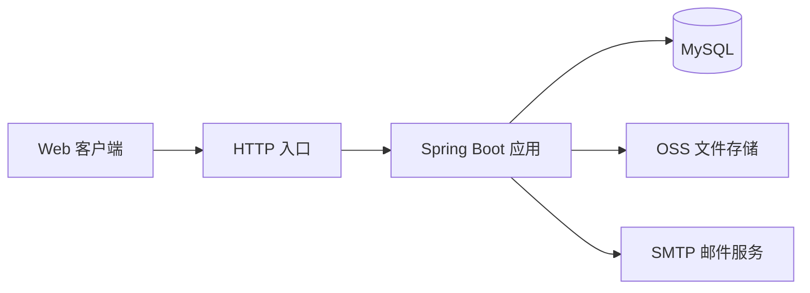
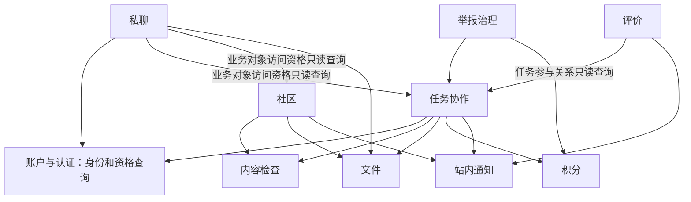
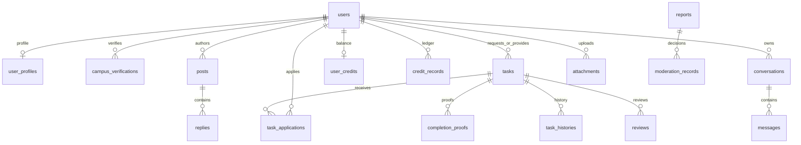
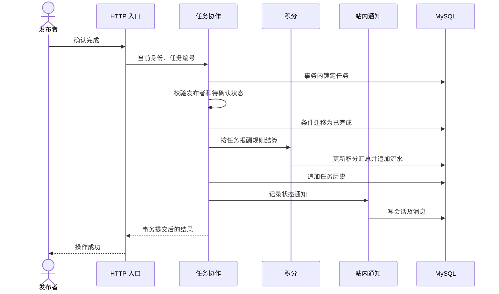

# CampusBridge 系统架构设计

**版本：** 1.1 · **更新日期：** 2026-11-16

本文依据 [SRS](srs.md)，规定系统技术选型、模块职责、数据归属、核心协作和一致性机制，作为实现与重构的设计依据。接口字段由代码及 [OpenAPI](openapi.yaml) 维护，完整数据库结构由 [Schema](../backend/sql/schema.sql) 及迁移脚本维护；实现差距记录在评审中。

## 1. 架构目标与技术选择

CampusBridge 采用前后端分离的模块化单体。任务、申请、履约、积分和站内通知具有紧密的一致性关系，由同一后端和同一关系数据库承载，通过本地事务协调。浏览器负责交互与状态呈现，服务端负责权限、业务规则和最终数据结果。

| 层次 | 选择 | 职责与理由 |
| --- | --- | --- |
| Web | Vue 3、Vue Router、Vite，原生 fetch 请求封装 | 页面路由、表单交互、公共内容与个人工作区；共享认证及错误处理 |
| 应用 | Java 17、Spring Boot 3、Spring MVC | 单个后端进程提供 HTTP API，便于统一业务事务与交付 |
| 安全 | Spring Security、JWT、BCrypt | 认证入口统一，角色与账号启用状态实时校验，密码不可逆存储 |
| 持久化 | MyBatis、MySQL 8 / InnoDB | 显式 SQL 表达聚合查询、行锁与条件更新，数据库约束维护唯一关系 |
| 文件 | 阿里云 OSS，MySQL 保存元数据 | 文件字节与关系数据分离，业务模块负责使用资格 |
| 邮件 | Spring Mail / SMTP | 发送账号及校园邮箱验证码 |
| 调度与通知 | Spring 定时任务、数据库站内消息、HTTP 查询 | 超时处理以持久化状态为依据；消息通过普通 HTTP 获取 |
| 接口描述 | 从 Controller/DTO 导出 OpenAPI | 接口结构随代码维护，消除独立手写清单的漂移 |

依赖具体版本由构建文件管理，升级时核对兼容性。部署规模按单实例应用与单 MySQL 数据源组织；扩容涉及验证码共享和调度协调时单独设计。

## 2. 系统边界

HTTP 入口负责页面资源与业务请求转发。业务 API 的身份、权限和资源归属由后端执行；对象存储的私密材料通过受控访问策略提供，不能只凭业务页面隐藏链接保护文件。

MySQL 保存业务结果及恢复所需记录。文件存储与数据库分别持久化，备份恢复应保留它们的引用关系。邮件发送是外部 I/O，投递结果不能由数据库提交成功推断。目标部署的 TLS、网络暴露和备份要求在[待决事项](open-questions.md)中确定，具体操作见运行说明。

## 3. 模块职责与数据所有权

顶层按业务域组织代码，模块内保持 Controller → Service → Mapper 的单向调用。Controller 负责身份取得、请求转换和结果输出；Service 负责业务条件、跨模块协作及事务；Mapper 负责查询和持久化。状态、角色、类型、排序及错误码采用强类型枚举。

每组数据由所属模块维护写入规则。跨模块写入通过公开业务能力完成，调用方不能直接修改对方表或绕过其校验。

| 模块 | 公开业务能力 | 管理的数据 | 主要业务依赖 |
| --- | --- | --- | --- |
| 账户与校园认证 | 注册登录、资料与账号维护、校园认证提交/确认/审核；提供当前账号与认证资格 | users、user_profiles、campus_verifications | 验证码投递基础设施 |
| 社区 | 帖子发布与编辑、回复、点赞收藏、采纳 | posts、replies、post_interactions | 内容检查、附件、站内通知 |
| 任务协作 | 发布/草稿、申请与选人、履约、取消退出、重发、争议裁决、超时处理 | tasks、task_applications、completion_proofs、task_histories | 账户资格、内容检查、附件、积分、站内通知 |
| 积分与评价 | 积分增减及流水、等级计算；参与者互评与评价查询 | user_credits、credit_records、reviews | 任务只读参与关系、站内通知 |
| 沟通与通知 | 建立私聊、发送与读取消息、已读、拉黑；写入系统通知 | conversations、messages、user_blocks | 账号状态、业务对象访问资格、附件 |
| 举报治理 | 举报提交、查询和一次性裁决 | reports、moderation_records | 目标只读资格、任务争议能力、积分 |
| 文件 | 上传、元数据查询、临时附件校验与业务绑定 | attachments | OSS 客户端 |
| 管理统计 | 总览、趋势、状态分布与待办查询 | 只读统计结果 | 各模块的受控只读查询 |

任务历史属于任务协作模块，记录状态流转与相关业务动作；举报裁决、积分流水和消息各自保留领域所需记录，不合并为无业务含义的通用日志。

### 3.1 依赖方向

私聊与站内通知同属沟通领域，但职责分开：通知写入只接收业务事件所需的收件人、上下文和内容，不反向调用任务业务；私聊建立才查询关联对象的访问资格。评价查询任务参与关系，任务详情的评价组合由查询服务完成，避免任务写服务与评价写服务形成相互调用。

管理端复用同一套领域能力：任务裁决通过任务服务，认证审核通过认证服务，举报处罚通过积分服务。统计查询不得修改来源数据。

## 4. 关键数据关系

图表示核心关系。附件及举报以类型和编号引用不同业务对象，其访问资格与生命周期由业务能力检查；完整字段、索引和外键见 Schema。

| 数据关系 | 设计约束及责任 |
| --- | --- |
| 账号 | 用户名和手机号哈希唯一；公开资料与登录、权限字段分离；普通资料更新只影响允许字段 |
| 认证 | 保留用户认证记录及审核结果；待审更新以预期状态为条件，终态不可被重复确认或撤回覆盖 |
| 帖子 | 采纳关系保存在帖子；回复及互动计数以独立更新维护，避免旧内容快照覆盖新计数 |
| 申请 | task_id + applicant_id 唯一，撤回后重申沿用申请记录；选人同时维护任务与申请结果 |
| 凭证与历史 | 一项任务可多次提交凭证，历史保留每次状态动作；详情返回范围受参与关系约束 |
| 积分 | 每用户一条汇总，增减同时追加来源明确的流水；业务幂等由触发动作保证 |
| 评价 | 每任务每评价者唯一，业务层验证被评价者为另一参与方 |
| 私聊 | 每用户拥有独立会话视图，同一 owner 与 peer 的可回复私聊唯一 |
| 系统会话 | 同一 owner 与业务上下文唯一；通知内容是消息记录，业务事件不得因重试重复生效 |
| 附件 | 上传者、用途、临时状态及绑定对象明确；临时附件只能成功绑定一次 |
| 举报 | 待处理状态与裁决历史分别记录；同一举报只允许一次终态处理 |
| 拉黑 | 按发起方与被拉黑方唯一保存；沟通判断任一方向的禁止关系 |

草稿与正式任务共用任务模型。数据库允许草稿字段缺失，领域服务在正式发布时强制完整性校验；字段可空不等于正式任务可以缺字段。

## 5. 核心流程与一致性边界

任务协作负责组织“发布 → 申请 → 选人 → 履约 → 确认/争议 → 结算”的状态变化。具体状态资格和处罚数值以 SRS 为准；本节定义一次业务动作必须共同提交的数据。

| 业务动作 | 事务内的一致性范围 | 失败处理 |
| --- | --- | --- |
| 发布或保存草稿 | 任务及创建历史；正式发布前完成资格、字段和内容检查 | 校验失败不创建任务 |
| 选择接单者 | 任务及 provider、目标申请接受、其他待选申请拒绝、历史及通知 | 任一写入失败全部回滚 |
| 提交完成 | 凭证、附件绑定、待确认状态、历史及通知 | 附件不可用时不留下凭证或新状态 |
| 确认或自动完成 | 完成状态、适用积分汇总与流水、历史及通知 | 保留原状态；不得出现已完成但缺结算 |
| 取消或退出 | 任务状态、接单关系与适用申请变更、适用处罚、历史及通知 | 原状态及积分保持一致 |
| 重发 | 完整发布条件复核、任务重新开放、接单关系清理、历史 | 校验失败保留原任务 |
| 任务争议裁决 | 裁决后的任务状态、对应奖励或处罚、历史及通知 | 重复裁决不得重复扣分或奖励 |
| 举报处理 | 举报终态、裁决记录、适用积分和任务争议动作 | 失败回滚本次裁决关联写入 |
| 回复或互动 | 回复/互动记录、对应计数及适用通知 | 不保留孤立计数或重复互动 |
| 发消息 | 双方会话更新时间、双方消息副本、图片附件绑定 | 不向其中一方留下单独成功副本 |

站内通知是数据库写入，参与发起业务的本地事务。SMTP、OSS 等外部调用位于数据库事务和锁持有期之外，其失败通过对应的外部调用结果与补偿策略处理。

### 5.1 完成确认协作

相同任务的确认、取消、争议及自动处理必须根据锁内取得的最新状态裁决。不能根据客户端按钮状态或事务外的旧查询结果推进。

### 5.2 锁、条件更新和唯一约束

- 任务竞争操作先锁任务，再判断操作者与状态。状态更新包含预期状态，并检查影响行数；任务与申请使用一致的锁顺序。
- 积分首次建档由用户唯一约束保证，再锁定汇总行累计并写流水。同一业务动作只调用一次积分变化，不能把流水的来源字段当成自动去重机制。
- 双向会话按用户编号固定顺序创建，发送时按会话编号升序锁定双方记录。并发创建冲突后读取已存在会话。
- 附件绑定按编号固定顺序执行条件更新，条件包括上传者、用途、临时状态及尚未绑定。失败时回滚所属业务动作。
- 举报及认证终态处理以待处理状态作为条件；唯一键负责数据唯一性，业务层负责将冲突转换为可识别结果。

重复请求的返回语义按业务契约区分：已存在的会话可以复用，重复评价或非法状态迁移返回冲突。无论返回何种结果，都不得重复产生已生效的业务副作用。

## 6. 超时处理与恢复

调度器只触发任务协作模块的超时能力，不直接修改任务表。候选查询与最终处理分离：按条件分批查询候选，每项在独立短事务中锁定任务，重新检查状态、业务时间和提醒记录，再执行提醒或状态迁移。

待接单与待确认分别依据 SRS 定义的起算时间。提醒记录应能识别所属状态阶段，任务退出重开、驳回再提交等操作不能错误复用旧阶段的提醒。服务重启后从持久化状态和历史继续判断，不依赖内存定时器保存每项任务的期限。

人工操作与扫描竞争时，以合法生效的状态迁移为准。自动完成沿用人工确认的积分、历史及通知能力；扫描批次不长期持有全部候选任务的锁。

## 7. 查询与数据可见性

公共查询在数据库层施加状态与权限条件，再执行计数、排序和分页。任务私有状态不能通过用户提供的 status 参数绕过过滤；管理查询使用明确的受权入口。

统一内容流在数据库组合帖子与任务，用相同筛选条件生成列表与总数，先对全部匹配结果排序再分页。不得先截断各来源再在内存中拼页。任务详情先验证任务可见性，再决定是否加载参与者专属的凭证、附件、历史和评价；游客敏感字段在响应视图中剔除。

公开响应使用明确的 DTO。实体只服务于持久化，不能因直接序列化实体而泄露手机号、实名、验证码内部信息或新增管理字段。输入 DTO 与公开响应分别建模，普通更新不接受角色、账号启用状态和资源归属的任意覆盖。

## 8. 认证与外部服务边界

### 8.1 认证和验证码

Spring Security 统一完成访问令牌校验和角色判断，业务服务负责资源归属与操作资格。每次受限请求读取账号当前启用状态与角色，使禁用和降权及时生效。访问令牌与刷新令牌用途分离，客户端自报用户编号不参与身份判定。

验证码按注册、改邮箱及校园认证区分用途，保存校验信息、接收地址和有效期；成功确认只能消费一次，再次发送替换原挑战。客户端查询不返回验证码哈希。共享存储、发送频率及账号撤销策略见待决事项，不能由不同业务入口各自定义。

### 8.2 文件与邮件

文件模块管理“上传临时资源 → 业务校验 → 绑定”的生命周期。业务提交传入附件编号，由文件能力校验上传者及用途，绑定与业务数据参加同一本地事务。OSS 上传先完成外部调用，再以短事务保存元数据；对象已写入但元数据失败、未绑定对象和已删除业务附件的清理由统一策略处理。

私密材料的元数据查询权限与文件字节访问权限分别控制。不能将公开 URL 当成私有资源授权机制。私有对象访问方式、密钥和清理策略在待决事项第 3 节确定。

验证码邮件的发送与确认记录相互区分：发送调用成功只表示发送服务接受调用，不证明用户收件；邮件失败不能自动确认邮箱。外部发送调用不持有业务数据库行锁。学生证认证由人工审核完成，自动 OCR 的资格和匹配规则独立裁决。

## 9. 接口与数据演进

HTTP 请求及响应使用强类型 DTO，业务失败通过统一异常及安全入口转换。具体外层字段、动态载荷的兼容情况和调用方式见接口使用说明；架构只规定身份来源、分层责任和错误处理边界。

OpenAPI 从代码导出，验证路由覆盖及关键 Schema；修改 DTO、枚举或契约后同步导出。业务变化先更新 SRS，对应的架构机制、数据库结构、前端调用和验收场景随之调整。

数据库初始化脚本描述完整结构，迁移脚本表达已有数据的升级。涉及会话合并、引用重定向和新增唯一约束时，在停止写入的窗口执行，并检查历史消息、附件及关系完整性。运行命令、测试库约束和具体迁移顺序在开发运行说明中维护。
