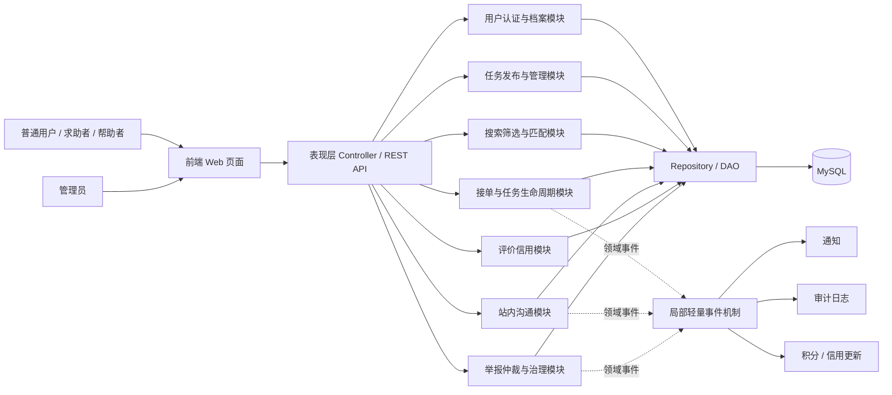
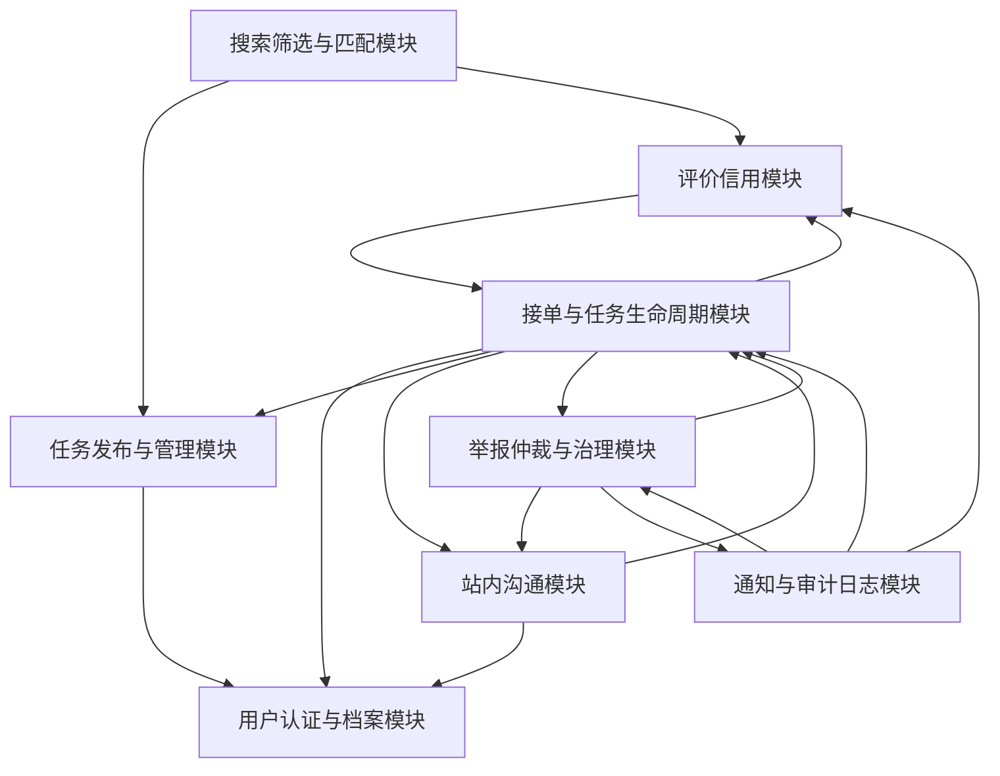

# CampusBridge 架构设计文档

## 1. 架构概览

### 1.1 架构选择

CampusBridge 采用**前后端分离的模块化单体架构**。系统整体以分层架构为主，表现层采用 MVC/REST 风格；对于通知、审计日志、积分/信用更新等辅助流程，预留局部轻量事件机制，但不采用微服务作为当前主架构。

该选择的主要依据是：

- 现有技术栈已经是 Vue 3 + Vite 前端与 Spring Boot 3 后端，天然适合前后端分离。
- 项目周期为 10 周，团队规模较小，需要优先保障核心互助闭环的完整性和可交付性。
- 校园互助平台的核心需求是认证、发布、接单、沟通、确认完成、评价、举报仲裁，而不是分布式治理能力。
- 分层单体更利于调试、联调、测试和文档表达，也更适合当前工程基础。

### 1.2 总体架构图



### 1.3 分层关系说明

- 表现层：负责接收前端请求、参数校验、权限检查、统一响应封装。
- 业务层：负责业务规则、状态流转、权限判断、评价与治理逻辑。
- 数据访问层：负责数据库读写，不直接承载业务规则。
- 数据存储层：当前使用 MySQL 统一存储核心业务数据。

## 2. 模块划分说明

### 2.1 后端核心模块

| 模块 | 主要职责 | 主要输入/输出 |
|---|---|---|
| 用户认证与档案模块 | 校内身份认证、登录注册、用户档案维护、角色与权限管理、隐私字段控制 | 输入：认证信息、档案编辑请求；输出：用户身份状态、公开档案信息 |
| 任务发布与管理模块 | 创建任务、编辑草稿、取消/重发、分类管理、任务详情维护 | 输入：任务表单、分类信息；输出：任务记录、任务详情 |
| 搜索筛选与匹配模块 | 任务列表浏览、关键词搜索、分类筛选、按校区/信用/标签排序、轻量推荐 | 输入：查询条件；输出：任务列表、推荐结果 |
| 接单与任务生命周期模块 | 申请接单、选择帮助者、状态流转、超时处理、完成确认主流程编排 | 输入：接单申请、状态变更请求；输出：任务状态、候选者列表、处理结果 |
| 站内沟通模块 | 站内文字/图片消息、会话管理、与任务相关的沟通记录保存 | 输入：消息内容、会话请求；输出：聊天记录、会话摘要 |
| 评价信用模块 | 双向评价、信用记录计算、积分变更记录、信用展示 | 输入：评分、评价文字、任务完成结果；输出：评价记录、信用记录、积分变化 |
| 举报仲裁与治理模块 | 举报、申诉、敏感任务审核、违规拦截、处罚记录 | 输入：举报信息、申诉材料、审核动作；输出：处理结论、处罚结果、审核状态 |
| 通知与审计日志模块 | 发送系统通知、记录关键操作日志、为后续追责和审计提供证据 | 输入：业务事件、操作记录；输出：通知消息、审计日志 |

### 2.2 前端页面模块

| 模块 | 主要职责 |
|---|---|
| 认证与个人中心 | 登录、认证、档案查看与编辑 |
| 任务大厅 | 任务浏览、搜索、筛选、查看详情 |
| 发布与编辑页 | 发布任务、保存草稿、修改任务 |
| 接单与任务管理页 | 申请接单、查看候选者、状态推进、确认完成 |
| 消息中心 | 站内聊天、通知提醒 |
| 评价与举报页 | 评价、申诉、举报、查看处理结果 |
| 管理后台页面 | 审核敏感任务、处理举报、查看日志摘要 |

### 2.3 模块依赖图



### 2.4 模块依赖原则

- 前端只通过 REST API 与后端交互，不直接访问数据库。
- 后端采用 `Controller -> Service -> Repository/DAO` 的分层调用。
- 任务生命周期模块是系统核心协调模块，主导接单、完成确认、取消、争议等状态变化。
- 通知与审计日志模块尽量通过轻量事件机制或服务调用接收业务结果，避免侵入主流程。
- 模块之间通过清晰的应用服务接口协作，不跨层直接访问其他模块的数据访问层。

### 2.5 接口方式

| 接口类型 | 使用位置 | 数据格式 |
|---|---|---|
| REST API | 前端与后端之间的主要交互方式 | JSON |
| Service 接口调用 | 后端模块之间协作 | Java 对象 / DTO |
| 轻量事件机制 | 通知、日志、积分/信用等辅助流程 | 领域事件对象 |

## 3. 技术选型说明

### 3.1 技术选型表

| 层次 | 选择 | 选择理由 |
|---|---|---|
| 前端框架 | Vue 3 + Vite + Vue Router | 与现有工程一致，开发门槛低，适合快速构建课程项目页面 |
| 后端框架 | Java 17 + Spring Boot 3 | 与现有后端骨架一致，适合 REST API、分层开发和模块化组织 |
| 表现层风格 | MVC/REST | 适合前后端分离场景，便于接口联调和职责分离 |
| 数据库 | MySQL | 结构化数据清晰，适合用户、任务、评价、举报、日志等核心业务数据存储 |
| 数据访问 | Repository/DAO 模式 | 与分层架构匹配，便于隔离 SQL 与业务逻辑 |
| 前后端通信 | HTTP + JSON | 简单直接，易于调试和测试 |
| 轻量异步机制 | Spring Event 或普通服务解耦 | 可支持通知、审计、积分更新等辅助逻辑，又不必引入重型 MQ |
| 鉴权与会话 | Spring Boot 鉴权组件 + 后续可扩展 JWT/Session | 当前阶段先保证身份可信与权限控制，具体实现保持轻量 |
| 文件存储 | 本地存储起步，后续可扩展对象存储 | 当前阶段主要支持图片/凭证上传，先控制复杂度 |
| 部署方式 | 前后端分离部署 | 前端静态资源部署简单，后端单体部署成本低，便于演示与答辩 |

### 3.2 暂不引入的技术

| 技术 | 暂不引入原因 |
|---|---|
| 微服务拆分 | 当前团队规模小、周期短，会显著增加联调和运维复杂度 |
| RabbitMQ / Kafka | 当前通知和日志场景可先用轻量事件机制满足 |
| Redis | 当前规模下不是必需组件，可后续用于缓存、验证码、限流 |
| Elasticsearch | 当前搜索规模较小，可先基于数据库查询实现 |
| API Gateway / 服务注册发现 | 单体架构下没有必要，会造成过度设计 |

### 3.3 选型说明

- 前端使用 Vue 3，是因为现有工程已经初始化完成，继续沿用可以降低学习成本和重构成本。
- 后端使用 Spring Boot 3，是因为它与 Java 17、REST API 和分层架构天然契合，适合课程项目快速实现。
- 数据库使用 MySQL，可以统一支撑用户、任务、消息、评价、举报、日志等结构化数据。
- 轻量事件机制被保留，是因为通知、审计和积分更新等辅助流程存在解耦需求；但是否立即实现监听器机制，仍应结合开发进度决定。

## 4. ADR 集合

### ADR-001：采用前后端分离的模块化单体架构

#### 状态
已接受

#### 背景

CampusBridge 是一个 10 周内完成的课程项目，团队规模为 4 人，现有工程已经搭建为 Vue 3 + Vite 前端和 Spring Boot 3 后端。P1 需求明确要求当前阶段优先交付认证、发布、接单、沟通、完成确认、评价信用、举报仲裁等核心业务闭环，同时要求控制复杂度，避免重社交和重运维方案。

在这种前提下，团队需要决定当前项目阶段到底采用单体还是微服务架构。

#### 决策

我们决定采用**前后端分离的模块化单体架构**：前端独立开发与部署，后端整体作为一个 Spring Boot 应用运行；后端内部按业务模块划分代码，但不拆成独立微服务。

#### 理由

1. 单体架构实现难度最低，最符合 10 周课程项目的时间约束。
2. 当前功能重点是把任务闭环做完整，而不是解决大规模分布式系统问题。
3. 模块化单体仍然可以在代码层面划分用户、任务、沟通、评价、治理、通知等边界，足以支撑当前阶段开发。
4. 现有仓库就是单后端服务骨架，继续沿用能最大化复用已有工程。

#### 后果

- 正面影响：开发、调试、联调和部署路径简单，适合小团队协作。
- 正面影响：便于把时间集中投入核心业务，而不是基础设施治理上。
- 负面影响：部署粒度较粗，后续横向扩展能力弱于微服务。
- 负面影响：如果模块边界控制不好，单体后期可能演变为高耦合代码库。
- 需要关注的风险：必须在代码层面维持模块隔离，不能因为“单体”就让所有逻辑互相穿透。

#### AI 辅助记录

- AI 初稿内容摘要：

  > 结合课程约束、现有技术栈和 P1 需求，我建议你们的最终选择是：
  >
  > **模块化单体架构 + 分层架构 + MVC/REST 表现层 + 局部事件机制**
  >
  > 你们的项目不是“超大规模互联网平台”，而是一个 10 周内完成、4 人协作、以“校园互助闭环”为核心的课程项目。
  >
  > `微服务`
  > 不建议第一版采用。原因不是它“不高级”，而是它会额外引入太多与你们当前目标无关的成本：
  > - 服务拆分难
  > - 接口联调复杂
  > - 部署和运维复杂
  > - 数据一致性更难
  > - 调试跨服务问题更痛苦

- 人工修订内容：
```diff
- 模块化单体架构
+ 前后端分离的模块化单体架构；后端整体作为单个 Spring Boot 应用部署

- 单体内部按模块拆分
+ 后端内部按业务模块划分代码，但不拆成独立微服务

- 单体实现成本低
+ 单体实现成本低，但主要风险不是性能，而是后期代码耦合失控，因此要求后续代码结构必须保持模块隔离
```

- 修订理由：

  AI 已经给出正确方向，但对“单体究竟怎么落地”描述还不够具体。课程作业里真正重要的不是口头说“用单体”，而是说明它具体意味着什么部署方式、什么模块粒度，以及会带来什么架构风险。

### ADR-002：后端采用分层架构，业务状态流转集中在 Service 层

#### 状态
已接受

#### 背景

当前系统要同时支持任务发布、接单、进行中、待确认、完成、争议、取消等多种状态，还要联动站内沟通、评价信用、举报仲裁和日志审计。如果缺少清晰的后端分层，这些状态修改很容易散落在多个控制器里，导致状态不一致和业务规则失控。

团队因此需要明确后端代码组织方式，以及核心业务逻辑应该落在哪一层。

#### 决策

我们决定后端采用**`Controller -> Service -> Repository/DAO` 的分层架构**；所有任务状态流转、权限判断、信用更新触发、争议处理入口等核心业务逻辑统一进入 Service 层，尤其由专门的任务生命周期服务集中管理状态变化。

#### 理由

1. 分层架构最适合当前 Spring Boot 项目形态，团队容易理解和执行。
2. 状态流转是本系统最核心的业务规则，必须集中管理，不能散落在多个接口处理函数中。
3. Repository/DAO 只负责数据库读写，便于隔离 SQL 细节，减少业务层和存储层耦合。
4. 这种结构最有利于后续补充测试、接口文档和模块边界说明。

#### 后果

- 正面影响：后端职责边界清楚，更容易定位问题和修改功能。
- 正面影响：任务生命周期规则集中，能够降低状态错乱和重复实现的风险。
- 负面影响：相比随意编码，需要额外设计 Service、DTO 和调用边界，前期工作略多。
- 负面影响：如果 Service 继续无限膨胀，仍可能出现“胖 Service”问题。
- 需要关注的风险：需要尽早定义任务生命周期相关接口和状态枚举，否则后续多人同时改动时容易冲突。

#### AI 辅助记录

- AI 初稿内容摘要：

  > `分层架构`
  > 非常适合你们。前端 Vue 3，后端 Spring Boot，本来就天然适合做表现层、业务层、数据访问层分离。它能很好支撑你们现在最重要的同步主流程：发布任务、接单、确认完成、发起争议。
  >
  > **建议的模块划分**
  >
  > 推荐至少拆成这几个模块：
  > - 用户认证与档案模块
  > - 任务发布与管理模块
  > - 搜索筛选与轻量匹配模块
  > - 接单与任务生命周期模块
  > - 站内沟通模块
  > - 完成确认与评价信用模块
  > - 举报仲裁与治理模块
  > - 通知与审计日志模块
  >
  > 这里面最关键的是把“任务状态流转”集中管理，不要散落在多个 Controller 里。

- 人工修订内容：
```diff
- 分层架构适合项目
+ 明确调用链为 `Controller -> Service -> Repository/DAO`

- 任务状态流转集中管理
+ 任务状态变化只能由生命周期相关 Service 主导，Controller 不直接改状态，Repository 不封装业务规则

- 业务逻辑进入 Service 层
+ 权限判断、信用更新触发、争议处理入口统一进入 Service 层，而不只限制在任务状态流转
```

- 修订理由：

  AI 正确指出了“任务状态流转要集中”，但没有给出足够强的结构性约束。人工修订的重点，是把这个建议变成可执行的代码组织规则，而不只是一个口号。

### ADR-003：表现层采用 MVC/REST，前后端以 JSON 接口协作

#### 状态
已接受

#### 背景

当前前端已经选用 Vue 3，后端为 Spring Boot。团队需要决定：系统表现层是采用服务端渲染式 MVC，还是采用 REST API 的前后端分离模式；同时也需要明确 MVC 在本项目中的位置，避免把 MVC 和全系统主架构混为一谈。

#### 决策

我们决定采用**MVC/REST 表现层**：后端使用 Spring MVC 提供 REST API，前端通过 HTTP 调用接口并以 JSON 交换数据；MVC 仅用于请求处理和职责分离，不作为整个系统的总架构描述。

#### 理由

1. 这与现有 Vue 前端工程完全一致，前后端协作边界清晰。
2. JSON 接口便于本地调试、接口联调和后续接口文档编写。
3. 将 MVC 限定在表现层，可以避免它掩盖业务模块划分和分层架构的主体地位。
4. Spring MVC 已经是当前后端框架的自然实现方式，团队上手成本最低。

#### 后果

- 正面影响：前后端分工明确，前端页面和后端业务可以并行推进。
- 正面影响：接口层职责更清楚，便于统一返回格式和错误处理。
- 负面影响：需要设计 DTO、接口参数校验和统一响应格式，接口层规范工作会增加。
- 负面影响：若接口设计不稳定，前后端联调成本会上升。
- 需要关注的风险：必须尽早固定核心接口风格，尤其是任务、消息、评价、举报几类主流程接口。

#### AI 辅助记录

- AI 初稿内容摘要：

  > `MVC`
  > MVC 适合作为后端表现层组织方式，比如 Spring MVC 的 `Controller -> Service -> Repository`。但它不够作为整个系统的总架构，因为它主要解决的是 Web 请求处理，不足以表达“认证、任务、沟通、治理、信用”这些业务模块边界。
  >
  > **推荐的最终表述**
  >
  > CampusBridge 第一版采用模块化单体架构。系统整体部署为一个 Spring Boot 应用，在内部按业务模块划分，并使用分层架构组织代码；表现层采用 MVC/REST 风格。

- 人工修订内容：
```diff
- 表现层采用 MVC/REST 风格
+ 后端使用 Spring MVC 提供 REST API，前端通过 HTTP 调用接口并交换 JSON 数据

- Controller 负责请求处理
+ Controller 还需统一返回格式、参数校验和错误处理，不能由各接口自由发挥

- MVC 适合作为表现层
+ 明确排除服务端模板渲染作为当前主路线，避免把 MVC 误写成 JSP/Thymeleaf 式页面架构
```

- 修订理由：

  AI 说明了 MVC 该放在哪里，但没有把接口协作方式说透。对课程项目来说，真正需要落地的是“前后端怎么通信、接口返回什么、哪些规范要统一”，这些都是人工补上的关键内容。

### ADR-004：RabbitMQ / Kafka / API Gateway / Elasticsearch 不作为当前阶段必需技术栈

#### 状态
已废弃

#### 背景

部分 AI 初稿提出了更完整的互联网式技术栈，包括 RabbitMQ/Kafka、Redis、Elasticsearch、API Gateway、Prometheus/Grafana、对象存储等。这些建议本身并非错误，但团队需要判断它们是否适合作为当前阶段默认方案。

这一决策关系到当前阶段的工程复杂度、环境配置成本和最终可交付性。

#### 决策

我们决定**废弃“当前阶段默认引入 MQ、网关、全文检索和监控组件”的方案**。在当前阶段，这些技术不作为必需依赖写入正式架构方案。

#### 理由

1. 当前阶段的首要目标是做出稳定、可演示的业务闭环，而不是搭建完整平台基础设施。
2. RabbitMQ/Kafka、API Gateway、Elasticsearch 等组件会明显增加部署、调试和运维难度。
3. 现有后端骨架还处于 Spring Web 基础阶段，贸然扩栈容易拖垮实现进度。
4. 当前需求规模下，用 MySQL + Spring Boot + 轻量事件机制即可满足主要场景。

#### 后果

- 正面影响：技术栈更轻，环境搭建更容易，团队出错面更小。
- 正面影响：把实现重点放回业务功能，而不是中间件整合。
- 负面影响：当前阶段不会具备完整的异步削峰、全文检索和统一网关能力。
- 负面影响：如果后续功能继续扩张，需要重新评估并增量引入这些基础设施。
- 需要关注的风险：虽然现在废弃这些组件作为“必需技术”，但不代表后续文档里完全不提，应保留为可演进方向。

#### AI 辅助记录

- AI 初稿内容摘要：

  > **2. 接入层**
  > - Nginx / API Gateway
  > - 统一鉴权、限流、跨域、路由转发
  >
  > **4. 数据层**
  > - MySQL：核心业务数据
  > - Redis：缓存、会话、热点数据、验证码、限流
  > - Elasticsearch（可选）：任务搜索、关键词检索
  > - 对象存储：头像、任务图片、凭证材料
  >
  > **5. 异步支撑层**
  > - RabbitMQ / Kafka（初期 RabbitMQ 更合适）
  >
  > **“前后端分离的模块化单体架构，配合 MySQL + Redis + MQ，预留微服务演进能力。”**

- 人工修订内容：
```diff
- API Gateway、RabbitMQ/Kafka、Elasticsearch 作为默认组件
+ 删除这些组件作为当前阶段默认组件的定位

- Redis、对象存储、全文检索、网关和监控属于当前方案
+ 将这些内容调整为后续可能引入的优化能力

- MySQL + Redis + MQ
+ 当前只保留 MySQL 作为明确确定的核心数据存储，避免当前阶段技术栈膨胀
```

- 修订理由：

  这条修订不是语言收缩，而是实打实地砍掉了多个 AI 推荐的默认基础设施。这样做的核心原因是项目约束和工程现实不支持这些组件在当前阶段同时落地。

### ADR-005：通知、审计日志、积分/信用更新采用局部轻量事件机制

#### 状态
待讨论

#### 背景

任务状态变化后，系统往往需要顺带触发多种辅助操作，例如发送站内通知、记录审计日志、更新积分或信用记录。若这些逻辑全部直接写进主业务 Service，会让主流程代码迅速膨胀；但如果一开始就全面引入消息队列，又会增加过高的实现成本。

因此，团队需要决定是否在当前阶段引入“轻量事件机制”，以及其适用范围。

#### 决策

当前倾向于采用**局部轻量事件机制**，例如 Spring Event 或同等轻量发布/订阅方式，仅用于通知、审计日志、积分/信用更新等辅助流程；但具体是否在当前阶段编码实现，还是先用普通 Service 调用保留接口，需要结合实际开发进度再确认。

#### 理由

1. 这类辅助逻辑天然适合从主业务流程中解耦出来。
2. 轻量事件机制能在不引入 MQ 的前提下提供一定解耦收益。
3. 如果时间紧张，先用普通 Service 调用也能实现功能闭环，因此这一决策暂时保留弹性。
4. 需要根据站内消息、日志和信用更新的最终实现复杂度来判断是否值得在当前阶段落地事件监听器。

#### 后果

- 正面影响：如果采用事件机制，主业务 Service 会更简洁，辅助逻辑更容易扩展。
- 正面影响：后续引入真正消息队列时，事件边界更容易平滑迁移。
- 负面影响：如果设计不当，会出现同步业务和事件监听职责边界不清的问题。
- 负面影响：若为了“形式上用事件”而引入过多抽象，可能反而增加当前实现复杂度。
- 需要关注的风险：必须严格限制事件机制的使用范围，不能让任务状态推进、举报仲裁结论等主决策逻辑依赖异步事件完成。

#### AI 辅助记录

- AI 初稿内容摘要：

  来自“直接问推荐什么架构”的 AI 回答：

  > 对于通知、日志、积分更新这类非主流程逻辑，可以使用轻量事件机制解耦，但不引入独立消息中间件作为第一版必需组件。

  来自“对比多种方案的优劣”的 AI 回答：

  > **善用事件优化内部**：在单体内部，可以用 Spring Event 或类似的轻量级发布/订阅模型来解耦核心业务与通知等辅助逻辑。比如，任务状态变为“已完成”后，发布事件触发积分更新和站内信通知。

- 人工修订内容：
```diff
- 轻量事件机制用于系统解耦
+ 轻量事件机制只允许用于通知、审计日志、积分/信用更新，不承载任务主状态流转或争议裁决

- 采用 Spring Event 等机制
+ 是否在当前阶段真正实现监听器保持待讨论，普通 Service 调用也可作为备选落地方式

- 引入事件机制优化内部协作
+ 先定义事件边界，再决定是否实现事件框架，避免为形式而提前引入不必要抽象
```

- 修订理由：

  AI 提供了合理方向，但默认倾向直接采用事件机制。人工修订后，把它从“直接落地决定”改成“范围明确、实现方式待讨论”的 ADR，更符合课程项目里按进度取舍的实际情况。
