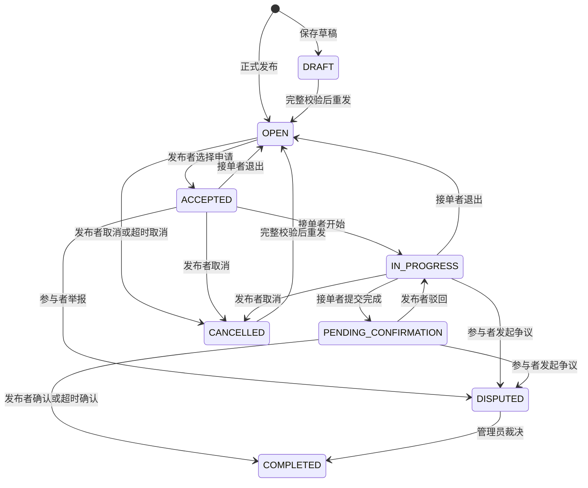

# CampusBridge 软件需求规格

**版本：** 1.1 · **更新日期：** 2026-11-16

**用途：** 定义后续开发与验收应遵循的业务规格。尚未确定的规则在[待决事项](open-questions.md)中集中裁决；实现差距与验证结果由评审记录维护。

## 1. 目的与范围

CampusBridge 为校园用户提供公开信息交流、跑腿与代办协作，以及围绕这些活动的站内沟通。主要流程是：发布者提出任务，其他用户申请，发布者选定一名接单者，双方完成履约、确认、积分结算和评价。社区帖子承载询问求助、二手交流、组队交友和校园社交。

系统范围包括账号与资料、校园认证、帖子与回复、任务与申请、完成凭证、评价积分、私聊与拉黑、站内通知、举报和管理员处理。现金报酬仅作为双方协商的信息记录，平台没有支付、资金托管或退款流程。

本文使用“发布者”表示提出任务的用户，“接单者”表示已被选定的执行者，“参与者”仅指这两人，申请者不自动成为参与者。FR 表示功能需求，NFR 表示非功能需求；各节验收条件用于设计测试和判断实现是否符合规格。

## 2. 身份与访问范围

| 身份或关系 | 权限 |
| --- | --- |
| 游客 | 浏览首页、公开内容、公开帖子与任务、用户公开主页及收到的评价 |
| 登录用户 | 发帖、回复、点赞和收藏；申请他人任务；管理本人资料、认证、申请、会话、拉黑及举报 |
| 校园认证通过的用户 | 在登录用户权限上，增加正式创建任务、保存服务端草稿和重发任务 |
| 任务发布者 | 查看本任务申请；选择接单者；在允许状态编辑、取消、确认或驳回完成；读取本人私有任务 |
| 选定的接单者 | 开始、提交完成、退出本人承担的任务；与发布者互评 |
| 任务双方 | 查看履约凭证、凭证附件元数据、任务历史及详情内评价；按状态发起争议 |
| 管理员 | 访问管理接口，处理校园认证、待审任务、举报和争议，查看管理统计 |

**FR-AUTH-01 身份校验。** 受限操作使用有效访问令牌；账号禁用及角色变更在下一次请求时生效。禁用账号的旧令牌不能继续使用，普通注册只能取得 USER 角色。校园认证与管理员角色分别管理，管理员身份不自动代替任务发布所需的校园认证。

**FR-AUTH-02 对象归属。** 修改账号资料、读取私聊及申请记录等操作使用当前登录身份。任务、帖子和会话按各自规则检查归属；前端隐藏按钮不构成权限校验。

### 可见性规则

| 对象 | 列表与详情规则 |
| --- | --- |
| 帖子 | 公共查询限 PUBLISHED、CLOSED；统一内容流默认仅 PUBLISHED，明确筛选 CLOSED 时可返回关闭帖子。非公开帖子详情仅作者可读，DELETED 对作者也按不存在处理 |
| 任务 | 公共列表始终排除 DRAFT、PENDING_REVIEW、REJECTED；默认再排除 CANCELLED、DISPUTED，明确筛选后二者可见。前三种私有状态详情仅发布者可读 |
| 游客任务信息 | 列表及详情隐藏 providerId、providerName、routeHint、sensitiveReason；校区、地点等任务公开信息仍可见 |
| 履约信息 | 非任务参与者的详情不返回完成凭证、凭证附件、历史和详情内评价；公开用户评价查询另按其接口开放 |
| 私聊与通知 | 每个账号只能读取自己的会话视图及其中消息 |
| 附件 | 业务接口控制附件元数据的返回范围；公开附件随公开内容访问；私密材料的文件读取也须检查权限 |

**验收条件**

| 前置条件与操作 | 预期结果 |
| --- | --- |
| 游客请求任务发布、私聊发送；普通用户请求管理接口 | 分别拒绝为未认证、无管理权限 |
| 用户 A 读取用户 B 的草稿或待审任务 | 返回任务不存在，不能靠指定 status 在公共列表中取出 |
| 游客与非参与登录用户分别读取公开任务详情 | 游客敏感字段为空；两者均没有履约凭证及任务历史 |
| 禁用已登录账号，再用原访问令牌调用受限接口 | 拒绝；重新登录同样被拒绝 |

## 3. 账号、资料与校园认证

### 3.1 注册、登录和账号维护

**FR-AUTH-03 注册。** 用户提交用户名、密码、手机号、邮箱和邮箱验证码，五项均非空。用户名及手机号查重；邮箱先去除首尾空白并转为小写，可由多个账号使用。验证码验证成功后单次消费，普通账号创建为启用状态。服务端校验必填性、长度和格式，失败时明确提示字段及原因。注册密码强度与账号字段上限见待决事项第 1 节，确定后统一用于注册和修改。

**FR-AUTH-04 登录。** 用户名和密码匹配且账号启用时，返回用户编号、用户名、角色、访问令牌和刷新令牌。访问令牌到期后重新登录。修改密码须校验原密码，新密码至少 6 位。令牌刷新和改密后的设备撤销规则见待决事项第 2 节。

**FR-AUTH-05 账号及资料修改。**

| 内容 | 条件与结果 |
| --- | --- |
| 修改邮箱 | 先向新邮箱发送验证码，再提交验证码确认；成功后替换当前邮箱，错误或过期验证码不能生效 |
| 修改手机号 | 非空值须匹配中国大陆手机号格式并检查重复；空值可清除手机号 |
| 公开资料 | 可维护昵称、简介、校区、院系、联系方式、头像 URL、兴趣和技能标签；公开主页展示用户主动提供的资料及认证、积分摘要 |
| 头像 | 可上传文件取得头像地址；文件存储依赖 OSS |
| 权限字段 | 普通资料及账号修改不修改 role、enabled 等权限字段 |

注册及改邮箱验证码有效期为 10 分钟；再次发送会替换同一用途的原验证码。邮件正常由 SMTP 投递，调试回显须显式启用。

### 3.2 校园认证

**FR-VERIFY-01 提交条件。** 认证方式、姓名、学号和学校必填，院系选填。方式与材料如下：

| 方式 | 附加条件 | 提交后的处理 |
| --- | --- | --- |
| STUDENT_CARD_IMAGE | evidenceUrl 非空 | 保存 PENDING，由管理员审核 |
| MANUAL_REVIEW | evidenceUrl 非空 | 保存 PENDING，由管理员审核 |
| CAMPUS_EMAIL | campusEmail 符合以 .edu.cn 结尾的校园邮箱格式 | 保存 PENDING 并发送验证码，确认正确后成为 VERIFIED |

**FR-VERIFY-02 状态和重提。** 没有记录表示未认证；提交新记录时直接为 PENDING。已有 VERIFIED 时拒绝重复提交。已有 PENDING 时一般拒绝重提，校园邮箱待审记录可以再次提交校园邮箱材料并替换验证码。REJECTED 后可以重新提交；撤回只删除本人当前 PENDING 记录。

**FR-VERIFY-03 审核。** 管理员只能将 PENDING 变为 VERIFIED 或 REJECTED，保存审核人和时间；拒绝原因省略时使用默认原因。并发审核、撤回与验证码确认只能让合法的待审记录变更一次。

**FR-VERIFY-04 邮箱确认。** 校园邮箱验证码有效期为 10 分钟，只对当前 CAMPUS_EMAIL 待审记录生效。普通查询返回邮箱，不暴露验证码哈希及内部挑战串。学生证和人工审核的通过结果由管理员裁定。

**验收条件**

| 前置条件与操作 | 预期结果 |
| --- | --- |
| 以重复用户名或手机号注册；使用错误、过期或已消费的验证码 | 拒绝，不创建新账号 |
| 同一注册验证码并发提交两次 | 至多一次消费成功 |
| 使用错误原密码改密；普通资料请求夹带角色字段 | 原密码保持有效；权限字段不变 |
| 校园邮箱输入非 .edu.cn 邮箱；图片认证缺材料 URL | 拒绝提交 |
| 已通过的认证被重复审核或撤回 | 拒绝，保留原终态 |
| 学生证提交成功后立即查询 | 状态为 PENDING，不能把请求成功当作认证通过 |

## 4. 社区帖子、回复和互动

**FR-POST-01 发布。** 登录用户可发帖。类别为 INQUIRY_HELP、SECOND_HAND、TEAM_FRIEND、CAMPUS_SOCIAL；类别、标题和正文必填，标题最多 100 字符，正文不能全为空白。合法发布直接为 PUBLISHED。可绑定最多 9 个本人上传、用途为 POST、尚未绑定的临时附件；附件编号不得重复或为空。

**FR-POST-02 编辑与删除。** 作者编辑时完整提交非空标题和正文，并重新接受内容检查。状态修改只接受 PUBLISHED 或 CLOSED，且原状态须为 PUBLISHED、CLOSED 或 DRAFT；作者不能自行公开被隐藏、拒绝或待审的帖子。编辑不提供类别和附件替换字段。删除设为 DELETED，保留回复及引用关系；关联附件的保留与清理遵循统一文件策略。

**FR-POST-03 回复。** 只有 PUBLISHED 帖子接受新回复，回复正文非空。引用父回复时，该回复须属于同一帖子且为 PUBLISHED。成功增加回复数并产生通知；关闭帖子仍可查看，但不能继续回复。帖子详情应能查看回复及其父子关系。

**FR-POST-04 点赞、收藏和采纳。** 点赞 LIKE、收藏 MARK 分别按用户和帖子唯一。重复添加返回冲突；取消不存在的互动返回参数错误，均不重复改变计数。作者可采纳本帖中仍为 PUBLISHED 的回复，帖子保存所选回复编号；后续采纳可以替换原编号。

### 内容检查

**FR-CONTENT-01 发布拦截。** 帖子标题和正文、任务标题/描述/报酬说明/完成标准/敏感原因执行不区分英文字母大小写的子串匹配。命中以下词语直接拒绝发布或编辑，不自动转入待审核：

- 高风险词：代考、替考、代签到、代出勤、代上课、代课、签到、作弊、刷课、买卖答案、赌博、诈骗、校园贷、管制刀具、处方药。
- 联系方式词：微信、vx、qq、电话、手机号、加我。帖子始终检查；任务仅在 onlyInAppContact 为 true 时检查。

该检查按字面命中，包含这些词的讨论、否定句也可能被拦截。

**验收条件**

| 操作 | 预期结果 |
| --- | --- |
| 登录但未校园认证的账号发合法帖子 | 允许发布 |
| 帖子作者编辑标题，同时另一用户回复或点赞 | 正文修改与计数均保留，不能相互覆盖 |
| 对 CLOSED 帖子回复；引用其他帖子的回复 | 拒绝，不增加回复数 |
| 重复点赞、重复取消收藏；采纳其他帖子的回复 | 拒绝，不产生额外互动或错误采纳关系 |
| 删除有回复的帖子后读取公共详情 | 按不存在处理，原回复关系仍保留 |
| 发布正文含“签到”或“微信”的帖子 | 命中对应规则并拒绝 |

## 5. 任务发布、草稿和查询

### 5.1 发布字段

**FR-TASK-01 正式发布。** 发布者须已完成校园认证。类别为 ERRAND（跑腿）或 AGENCY（代办）；合法创建直接进入 OPEN。

| 字段 | 正式发布规则 | 草稿规则 |
| --- | --- | --- |
| category | 必填，ERRAND / AGENCY | 可省略 |
| title | 非空，最多 100 字符 | 可省略；填写时同样限制长度 |
| description | 非空，最多 2000 字符 | 可省略；填写时同样限制长度 |
| campus | 非空，最多 50 字符 | 可省略；填写时同样限制长度 |
| location | 非空，最多 120 字符 | 可省略；填写时同样限制长度 |
| deliveryLocation | 选填，最多 120 字符 | 相同 |
| deadline | 必填，严格晚于提交时的当前时间 | 可省略，可保存已过期时间 |
| rewardType | 必填，FREE / POINTS / CASH / NEGOTIABLE | 可省略 |
| rewardDescription | 选填，最多 200 字符 | 相同 |
| rewardAmount | 选填正整数；POINTS 时最多 10 | 相同；省略不产生报酬积分 |
| completionStandard | 非空，最多 500 字符 | 可省略；填写时同样限制长度 |
| requiresProof | 必填布尔值 | 省略按 false 保存 |
| onlyInAppContact | 省略为 true | 相同 |
| allowOfflineContact、isInstantTask、riskDisclosureConfirmed | 省略为 false | 相同 |
| routeHint、sensitiveReason | 各最多 300 字符 | 相同 |
| attachmentIds | 省略或空列表；发布附件为范围外能力 | 相同 |

requiresProof 表示任务的凭证提示；提交完成说明即可构成履约提交，图片为可选补充。allowOfflineContact、isInstantTask、riskDisclosureConfirmed 分别记录联系偏好、即时任务及风险确认信息；任务仍按本规格的申请、选人和履约流程推进。

**FR-TASK-02 草稿。** 已认证用户可保存 DRAFT；只有发布者可读取、修改和删除。保存草稿允许缺少正式发布字段，编辑应能补全类别、校区、地点等全部发布信息。草稿发布时重新执行正式发布校验，失败时保留草稿及已填写内容。前端保存失败须保留用户输入并允许重试，不能显示为保存成功。

**FR-TASK-03 编辑和重发。** 发布者可编辑 DRAFT 或 OPEN，编辑时完整提交允许修改的字段，必填内容及截止时间须有效，可选奖励说明和金额留空时清除原值；OPEN 编辑须通过内容检查，已经选人的任务拒绝此类编辑。草稿保存允许信息未填完整。DRAFT 发布、CANCELLED 重发均提交完整发布表单，可修订内容及截止时间，重新检查校园认证、未来截止时间及全部发布条件。成功后在原任务编号下保存本次表单，保留发布者与原创建时间，清空接单者并设为 OPEN。旧申请资格按待决事项第 4 节统一确定；历史申请与已发生的履约记录应可追溯。

**FR-TASK-04 查询。** 任务广场支持关键词、类别、校区、状态、报酬类型、凭证要求和排除过期筛选，并提供创建时间倒序、截止时间升序/降序。默认每页 20 条，上限 100。统一内容流组合帖子和任务，在全部匹配结果上排序分页，并支持地点/送达地点关键词；可见性遵循第 2 节。

### 5.2 申请与选择接单者

**FR-TASK-05 申请。** 登录用户可申请非本人发布的 OPEN 任务，留言非空且最多 300 字符。每用户每任务保留一条申请；PENDING、ACCEPTED、REJECTED 均不能重复申请，WITHDRAWN 可以重新提交。申请者可撤回本人的 PENDING 申请。截止时点至超时取消宽限期内的申请资格见待决事项第 4 节。

**FR-TASK-06 选择。** 发布者可查看申请人资料、认证及积分信息，选择一条 PENDING 申请。成功后任务为 ACCEPTED，记录唯一接单者，该申请为 ACCEPTED，其他 PENDING 申请变为 REJECTED，并记录历史及通知。并发选择不同申请时只能有一人成功成为接单者。

**验收条件**

| 前置条件与操作 | 预期结果 |
| --- | --- |
| 未认证用户创建正式任务或服务端草稿 | 拒绝，不新增任务 |
| 发布缺字段、截止时间已过、积分报酬 11 分、带非空 attachmentIds 的任务 | 分别拒绝；合法任务直接 OPEN |
| 保存缺字段草稿后发布 | 草稿可保存；发布请求缺少必填字段时拒绝，补齐完整表单后沿用原编号发布 |
| 已接单后提交此前打开的任务编辑表单 | 拒绝，不覆盖接单者和状态 |
| 本人申请自己的任务；重复申请；撤回别人的申请 | 拒绝，原申请和任务保持有效 |
| 两个请求同时选择不同申请 | 只选中一人，其他待处理申请被拒绝，通知和历史与结果一致 |
| CANCELLED 任务重发 | 本次请求的截止时间必须在未来；通过后保存新内容，校验失败时保留原记录 |

## 6. 履约、取消、争议和超时

### 6.1 状态流转

正式发布和重发均进入 OPEN。待审任务 PENDING_REVIEW 由管理员通过为 OPEN 或拒绝为 REJECTED；启用何种送审条件另见待决事项第 5 节。评价以独立记录表达，任务完成后保持 COMPLETED。

### 6.2 操作条件与副作用

| 规则 | 操作者及起始状态 | 成功结果 | 拒绝条件 |
| --- | --- | --- | --- |
| FR-FULFIL-01 开始 | 接单者；ACCEPTED | IN_PROGRESS，记录历史和通知 | 非接单者或状态不符 |
| FR-FULFIL-02 提交完成 | 接单者；IN_PROGRESS | 保存非空完成说明（最多 1000 字符）及最多 9 个附件，进入 PENDING_CONFIRMATION | 缺说明；附件重复、他人上传、用途不符或已绑定 |
| FR-FULFIL-03 确认 | 发布者；PENDING_CONFIRMATION | COMPLETED，按第 7 节结算，记录历史和通知 | 非发布者、重复确认或其他状态 |
| FR-FULFIL-04 驳回 | 发布者；PENDING_CONFIRMATION | IN_PROGRESS，记录原因；接单者可再次提交新凭证 | 原因空白或超过约定上限 |
| FR-FULFIL-05 取消 | 发布者；OPEN / ACCEPTED / IN_PROGRESS | CANCELLED；从 IN_PROGRESS 取消时发布者扣 1 分 | 操作者或状态不符，原因不满足规则 |
| FR-FULFIL-06 退出 | 接单者；ACCEPTED / IN_PROGRESS | OPEN，清空接单者，原 ACCEPTED 申请改 WITHDRAWN；进行中退出扣接单者 1 分 | 原因空白或超长，操作者或状态不符 |
| FR-FULFIL-07 争议 | 参与者；IN_PROGRESS / PENDING_CONFIRMATION，ACCEPTED 资格待定 | DISPUTED，记录原因、历史和通知 | 非参与者或状态不符 |
| FR-FULFIL-08 裁决 | 管理员；DISPUTED | dismiss：COMPLETED 并正常结算；punish：COMPLETED，接单者扣 20 分，不发任务报酬 | 重复裁决或非争议任务 |

取消 OPEN 任务时原因可省略，取消 ACCEPTED 或 IN_PROGRESS 任务、退出、驳回及争议须提供非空原因。同一业务动作从不同入口发起时遵循相同的权限、状态和副作用规则。原因长度及争议是否覆盖 ACCEPTED 的统一规则在待决事项第 5 节确定，接口不得自行形成另一套业务定义。

### 6.3 自动超时

**FR-FULFIL-09 待接单超时。** OPEN 任务达到 deadline 后，系统提醒发布者；该次提醒满 24 小时且任务仍满足条件时自动 CANCELLED。提醒不会立即取消任务。

**FR-FULFIL-10 待确认超时。** PENDING_CONFIRMATION 从最近状态更新时间起满 24 小时后提醒发布者；提醒再满 24 小时、仍待确认时自动 COMPLETED 并正常结算。驳回后再次提交从新状态时间计算。

超时处理由系统自动执行，用户离线时仍生效；状态已改变的任务按新状态判断。扫描周期属于运行参数，业务验收应分别检查“达到提醒条件”和“提醒后满 24 小时”的时间边界。ACCEPTED、IN_PROGRESS 任务通过人工履约、取消或争议流程处理。

**验收条件**

| 前置条件与操作 | 预期结果 |
| --- | --- |
| 第三人开始、提交或确认任务 | 拒绝，不写凭证、积分或成功历史 |
| 提交完成后再次提交；确认后再次确认 | 状态冲突，凭证和积分不重复产生 |
| 发布者驳回后接单者补交 | 回到 IN_PROGRESS 后允许新提交，重新进入待确认 |
| 从 ACCEPTED 退出；从 IN_PROGRESS 退出 | 都恢复 OPEN，分别不扣分、扣接单者 1 分 |
| 提醒前、提醒不足 24 小时、提醒满 24 小时分别扫描 | 只在满足对应阶段时间与状态条件时自动流转 |
| 扫描候选读取后，人工确认或取消先成功 | 自动处理重新判断状态，不重复结算 |
| 同一争议连续 dismiss / punish | 只有首次合法裁决生效，后续拒绝 |

## 7. 积分与评价

**FR-CREDIT-01 积分含义。** 积分为平台记录的信誉/奖励数值，初始为 0 分、等级 1。POINTS 任务完成时，只向接单者增加 rewardAmount，不从发布者扣除。FREE、CASH、NEGOTIABLE 和未填金额的任务不发报酬积分。积分允许因处罚成为负数。

**FR-CREDIT-02 变更记录。** 每次有效增减同时更新积分总额、等级和流水，流水包含变化值、原因及来源。任务正常确认、超时确认、争议 dismiss 共用奖励规则；punish 使用独立处罚规则。重复状态请求不能重复结算，但不同举报的独立裁决可能各自产生处罚。

| 当前积分 | 等级 |
| --- | --- |
| 小于 60 | 1 |
| 60～79 | 2 |
| 80～89 | 3 |
| 90～99 | 4 |
| 至少 100 | 5 |

**FR-REVIEW-01 互评。** 完成的任务允许参与双方评价另一方。评分为 1～5，评语选填且最多 500 字符；每位评价者每任务只能提交一次。评价不改变任务主状态。

**验收条件**

| 操作 | 预期结果 |
| --- | --- |
| 完成报酬为 5 的 POINTS 任务 | 接单者增加 5 分并有一条流水；发布者积分不扣减 |
| 对同任务重复确认或并发确认 | 只奖励一次 |
| 对争议任务执行 punish | 接单者扣 20 分，无报酬奖励 |
| 评价自己、第三人或未完成任务；重复评价 | 拒绝；合法评价后任务状态保持 COMPLETED |
| 积分跨越等级阈值 | 等级与新总额一致，流水变化值可核对 |

## 8. 私聊、通知和附件

### 8.1 私聊与已读

**FR-CHAT-01 建立会话。** 登录用户从双方可访问的帖子或任务发起沟通，对方须为另一位启用账号。系统校验关联对象存在及双方的访问资格；无效编号、无权访问的上下文和本人账号均不能用于建聊。双方任一方向存在拉黑关系时拒绝。

同一对用户复用私聊，双方分别维护自己的已读状态。初始消息最多 1000 字符，仅在会话尚无消息且文本非空时发送；从其他任务再次进入时继续查看双方既有沟通记录。

**FR-CHAT-02 发消息。** 用户只能在自己的可回复会话中发送 TEXT 或 IMAGE，内容非空且最多 2000 字符。文本不能带附件；图片必须恰好绑定一张本人上传的 MESSAGE/IMAGE 临时附件，content 与该附件 URL 相同。消息分别进入双方会话视图；有拉黑关系时拒绝继续发送。

**FR-CHAT-03 已读。** 读取任一页消息会将当前会话所有未读消息标为已读，包括未在该页返回的消息。用户也可标记单会话或全部会话已读，系统与私聊未读数分别统计。

**FR-NOTICE-01 系统通知。** 任务申请、履约、超时、回复及评价等事件写入系统会话。系统会话不可回复，客户端不可发送 SYSTEM_NOTIFICATION。消息与通知由 HTTP 查询获取。

### 8.2 附件

**FR-FILE-01 上传与绑定。** 登录用户上传文件，单文件限制 5 MB、单请求 10 MB。上传成功先产生临时附件，再由帖子、完成凭证或图片消息提交绑定。绑定验证上传者、用途、临时状态及未绑定条件；同一临时附件不能被两个业务对象重复占用。

文件须有明确用途与上传者。帖子、完成凭证和图片消息按各自的数量与归属规则使用附件，校园认证使用材料地址。上传失败不能当作成功；未绑定文件及业务删除后的文件保留策略见待决事项第 3 节。

**验收条件**

| 操作 | 预期结果 |
| --- | --- |
| 用户 A 读取或发送用户 B 的会话 | 拒绝，不泄露消息 |
| 双方同时建立私聊、互相发送消息 | 每人仅保留对应会话，双方可读到各自消息副本 |
| 拉黑后尝试新建会话或继续发送 | 拒绝 |
| 读取第 1 页时其他页还有未读消息 | 当前会话未读总数归零；其他会话不受影响 |
| 使用不存在或双方无权访问的业务上下文创建私聊 | 拒绝，不创建会话或初始消息 |
| 发送系统通知类型、图片 URL 与附件不符、文本携带附件 | 拒绝 |
| 同一附件并发绑定到两个帖子；绑定他人附件 | 至多一个合法绑定成功；他人绑定被拒绝 |

## 9. 举报与管理员处理

**FR-MOD-01 举报。** 登录用户可举报 POST、REPLY、TASK、USER、MESSAGE；目标须存在，消息须属于举报者的会话视图。原因必填且最多 100 字符，补充描述最多 1000 字符。记录初始状态为 PENDING，用户可查询自己的举报。

参与者举报 ACCEPTED、IN_PROGRESS 或 PENDING_CONFIRMATION 的任务时，会尝试将任务改为 DISPUTED；第三人举报可保存举报，但不因此改变任务状态。

**FR-MOD-02 裁决。** 管理员处理 PENDING 或 PROCESSING 举报，选择 APPROVED、REJECTED、RESOLVED 或 PUNISHED，填写最多 500 字符的非空决定。终态举报不得再次处理。可同时将适用状态的被举报任务标为争议，并指定积分变化及对象；积分变化显式提供时不能为零，PUNISHED 未提供时默认 -10。

默认积分对象：帖子/回复作者、被举报用户、消息发送者；任务中举报者是发布者时默认接单者，是接单者时默认发布者，其他情况默认发布者。管理员显式指定对象时只校验该用户存在。举报处罚与任务争议 punish 的 -20 分是不同入口。

**FR-MOD-03 管理查询。** 管理端提供待审认证、待审任务、举报和争议列表，以及用户/认证用户/任务/帖子等总览、趋势、状态分布及待办。趋势默认 7 天，输入限制到 1～30 天。管理查询不代表普通发布会自动进入审核。

**验收条件**

| 操作 | 预期结果 |
| --- | --- |
| 读取别人的举报记录；举报不属于自己的消息 | 不返回他人的举报；消息目标不可用 |
| 两名管理员并发处理同一举报 | 只记录一次裁决及对应积分变化 |
| 第三人举报进行中任务，参与者举报同类任务 | 前者不改变任务状态；后者符合条件时进入 DISPUTED |
| 举报处理后再次处理或再次扣分 | 拒绝，终态及已有流水保留 |

## 10. 非功能要求

**NFR-CONS-01 业务原子性。** 任务状态、相关申请、凭证绑定、适用积分、历史及通知在相应业务动作中共同成立；失败不能留下半完成结果。并发选人只产生一名接单者；重复确认、裁决和附件绑定不重复产生副作用。

**NFR-ERR-01 错误可识别。** 调用方区分未认证、无权限、资源不存在、输入错误、状态冲突与内部失败。同类失败采用一致的错误语义，提示应指出可操作的原因；不得以成功响应表示业务失败。具体协议字段由接口契约定义。

**NFR-RUN-01 持久化与恢复。** 账号、任务、凭证、积分、消息及处理记录持久保存；服务重启后依据已存状态恢复超时处理，不能重复执行已完成的结算。验证码过期或失效时允许重新发送。

**NFR-SEC-01 敏感信息保护。** 密码不可逆保存；手机号、实名和学号等敏感信息按用途授权访问，验证码及其内部校验数据不返回普通查询。私密材料的下载须校验读取资格，密钥与业务代码分离。加密与存储访问方案见待决事项第 3 节。

**NFR-USE-01 操作反馈。** 表单保留失败时的输入，列表区分加载、空结果和读取失败。状态变更后以服务端结果更新可用操作；重复点击、请求超时后重新查询结果，避免把未知结果显示为成功。

验收先覆盖“认证 → 发布 → 申请 → 选人 → 开始 → 提交 → 确认 → 互评”主流程，再按各节表格覆盖越权、无效状态、重复请求、并发和外部服务失败。性能目标与部署容量见待决事项第 9 节。
